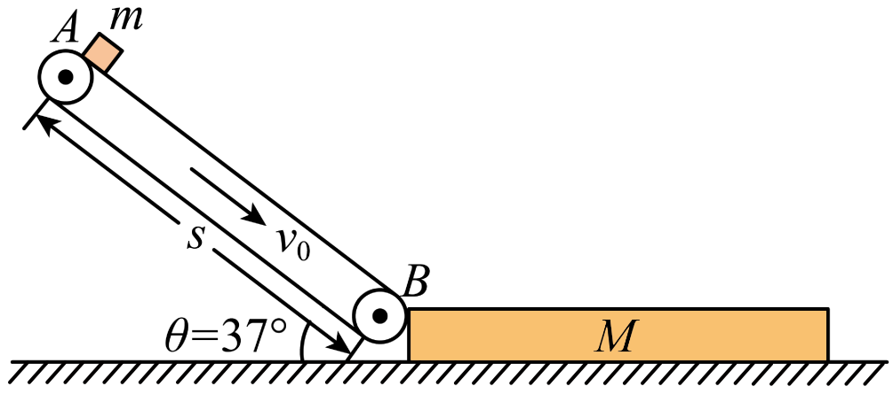

# Physics - 题目 892

**ID**: 92b31271dbda45328f49af9e84a1329a
**年级**: Grade 10
**难度**: Medium-Hard
**题型**: Calculation

## 题目
某物流公司用如图所示的传送带将货物从高处传送到低处。​​​​​​​‌传送带与水平地面夹角 $θ=37{}\degree $ ，顺时针转动的速率为 $v{{}_{0}}=2{\rm{m}}/{\rm{s}}$ 。将质量为 $m=25{\rm{k}}{\rm{g}}$ 的物体无初速地放在传送带的顶端A，物体到达底端 $B$ 后能无碰撞地滑上质量为 $M=50{\rm{k}}{\rm{g}}$ 的木板左端。已知木板与地面之间是光滑的，物体与传送带、木板间的动摩擦因数分别为 $μ{{}_{1}}=0.5$ ， $μ{{}_{2}}=0.25$ ， $AB$ 的距离为 $s=8.20{\rm{m}}$ 。重力加速度 $g=10{\rm{m}}/{\rm{s}}{^{2}}$ （已知 $\sin 37\mathrm{°}=0.6$ ， ${\cos}37\mathrm{°}=0.8$ ）。求：（1）物体刚开始下滑时的加速度大小；（2）物体通过传送带所需要的时间；（3）要使物体恰好不会从木板上掉下，木板长度 $L$ 应是多少？

## 解答

1. （1）物体速度达到传送带速度前，对物体由牛顿第二定律得 $mg\sin 37{}\degree +μ{{}_{1}}mg{\rm{c}}{\rm{o}}{\rm{s}}37{}\degree =ma{{}_{1}}$ ，解得 $a{{}_{1}}=10{\rm{m}}/{\rm{s}}{^{2}}$ 。
2. （2）物体与传送带共速所需时间为 $t{{}_{1}}=\frac {v{{}_{0}}}{a{{}_{1}}}=0.2{\rm{s}}$ ，运动的位移为 $x{{}_{1}}$ ，对物体根据运动学公式可得 $v{{}_{0}^{2}}=2a{{}_{1}}x{{}_{1}}$ ，解得 $x{{}_{1}}=0.2{\rm{m}}$ ，共速后，由于 $μ{{}_{1}}=0.5<{\rm{t}}{\rm{a}}{\rm{n}}37{}\degree =0.75$ ，物体继续在传送带上做匀加速直线运动，设加速度为 $a{{}_{2}}$ ，对物体由牛顿第二定律得 $mg{\rm{s}}{\rm{i}}{\rm{n}}37{}\degree -μ{{}_{1}}mg{\rm{c}}{\rm{o}}{\rm{s}}37{}\degree =ma{{}_{2}}$ ，解得 $a{{}_{2}}=2{\rm{m}}/{\rm{s}}{^{2}}$ ，设物体经 $t{{}_{2}}$ 到达 $B$ 端，则有 $\left ({s-x{{}_{1}}}\right )=v{{}_{0}}t{{}_{2}}+\frac {1}{2}a{{}_{2}}t{{}_{2}^{2}}$ ，解得 $t{{}_{2}}=2{\rm{s}}$ ，物体通过传送带所需要的时间为 $t{{}_{1}}+t{{}_{2}}={{2}}{{.}}{{2}}{\rm{s}}$ 。
3. （3）物体滑上木板左端时的速度大小 $v{{}_{B}}=v{{}_{0}}+a{{}_{2}}t{{}_{2}}$ ，解得 $v{{}_{B}}=6{\rm{m}}/{\rm{s}}$ ，物体滑上木板后向右做匀减速直线运动，加速度大小为 $a{{}_{m}}=μ{{}_{2}}g=2.5{\rm{m}}/{\rm{s}}{^{2}}$ ，木板向右做匀加速直线运动，由 $μ{{}_{2}}mg=Ma{{}_{M}}$ ，解得 $a{{}_{M}}=1.25{\rm{m}}/{\rm{s}}{^{2}}$ ，设再经时间 $t$ 两者速度相等，则有 $v{{}_{B}}-a{{}_{m}}t=a{{}_{M}}t$ ，解得 $t=1.6{\rm{s}}$ ，共同速度为 $v{{}_{共}}=a{{}_{M}}t=2{\rm{m}}/{\rm{s}}$ ，物体的位移大小为 $x{{}_{m}}=\frac {v{{}_{B}}+v{{}_{共}}}{2}t=6.4{\rm{m}}$ ，木板的位移大小为 $x{{}_{M}}=\frac {v{{}_{共}}}{2}t=1.6{\rm{m}}$ ，因恰好不掉下来，所以木板长度为 $L=x{{}_{m}}-x{{}_{M}}=4.8{\rm{m}}$ 。

## 知识点

**中文**:
  - 传送带模型
  - 板块模型

**English**:
  - Conveyor Belt Model
  - Plate Model

---
