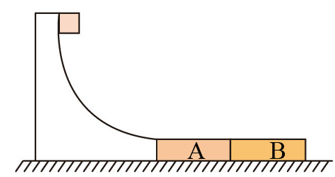

# Physics - 题目 385

**ID**: 92c50afd9b144a95bccf9a1e51b4ea29
**年级**: Grade 10
**难度**: Medium-Hard
**题型**: Calculation

## 题目
如图所示，某货场利用固定于地面的、半径 $R=1.8{\rm{m}}$ 的四分之一圆轨道将质量为 $m{{}_{1}}=10{\rm{k}}{\rm{g}}$ 的货物（可视为质点）从高处运送至地面，已知当货物由轨道顶端无初速度滑下时，到达轨道底端的速度为 $v=5{\rm{m}}{\rm{/}}{\rm{s}}$ 。​​​​​​​‌为避免货物与地面发生撞击，在地面上紧靠轨道依次排放两块完全相同的木板A、B，长度均为 $l=2{\rm{m}}$ ，质量均为 $m{{}_{2}}=20{\rm{k}}{\rm{g}}$ ，木板上表面与轨道末端相切。货物与木板间的动摩擦因数为 $μ{{}_{1}}=0.4$ ，木板与地面间的动摩擦因数为 $μ{{}_{2}}=0.1$ （最大静摩擦力与滑动摩擦力大小相等，取 $g=10{\rm{m}}{\rm{/}}{\rm{s}}{^{2}}$ ）。（1）求货物沿圆轨道下滑过程中克服摩擦力做的功；（2）判断货物滑上A板时A板对地是否滑动，并求出货物刚离开A板时的速度大小；（3）通过计算判断货物是否会从木板B的右端滑落？若能，求货物滑离木板B右端时的速度；若不能，求货物最终停在木板B上的位置。

## 解答

1. （1）货物沿圆轨道下滑过程中，根据动能定理可得 $m{{}_{1}}gR-W{{}_{{\rm{f}}}}=\frac {1}{2}m{{}_{1}}v{^{2}}-0$
2. 解得克服摩擦力做的功为 $W{{}_{{\rm{f}}}}=55{\rm{J}}$
3. （2）当货物滑上木板A时，货物对木板的摩擦力大小为 $f{{}_{1}}=μ{{}_{1}}m{{}_{1}}g{\rm{=}}{{4}}{{0}}{\rm{N}}$
4. 地面对木板A、B的最大静摩擦力为 $f{{}_{2}}=μ{{}_{2}}\left ({2m{{}_{2}}+m{{}_{1}}}\right )g={{5}}{{0}}{\rm{N}}$
5. 由于 $f{{}_{1}}<f{{}_{2}}$ ，此时木板A、B静止不动，设货物滑到木板A右端时速度为 $v{{}_{1}}$ ，由动能定理得 $-μ{{}_{1}}m{{}_{1}}gl=\frac {1}{2}m{{}_{1}}v{{}_{{{1}}}}{^{2}}-\frac {1}{2}m{{}_{1}}v{^{2}}$
6. 解得货物刚离开A板时的速度大小 $v{{}_{1}}=3{\rm{m}}/{\rm{s}}$
7. （3）当货物滑上木板B时，地面对木板B最大静摩擦力为 $f{{}_{3}}=μ{{}_{2}}\left ({m{{}_{2}}+m{{}_{1}}}\right )g={{3}}{{0}}{\rm{N}}$
8. 由于 $f{{}_{1}}>f{{}_{{{3}}}}$ ，此时木板B开始滑动，设货物不会从木板B的右端滑落，二者刚好相对静止时的速度为 $v{{}_{2}}$ ；对货物，由牛顿第二定律可得 $μ{{}_{1}}m{{}_{1}}g=m{{}_{1}}a{{}_{1}}$
9. 解得加速度大小为 $a{{}_{1}}=4{\rm{m}}/{\rm{s}}{^{2}}$
10. 对木板B，由牛顿第二定律可得 $μ{{}_{1}}m{{}_{1}}g-μ{{}_{2}}\left ({m{{}_{2}}+m{{}_{1}}}\right )g=m{{}_{2}}a{{}_{2}}$
11. 解得加速度大小为 $a{{}_{2}}=0.5{\rm{m}}/{\rm{s}}{^{2}}$
12. 根据运动学公式可得 $v{{}_{{{2}}}}=v{{}_{{{1}}}}-a{{}_{1}}t=a{{}_{{{2}}}}t$
13. 解得 $t=\frac {2}{3}{\rm{s}}$ ， $v{{}_{2}}=\frac {1}{3}{\rm{m}}{\rm{/}}{\rm{s}}$
14. 此过程中货物的位移大小为 $x{{}_{1}}=\frac {1}{2}\left ({v{{}_{1}}+v{{}_{2}}}\right )t=\frac {10}{9}{\rm{m}}$
15. 木板B的位移大小为 $x{{}_{{{2}}}}=\frac {1}{2}v{{}_{2}}t=\frac {1}{9}{\rm{m}}$
16. 由于 $x{{}_{1}}-x{{}_{2}}=1{\rm{m}}<l$
17. 则货物与木板共速后，一起做匀减速到停下，所以货物最终未从木板B上滑下，且货物最终停在与木板B右端的距离为 $1{\rm{m}}$ 处。

## 知识点

**中文**:
  - 应用动能定理求解连接体问题

**English**:
  - Solving Connected Body Problems

---
