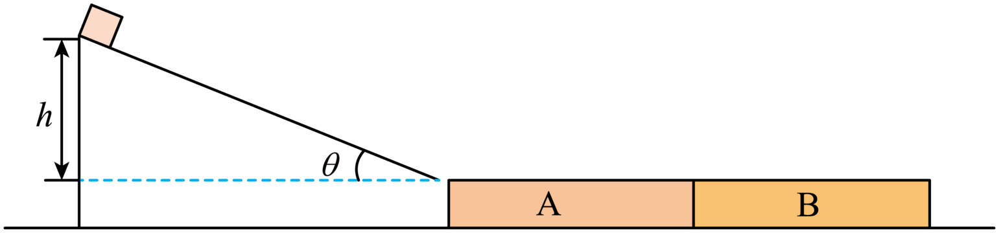

# Physics - 题目 1906

**ID**: 93a3e4b22f7b4519a49fad0e58cc5a7b
**年级**: Grade 10
**难度**: Medium-Hard
**题型**: Calculation

## 题目
如图所示，某货场需将质量为 $m{{}_{1}}=2{\rm{0}}{\rm{k}}{\rm{g}}$ 的货物（可视为质点）从高处运送至地面，为避免货物与地面发生撞击，现利用固定于地面的光滑斜面轨道使货物从轨道顶端无初速度滑下，轨道高 $h=1.{\rm{8}}{\rm{m}}$ ，轨道斜面倾角为 $θ$ 。​​​​​​​‌地面上紧靠轨道依次排放两个完全相同的木板A、B。其长度均为 $l=2{\rm{m}}$ ，质量均为 $m{{}_{2}}=2{\rm{0}}{\rm{k}}{\rm{g}}$ ，轨道末端通过微小圆弧与木板上表面相连，使货物通过轨道末端的速度大小不变，方向变为水平方向，货物与木板间的动摩擦因数为 $μ{{}_{1}}$ ，木板与地面间的动摩擦因数为 $μ{{}_{2}}=0.2$ 。已知最大静摩擦力与滑动摩擦力大小相等，重力加速度g取 ${\rm{1}}{\rm{0}}{\rm{m}}{\rm{/}}{\rm{s}}{{}^{{\rm{2}}}}$ 。（1）求货物到达斜面轨道末端时的速度大小；（2）若货物滑上木板A时，木板不动，而滑上木板B时，木板B开始滑动，求 $μ{{}_{1}}$ 应满足的条件；（3）若 $μ{{}_{1}}=0.5$ ，通过计算判断货物是否会从木板B滑出。

## 解答

1. （1）根据题意，设货物下滑的加速度为 $a{{}_{0}}$ ，滑到轨道末端时的速度为 $v{{}_{0}}$ ，根据牛顿第二定律有
2. $mg{\sin}θ=ma{{}_{0}}$
3. 由运动学公式得
4. $v{{}_{0}^{2}}=2a{{}_{0}}x$
5. 其中
6. $x=\frac {h}{{\sin}θ}$
7. 解得
8. $v{{}_{0}}=6{{\rm{m}}}/{{\rm{s}}}$
9. （2）若货物滑上木板A时，木板不动，由受力分析得
10. $μ{{}_{1}}m{{}_{1}}g\leqslant μ{{}_{2}}\left ({m{{}_{1}}+2m{{}_{2}}}\right )g$
11. 若滑上木板B时，木板B开始滑动，由受力分析得
12. $μ{{}_{1}}m{{}_{1}}g>μ{{}_{2}}\left ({m{{}_{1}}+m{{}_{2}}}\right )g$
13. 联立解得
14. $0.4<μ{{}_{1}}\leqslant 0.6$
15. （3）当 $μ{{}_{1}}=0.5$ 时，由第（2）问可知，货物在木板A上滑动时，木板不动。设货物在木板A上做减速运动时的加速度大小为 $a{{}_{1}}$ ，货物滑到木板A末端时的速度为 $v{{}_{1}}$ ，由牛顿第二定律得
16. $μ{{}_{1}}m{{}_{1}}g=m{{}_{1}}a{{}_{1}}$
17. 由运动学公式得
18. $v{{}_{1}^{2}}-v{{}_{0}^{2}}=-2a{{}_{1}}l$
19. 货物在木板B上滑动时，货物做减速运动，加速度大小也为 $a{{}_{1}}$ ，木板B做加速运动，加速度大小为 $a{{}_{2}}$ ，由牛顿第二定律得
20. $μ{{}_{1}}m{{}_{1}}g-μ{{}_{2}}\left ({m{{}_{1}}+m{{}_{2}}}\right )g=m{{}_{2}}a{{}_{2}}$
21. 设经过 $t{{}_{1}}$ 时间二者共速，则满足
22. $v{{}_{1}}-a{{}_{1}}t{{}_{1}}=a{{}_{2}}t{{}_{1}}$
23. 在此过程中货物和木板B的位移分别为 $x{{}_{1}}$ 和 $x{{}_{2}}$ ，由运动学公式得
24. $x{{}_{1}}=v{{}_{1}}t{{}_{1}}-\frac {1}{2}a{{}_{1}}t{{}_{1}^{2}}$
25. $x{{}_{2}}=\frac {1}{2}a{{}_{2}}t{{}_{1}^{2}}$
26. 解得
27. $x{{}_{1}}=\frac {14}{9}\{\rm{m}}$
28. $x{{}_{2}}=\frac {2}{9}\{\rm{m}}$
29. 则
30. $x{{}_{1}}-x{{}_{2}}<l$
31. 所以共速之后货物与木板B一起做匀减速运动，所以货物不会从木板B滑出。

## 知识点

**中文**:
  - 匀变速直线运动的位移—时间公式及其应用
  - 匀变速直线运动的速度—位移公式及其应用
  - 板块模型

**English**:
  - Displacement-Time Formula and Applications
  - Velocity-Displacement Formula and Applications
  - Plate Model

---
