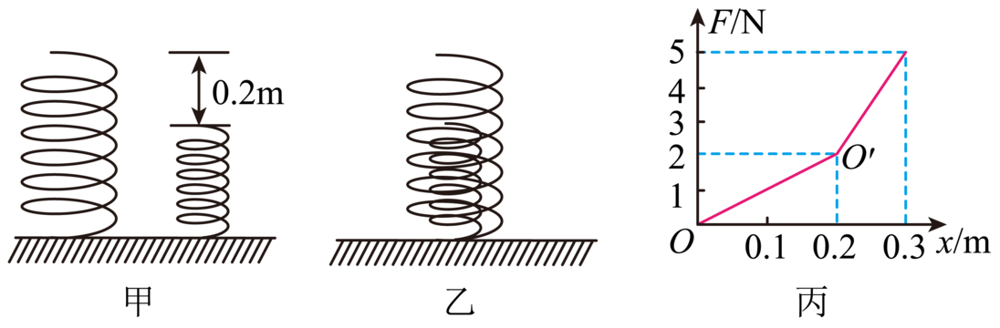

# Physics - 题目 2479

**ID**: 95667318233f47f89557c950dc6b837f
**年级**: Grade 10
**难度**: Medium-Hard
**题型**: Calculation

## 题目
一根大弹簧内套一根小弹簧如图乙所示，大弹簧比小弹簧长0.2 m，如图甲所示，它们的下端平齐并固定，另一端自由，当压缩此组合弹簧时，测得弹力与弹簧压缩量的关系如图丙所示。​​​​​​​‌试求这两根弹簧的劲度系数k_{1}和k_{2}。

## 解答

1. 据题意，当压缩量只有0.2m的过程，只有大弹簧发生形变。从图中读出x=0.2m时，F=2N，根据
2. F=k_{1}x
3. 解得
4. k_{1}=10N/m
5. 其中OO′图线的斜率就是k_{1}，弹簧组合形变量为0.3m时，大弹簧的形变量为x_{1}=0.3m，小弹簧的形变量x_{2}=0.1m，根据
6. F_{1}＋F_{2}=5 N
7. 即有
8. k_{1}x_{1}＋k_{2}x_{2}=5 N
9. 则有
10. k_{2}=20N/m

## 知识点

**中文**:
  - 弹力的大小与胡克定律

**English**:
  - Magnitude of Elastic Force and Hooke's Law

---
