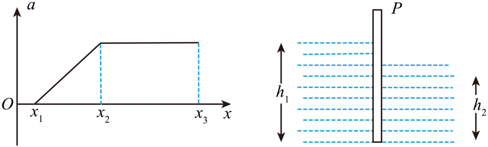

# Physics - 题目 2449

**ID**: 9706c092ab5d4b938c48379057cd67e3
**年级**: Grade 10
**难度**: Medium-Hard
**题型**: Calculation

## 题目
汽车以某一速度在平直公路上匀速行驶，行驶过程中司机忽然发现前方50 m处有一警示牌，立即刹车。​​​​​​​‌刹车过程中，汽车加速度的大小随位移变化的关系如图所示。司机的反应时间t_{1}= 0.3 s，在这段时间内汽车仍保持匀速行驶，x_{1}~x_{2}段为刹车系统的启动阶段，从x_{2}位置开始，汽车的刹车系统稳定工作，直至汽车停止。已知从x_{2}位置开始计时，汽车第1 s内的位移为10 m，第3 s内的位移为6 m。（1）求汽车刹车系统稳定工作后加速度的大小及x_{2}位置汽车的速度大小；（2）若x_{1}~x_{2}段位移大小为11.5 m，求从司机发现警示牌到汽车停止过程汽车位移的大小。（3）在研究物理问题的过程中，我们会用到一些重要的科学思维方法，微元法就是其中之一，教科书中评解了如何由v−t图像来求位移，然而微元法的运用不会局限于运动学，请你借鉴该过程，运用微元法解决如下力学问题：如图，P为一个水闸的剖面图，闸门的质量为m、宽为b，水闸两侧水面的高度分别为h_{1}、h_{2}，水与闸门间、闸门与轨道间的动摩擦因数分别为μ_{1}、μ_{2}。设水的密度为ρ（液体压强公式p=ρgh，g为重力加速度），求拉起闸门至少需要多大的力？

## 解答

1. （1）假设第三秒内未停止，则加速度大小为 $a=\frac {s{{}_{1}}-s{{}_{3}}}{2T{^{2}}}=2{\rm{m}}{\rm{/}}{\rm{s}}{^{2}}$
2. 最后一秒内的位移应为 $x{{}_{0}}=\frac {1}{2}aT{^{2}}=1{\rm{m}}<6{\rm{m}}$
3. 假设成立。
4. 根据匀变速直线运动规律 $v{{}_{{\rm{T}}}}-\frac {1}{2}aT{^{2}}=s{{}_{1}}$
5. 解得 $v=11{\rm{m}}{\rm{/}}{\rm{s}}$
6. （2）从x_{1}~x_{2}，取一小段位移Δx，则有 $v{{}_{0}^{2}}-v{{}_{1}^{2}}=2a{{}_{1}}{\rm{Δ}}x$ ， $v{{}_{1}^{2}}-v{{}_{2}^{2}}=2a{{}_{2}}{\rm{Δ}}x$
7. …… $v{{}_{n-1}^{2}}-v{{}_{n}^{2}}=2a{{}_{n}}{\rm{Δ}}x$ ， $v{{}_{n}}=11{\rm{m}}{\rm{/}}{\rm{s}}$
8. 上式相加有 $v{{}_{0}^{2}}-v{{}_{n}^{2}}=2（a{{}_{1}}{\rm{Δ}}x{{}_{1}}+a{{}_{2}}{\rm{Δ}}x{{}_{2}}+a{{}_{3}}{\rm{Δ}}x{{}_{3}}\ldots +a{{}_{n}}{\rm{Δ}}x{{}_{n}}）$
9. 其中括号内之和表示a−x图像围成面积，可得 $v{{}_{0}^{2}}-v{{}_{n}^{2}}=2\times \frac {x{{}_{2}}-x{{}_{1}}}{2}a$
10. 解得 $v{{}_{0}}=12{\rm{m}}{\rm{/}}{\rm{s}}$
11. 则反应时间内 $x{{}_{1}}=v{{}_{0}}t{{}_{1}}=3.6{\rm{m}}$
12. 在匀减速阶段有 $x{{}_{3}}-x{{}_{2}}=\frac {v{^{2}}}{2a}=30.2{{5}}{\rm{m}}$
13. 汽车行驶总位移 $x=x{{}_{1}}+（x{{}_{2}}-x{{}_{1}}）+（x{{}_{3}}-x{{}_{2}}）=45.35{\rm{m}}$
14. （3）液体压强与h的关系p=ρgh，因为p−h图像是过原点的直线，如图所示
15. 
16. 则水闸两边所受压力分别为 $F{{}_{1}}=\frac {1}{2}ρgbh{{}_{1}^{2}}$ ， $F{{}_{2}}=\frac {1}{2}ρgbh{{}_{2}^{2}}$
17. 故闸门左侧水和右侧水对闸门的摩擦力为 $f{{}_{1}}=μ{{}_{1}}F{{}_{1}}$ ， $f{{}_{2}}=μ{{}_{1}}F{{}_{2}}$
18. 闸门与轨道间的摩擦力为 $f=μ{{}_{2}}（F{{}_{1}}-F{{}_{2}}）$
19. 所求拉力为 $F=f{{}_{1}}+f{{}_{2}}+f+mg$
20. 解得 $F=\frac {μ{{}_{1}}pgb}{2}（h{{}_{1}^{2}}+h{{}_{2}^{2}}）+\frac {μ{{}_{2}}pgb}{2}（h{{}_{1}^{2}}-h{{}_{2}^{2}}）+mg$

## 知识点

**中文**:
  - 刹车问题
  - 非常规图像问题

**English**:
  - Braking Problems
  - Non-standard Graph Problems

---
