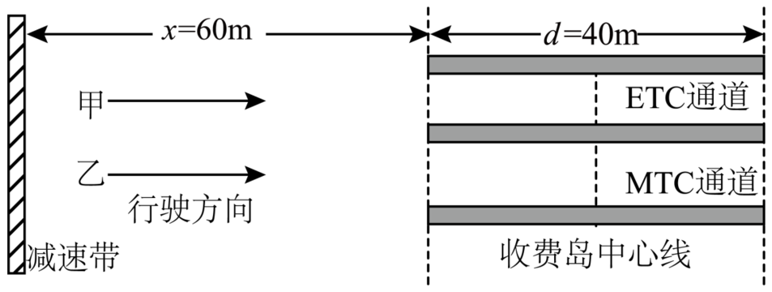

# Physics - 题目 1056

**ID**: 99c30e02354d4658bfeec448e2de006f
**年级**: Grade 10
**难度**: Medium-Hard
**题型**: Calculation

## 题目
高速公路收费站出入口安装电子不停车收费系统 ${\rm{E}}{\rm{T}}{\rm{C}}$ ，大大提升了通行效率。​​​​​​​‌甲、乙两辆汽车分别通过 ${\rm{E}}{\rm{T}}{\rm{C}}$ 通道和人工收费通道（ ${\rm{M}}{\rm{T}}{\rm{C}}$ ）驶离高速公路，流程如图。假设减速带离收费岛口 $x=60{\rm{m}}$ ，收费岛总长度为 $d=40{\rm{m}}$ ，两辆汽车同时以相同的速度 $v{{}_{1}}=20{\rm{m}}{\rm{/}}{\rm{s}}$ 经过减速带后，一起以相同的加速度做匀减速运动。甲车减速至 $v{{}_{0}}=5{\rm{m}}{\rm{/}}{\rm{s}}$ 后，匀速行驶到中心线即可完成缴费，自动栏杆立即打开；乙车刚好到收费岛中心线收费窗门停下，经过 $t{{}_{0}}=20{\rm{s}}$ 的时间缴费成功，人工栏杆立即打开。两辆汽车均在栏杆打开的同时立即开始做匀加速直线运动，达到速度 $v{{}_{1}}$ 后沿直线匀速行驶到达相同的目的地，设加速和减速过程中的加速度大小相等。求：（1）甲车在通过中心线之前匀速的时间；（2）此次人工收费通道和 ${\rm{E}}{\rm{T}}{\rm{C}}$ 通道打开栏杆放行的时间差 $Δt$ ；（3）甲车和乙车在通过中心线后两车间最大车距。

## 解答

1. （1）乙车刚好到收费岛中心线收费窗门停下，则根据 $v{{}_{1}^{2}}=2a\left ({x+\frac {d}{2}}\right )$
2. 可得两车减速运动的加速度大小为 $a=\frac {v{{}_{1}^{2}}}{2\left ({x+\frac {d}{2}}\right )}=\frac {20{^{2}}}{2\times \left ({60+\frac {40}{2}}\right )}{\rm{m}}{\rm{/}}{\rm{s}}{^{2}}=2.5{\rm{m}}{\rm{/}}{\rm{s}}{^{2}}$
3. 甲车过 $ETC$ 通道时，匀减速运动 $v{{}_{1}^{2}}-v{{}_{0}^{2}}=2ax{{}_{1}}$
4. 位移为 $x{{}_{1}}=\frac {v{{}_{1}^{2}}-v{{}_{0}^{2}}}{2a}=\frac {20{^{2}}-5{^{2}}}{2\times 2.5}{\rm{m}}=75{\rm{m}}$
5. 到中心线的距离还剩下 $d^{′}=x+\frac {d}{2}-x{{}_{1}}=60{\rm{m}}+\frac {40}{2}{\rm{m}}-75{\rm{m}}=5{\rm{m}}$
6. 甲车匀速的时间为 $t{{}_{匀}}=\frac {d^{′}}{v{{}_{0}}}=\frac {5}{5}{\rm{s}}=1{\rm{s}}$
7. （2）甲车减速到 $v{{}_{0}}$ 所用时间为 $t{{}_{1}}=\frac {v{{}_{1}}-v{{}_{0}}}{a}=\frac {20-5}{2.5}{\rm{s}}=6{\rm{s}}$
8. 甲车从减速到栏杆打开的总时间为 $t{{}_{甲}}=t{{}_{1}}+t{{}_{匀}}=6{\rm{s}}+1{\rm{s}}=7{\rm{s}}$
9. 乙车减速行驶到收费岛中心线的时间为 $t{{}_{3}}=\frac {v{{}_{1}}}{a}=\frac {20}{2.5}{\rm{s}}=8{\rm{s}}$
10. 从减速到打开栏杆的总时间为 $t{{}_{乙}}=t{{}_{0}}+t{{}_{3}}=20{\rm{s}}+8{\rm{s}}=28{\rm{s}}$
11. 打开栏杆放行的时间差为 $Δt=t{{}_{乙}}-t{{}_{甲}}=28{\rm{s}}-7{\rm{s}}=21{\rm{s}}$
12. （3）甲车和乙车再次加速到 $v{{}_{1}}$ 时车距最大，此时 $t=2t{{}_{3}}+t{{}_{0}}=2\times 8{\rm{s}}+20{\rm{s}}=36{\rm{s}}$
13. 乙车的位移 $s{{}_{乙}}=2\times \left ({x+\frac {d}{2}}\right )=160{\rm{m}}$
14. 甲车的位移 $s{{}_{甲}}=2x{{}_{1}}+5+v{{}_{1}}\left ({t-2\times t{{}_{1}}-t{{}_{匀}}}\right )=615{\rm{m}}$
15. 因此两车最远距离 $L=s{{}_{甲}}-s{{}_{乙}}=615{\rm{m}}-160{\rm{m}}=455{\rm{m}}$

## 知识点

**中文**:
  - 匀变速直线运动的位移—时间公式及其应用
  - 匀变速直线运动的速度—位移公式及其应用
  - 匀变速直线运动的速度—时间公式及其应用

**English**:
  - Displacement-Time Formula and Applications
  - Velocity-Displacement Formula and Applications
  - Velocity-Time Formula and Applications

---
