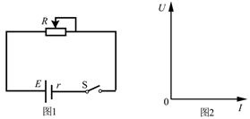

# Physics - 题目 1002

**ID**: 9bf570f794214242947aead8ce668e48
**年级**: Grade 10
**难度**: Medium-Hard
**题型**: Calculation

## 题目
如图1所示，用电动势为E、内阻为r的电源，向滑动变阻器R供电．改变变阻器R的阻值，路端电压U与电流I均随之变化．（1）以U为纵坐标，I为横坐标，在图2中画出变阻器阻值R变化过程中U-I图像的示意图，并说明U-I图像与两坐标轴交点的物理意义．（2）a．请在图2画好的U-I关系图线上任取一点，画出带网格的图形，以其面积表示此时电源的输出功率；​​​​​​​‌b．请推导该电源对外电路能够输出的最大电功率及条件．（3）请写出电源电动势定义式，并结合能量守恒定律证明：电源电动势在数值上等于内、外电路电势降落之和．

## 解答

1. （1）U–I图像如图所示，
2. 
3. 其中图像与纵轴交点的坐标值为电源电动势，与横轴交点的坐标值为短路电流
4. （2）a．如图所示
5. 
6. b．电源输出的电功率： $P=I{^{2}}R=(\frac {E}{R+r}){^{2}}R=\frac {E{^{2}}}{R+2r+\frac {r{^{2}}}{R}}$
7. 当外电路电阻R=r时，电源输出的电功率最大，为 $P{{}_{{\rm \max }}}{\rm{=}}\frac {E{^{2}}}{4r}$
8. （3）电动势定义式： $E=\frac {W{{}_{非静电力}}}{q}$
9. 根据能量守恒定律，在图1所示电路中，非静电力做功W产生的电能等于在外电路和内电路产生的电热，即
10. $W=I{^{2}}rt+I{^{2}}Rt=Irq+IRq$
11. $E=Ir+IR=U{{}_{内}}+U{{}_{外}}$
12. 本题答案是：（1）U–I图像如图所示，
13. 
14. 其中图像与纵轴交点的坐标值为电源电动势，与横轴交点的坐标值为短路电流
15. （2）a．如图所示
16. 
17. 当外电路电阻R=r时，电源输出的电功率最大，为 $P{{}_{{\rm \max }}}{\rm{=}}\frac {E{^{2}}}{4r}$
18. （3） $E=U{{}_{内}}+U{{}_{外}}$
19. 点睛：运用数学知识结合电路求出回路中最大输出功率的表达式，并求出当R=r时，输出功率最大．

## 知识点

**中文**:
  - 闭合电路输出功率与效率

**English**:
  - Output Power and Efficiency of Closed Circuits

---
