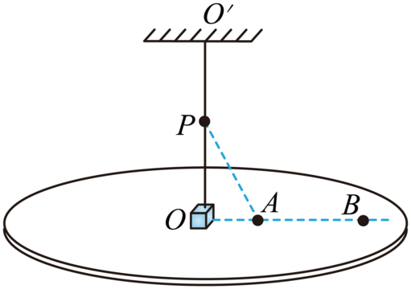

# Physics - 题目 1727

**ID**: 9ef7e511f2ae44efaf4ba158697d9e7c
**年级**: Grade 10
**难度**: Medium-Hard
**题型**: Calculation

## 题目
如图所示，在水平圆盘上有一条标记线 ${\rm \mathit{OAB}，}L{{}_{OA}}=\frac {\sqrt {3}}{3}L$ 。​​​​​​​‌圆心O点放置一个质量为m可视为质点的小物块，小物块与一根轻质弹性绳连接，绳另一端固定在O点正上方的 $O^{′}$ 点，圆盘与小物块间的动摩擦因数 $μ=\frac {\sqrt {3}}{2}$ ，最大静摩擦力等于滑动摩擦力。轻质弹性绳原长为L，其弹力F随伸长量x变化满足胡克定律。图中 $OO^{′}$ 长度为2L，P为 $O^{′}$ 点正下方一固定的光滑小圆环，轻质弹性绳穿过圆环，且 $OP=L$ 。开始时圆盘及小物块都静止，此时测得圆盘对小物块的支持力大小为 $\frac {mg}{2}{\rm ，\mathit{g}}$ 为重力加速度。（1）保持圆盘静止，将小物块放置在圆盘上A点，试判断小物块是否能够静止并求出此时小物块受到的摩擦力大小；（2）使圆盘以某一角速度 $ω$ 绕 $OO^{′}$ 匀速转动，要使小物块在A点与圆盘保持相对静止，求角速度 $ω$ 的取值范围。

## 解答

1. （1）小物块在O点时 $N+kL=mg$ ，
2. 而 $N=\frac {mg}{2}$ ，
3. 则 $k=\frac {mg}{2L}$ ，
4. 小物块在A点时 $F{{}_{k}}=k\cdot \frac {2\sqrt {3}}{3}L$ ，
5. $F{{}_{k}}$ 在竖直方向上的分力 $F{{}_{k1}}=F{{}_{k}}\sin 60{}\degree =\frac {mg}{2}$ ，
6. $F{{}_{k}}$ 在水平方向上分力 $F{{}_{k2}}=F{{}_{k}}{\cos}60{}\degree =\frac {\sqrt {3}}{6}mg$ ，
7. 最大静摩擦力 $F{{}_{{\rm{f}}}}=μN=μ(mg-F{{}_{k1}})=\frac {\sqrt {3}}{4}mg$ ，
8. $F{{}_{{\rm{f}}}}>F{{}_{k2}}$ ，小物块相对圆盘静止，小物块所受静摩擦力大小为 $f=\frac {\sqrt {3}}{6}mg$ 。
9. （2）小物块要相对圆盘静止圆盘角速度最小时，因 $F{{}_{{\rm{f}}}}>F{{}_{k2}}$ ， $ω{{}_{1}}=0$ ，
10. 圆盘角速度最大时 $F{{}_{{\rm{f}}}}+F{{}_{k2}}=mω{{}_{2}^{2}}L{{}_{OA}}$ ，
11. 解得 $ω{{}_{2}}=\sqrt {\frac {5g}{4L}}$ ，
12. 则 $0⩽ω⩽\sqrt {\frac {5g}{4L}}$ 。

## 知识点

**中文**:
  - 水平面内匀速圆周问题

**English**:
  - Uniform Circular Motion in Horizontal Plane

---
