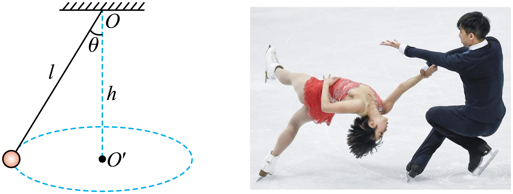

# Physics - 题目 2824

**ID**: a488c188f107433692fa4b065f46e949
**年级**: Grade 10
**难度**: Medium-Hard
**题型**: Calculation

## 题目
如左图，质量为m的小球用细线悬于O点，使小球在水平面内以O'为圆心做匀速圆周运动时，忽略空气阻力，重力加速度为g。​​​​​​​‌悬挂小球的绳长为l，悬点O到圆心O'的距离为h，细线与OO'的夹角为θ，小球做匀速圆周运动的角速度为ω。（1）画出小球做匀速圆周运动时受力分析图，并求出小球受到拉力F的大小；（2）若保持轨迹圆的圆心O'到悬点O的距离h不变，改变绳长l，请通过分析说明小球做匀速圆周运动角速度ω是否会发生改变；（3）右图为北京冬奥会花样滑冰双人自由滑比赛时，中国男运动员拉着女运动员的手，以过自己右肩的竖直线为轴，让女运动员旋转到几乎飞起来时的精彩画面。请结合（2）的结论分析说明：在不考虑阻力、忽略冰面对女运动员的支持力的情况下，影响女运动员旋转快慢的因素是什么？

## 解答

1. （1）小球受力如图所示
2. 
3. 根据平衡条件得 $F{\cos}θ=mg$  ，解得 $F=\frac {mg}{{\cos}θ}$
4. （2）根据牛顿第二定律得 $mg{\tan}θ=mω{^{2}}h{\tan}θ$  ，解得 $ω=\sqrt {\frac {g}{h}}$
5. 若保持轨迹圆的圆心O'到悬点O的距离h不变，改变绳长l，小球做匀速圆周运动角速度ω不会发生改变；
6. （3）根据 $ω=\sqrt {\frac {g}{h}}$ ，男运动员的右肩越低，h越小，ω越大，女运动员转动越快。

## 知识点

**中文**:
  - 水平面内匀速圆周问题

**English**:
  - Uniform Circular Motion in Horizontal Plane

---
