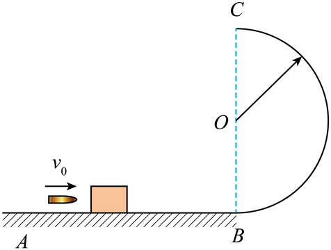

# Physics - 题目 1200

**ID**: a6d75d6f3d644af3a15161755232ba4c
**年级**: Grade 10
**难度**: Medium-Hard
**题型**: Calculation

## 题目
如图所示，光滑水平轨道AB与竖直面内的粗糙半圆轨道BC在B点相切，半圆轨道BC的半径r=0.9m，质量M=0.39kg的木块静置于水平轨道AB上，一颗质量m=0.01kg的子弹以 $v{{}_{0}}=400{\rm{m}}/{\rm{s}}$ 的速度沿水平方向射入木块且并未穿出，之后子弹和木块（下称结合体）经B点进入半圆轨道，并恰好能通过最高点C。​​​​​​​‌取重力加速度大小 $g=10{\rm{m}}/{\rm{s}}{^{2}}$ ，子弹射入木块的时间极短，结合体可视为质点，不计空气阻力。求：（1）结合体到达B点时的速度大小 $v{{}_{B}}$ ；（2）结合体在AB上的落点与B点间的距离x；（3）结合体沿BC运动的过程中克服摩擦力做的功 $W{{}_{f}}$ 。

## 解答

1. （1）设子弹与木块的共同速度为 $v{{}_{1}}$ ，由动量守恒定律则有 $mv{{}_{0}}=\left ({M+m}\right )v{{}_{1}}$
2. $v{{}_{1}}=10{\rm{m}}/{\rm{s}}$
3. （2）结合体恰好能通过最高点C，此时重力提供向心力得 $\left ({M+m}\right )g=\left ({M+m}\right )\frac {v{{}_{c}^{2}}}{r}$
4. 解得 $v{{}_{C}}=3{\rm{m}}/{\rm{s}}$
5. 结合体从C点做平抛运动，竖直方向上做自由落体运动有 $h=2r=\frac {1}{2}gt{^{2}}$
6. 水平方向上做匀速直线运动有 $x=v{{}_{C}}t$
7. 联立可得 $x=1.8{\rm{m}}$
8. （3）结合体由B运动到C点的过程中由动能定理 $-\left ({M+m}\right )g\cdot 2r-W{{}_{f}}=\frac {1}{2}\left ({M+m}\right )v{{}_{C}^{2}}-\frac {1}{2}\left ({M+m}\right )v{{}_{1}^{2}}$
9. 联立可得 $W{{}_{f}}=11{\rm{J}}$

## 知识点

**中文**:
  - 子弹-木块模型
  - 应用动能定理求解多阶段、多过程问题

**English**:
  - Bullet-Block Model
  - Multi-stage/Multi-process Problems

---
