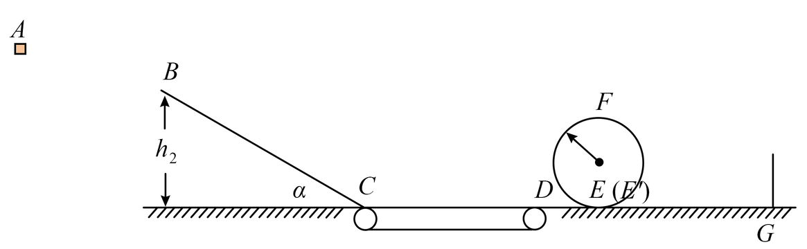

# Physics - 题目 2022

**ID**: a9e53928cecf4638b7817b2cfcd0a85d
**年级**: Grade 10
**难度**: Medium-Hard
**题型**: Calculation

## 题目
如图所示，一游戏装置由固定在竖直平面内的倾斜直轨道BC、传送带CD、竖直圆轨道EFE´和几段水平轨道组成，竖直圆轨在最低点略微错开且分别与水平轨道DE和E´G相连。​​​​​​​‌游戏时滑块从A点以4m/s的速度水平抛出，恰好在B点沿轨道BC进入轨道。已知直轨道BC倾角 ${\rm \mathit{α}=37°，}h{{}_{2}}=0.55{\rm{m}}$ ，传送带长L_{CD}=3.2m，圆轨道半径 $r=0.4{\rm{m}}$ ，E´G长L_{E´G}=2.0m，各轨道间均平滑连接，除传送带及直轨道E´G外，其它轨道匀光滑，物块与传送带及直轨道E´G的动摩擦因数μ=0.5，滑块质量m_{A}=0.05kg，可视为质点，C、D、E（E´）、G在同一水平面内。（1）求A、B两点的高度差h_{1}；（2）传送带静止时，求滑块经过轨道最低点E时受到轨道支持力的大小；（3）传送带以v=4m/s的速度顺时针转动时，滑块能否到达F点？（4）传送带顺时针转动，滑块与处在G处的挡板碰撞后速度大小不变，若要求滑块始终不脱离轨道，求传送带速度取值范围。

## 解答

1. （1）从A到B做平抛运动，则 $v{{}_{By}}=v{{}_{A}}{\rm{t}}{\rm{a}}{\rm{n}}θ$ ，解得 $v{{}_{By}}=3{\rm{m}}{\rm{/}}{\rm{s}}$ ， $v{{}_{By}}{^{2}}=2gh{{}_{1}}$ ，解得 $h{{}_{1}}=0.45{\rm{m}}$
2. （2）由动能定理，得 $mg（h{{}_{1}}+h{{}_{2}}）-{\rm μm}gL{{}_{CD}}=\frac {1}{2}mv{{}_{E}^{2}}-\frac {1}{2}mv{{}_{A}^{2}}$ ，解得 $v{{}_{E}}=2{\rm{m}}{\rm{/}}{\rm{s}}$ ，由牛顿第二定律 $F{{}_{{\rm{N}}}}-mg=\frac {mv{{}_{E}^{2}}}{r}$ ，得 $F{{}_{{\rm{N}}}}=1{\rm{N}}$
3. （3）由动能定理 $\frac {1}{2}mv{{}_{C}^{2}}\pm {\rm μm}gL{{}_{CD}}=\frac {1}{2}mv{{}_{Em}^{2}}$ ，解得 $v{{}_{E{\rm \max }0}}=2\sqrt {17}{\rm{m}}{\rm{/}}{\rm{s}}$ ， $v{{}_{E{\rm \min }0}}=2{\rm{m}}{\rm{/}}{\rm{s}}$ ，当传送带速度处于 $2{\rm{m}}{\rm{/}}{\rm{s}}\sim 2\sqrt {17}{\rm{m}}{\rm{/}}{\rm{s}}$ 时物块均可共速离开，所以 $v{{}_{E1}}=4{\rm{m}}{\rm{/}}{\rm{s}}$ ，从E到 ${\rm \mathit{F}\mathit{，}}\frac {1}{2}mv{{}_{E1}^{2}}-2mgr=\frac {1}{2}mv{{}_{F1}^{2}}$  ，解得 $v{{}_{F1}}=0{\rm{m}}{\rm{/}}{\rm{s}}$ ， $\frac {mv{{}_{F1}^{2}}}{r}<mg$  ，不能过F点。
4. （4）1、物块第一次无法过圆心等高处 $\frac {1}{2}mv{{}_{E}^{2}}-mgr\leqslant 0$ ， $0{\rm{m}}{\rm{/}}{\rm{s}}<v{{}_{传}}<2\sqrt {2}{\rm{m}}{\rm{/}}{\rm{s}}$
5. 2、物块能从右侧返回时，但无法回到圆心等高处 $\frac {1}{2}mv{{}_{E}^{2}}-2{\rm μm}gL{{}_{EG}}<mgR$ ，解得 $v{{}_{E}}<4\sqrt {3}{\rm{m}}{\rm{/}}{\rm{s}}$ ， $\frac {1}{2}mv{{}_{E}^{2}}-2mgr=\frac {1}{2}mv{{}_{F}^{2}}$ ，在F点时 $\frac {mv{{}_{F}^{2}}}{r}\leqslant mg$ ， $v{{}_{E}}\geqslant 2\sqrt {5}{\rm{m}}{\rm{/}}{\rm{s}}$ ，可得 $2\sqrt {5}{\rm{m}}{\rm{/}}{\rm{s}}<v{{}_{E}}<4\sqrt {3}{\rm{m}}{\rm{/}}{\rm{s}}$
6. 3、物块能第二次到达最高点 $\frac {1}{2}mv{{}_{E}^{2}}-2{\rm μm}gL{{}_{EG}}>\frac {1}{2}mv{{}_{E\min 1}^{2}}$ ， $v{{}_{E}}>2\sqrt {15}{\rm{m}}{\rm{/}}{\rm{s}}$ ， $\frac {1}{2}mv{{}_{E{\rm \max }}^{2}}-2{\rm μm}gL{{}_{EG}}=0.7{\rm{J}}<{\rm μm}gL{{}_{CD}}$ ，物块无法完成 $D\to C$ 的过程，重新回到传送带后会原速从 $D$ 点离开。当 $2\sqrt {15}{\rm{m}}{\rm{/}}{\rm{s}}<v{{}_{E}}<2\sqrt {17}{\rm{m}}{\rm{/}}{\rm{s}}$ ，不会脱离轨道，综合上述情况： $0{\rm{m}}{\rm{/}}{\rm{s}}<v{{}_{传}}<2\sqrt {2}{\rm{m}}{\rm{/}}{\rm{s}}$  ； $2\sqrt {5}{\rm{m}}{\rm{/}}{\rm{s}}<v{{}_{传}}<4\sqrt {3}{\rm{m}}{\rm{/}}{\rm{s}}$ ；  $v{{}_{传}}>2\sqrt {15}{\rm{m}}{\rm{/}}{\rm{s}}$  ，三种情况。

## 知识点

**中文**:
  - 应用动能定理求解多阶段、多过程问题
  - 竖直面内圆周运动问题

**English**:
  - Multi-stage/Multi-process Problems
  - Circular Motion in Vertical Plane

---
