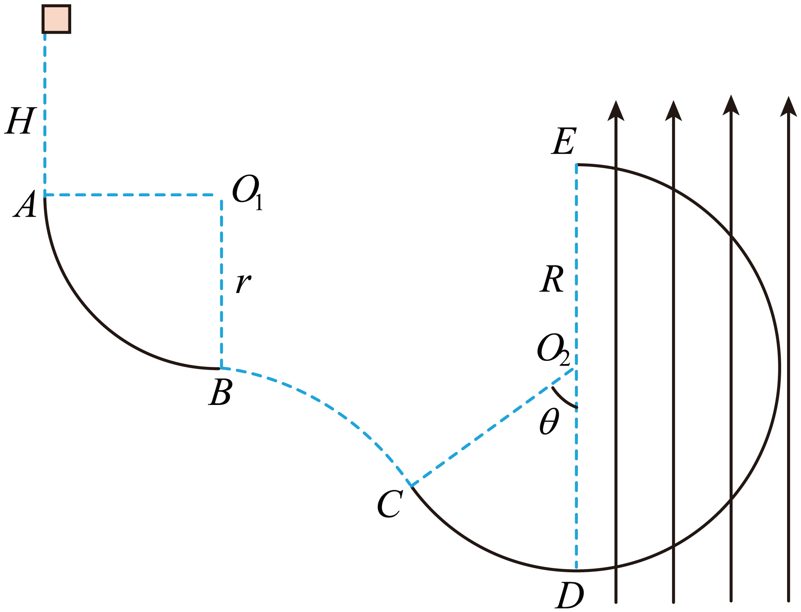

# Physics - 题目 2960

**ID**: ae3dbbc31a8c4c708f6628888041cdec
**年级**: Grade 10
**难度**: Medium-Hard
**题型**: Calculation

## 题目
如图所示，AB为半径 $r=0.9{\rm{m}}$ 的四分之一光滑绝缘竖直圆弧轨道，半径 $O{{}_{1}}A$ 水平， $B$ 点右侧有一竖直放置的光滑绝缘圆弧轨道 ${\rm \mathit{CDE}，}D$ 点是轨道最低点， $E$ 点是轨道最高点，圆弧CD对应的圆心角 $θ=53{}\degree $ ，竖直直径 $DE$ 右侧空间存在竖直向上的匀强电场，电场强度 $E=5\times 10{^{2}}{\rm{N}}{\rm{/}}{\rm{C}}$ ，一质量为 $m=1{\rm{k}}{\rm{g}}$ 、电荷量为 $q=+4\times 10{^{-3}}{\rm{C}}$ 的物体（可视为质点），从A点的正上方距离A点 $H=0.9{\rm{m}}$ 处由静止开始自由下落，经圆弧轨道AB从 $B$ 点水平抛出，恰好从 $C$ 点沿切线方向进入圆弧轨道CDE且恰能通过 $E$ 点。​​​​​​​‌已知 $\sin 53{}\degree =0.8$ ， ${\cos}53{}\degree =0.6$ ，不计空气阻力， $g$ 取 $10{\rm{m}}{\rm{/}}{\rm{s}}{^{2}}$ ，求：（1）物体运动至圆弧轨道 $B$ 点时所受支持力 $F{{}_{{\rm{N}}}}$ 的大小；（2） $B$ 、 $C$ 两点的高度差 $h$ ；（3）圆弧CDE的半径 $R$ 。

## 解答

1. （1）物体运动到B点过程，根据动能定理有 $mg\left ({H+r}\right )=\frac {1}{2}mv{{}_{B}^{2}}$ ，
2. 物体在B点，根据牛顿第二定律有 $F{{}_{{\rm{N}}}}-mg=\frac {mv{{}_{B}^{2}}}{r}$ ，
3. 解得 $v{{}_{B}}=6{\rm{m}}{\rm{/}}{\rm{s}}$ ， $F{{}_{{\rm{N}}}}=50{\rm{N}}$ 。
4. （2）物体恰好从 $C$ 点沿切线方向进入圆弧轨道，根据速度分解有 $v{{}_{B}}{\tan}θ=gt$ ，
5. 物体做平抛运动，则有 $h=\frac {1}{2}gt{^{2}}$ ，
6. 解得h=3.2m。
7. （3）结合上述，物体在C点速度 $v{{}_{C}}=\frac {v{{}_{B}}}{{\cos}θ}=10{\rm{m}}{\rm{/}}{\rm{s}}$ ，
8. 物体进入圆弧轨道CDE且后恰能通过 $E$ 点，根据牛顿第二定律有 $mg-qE=\frac {mv{{}_{E}^{2}}}{R}$ ，
9. 物体从C点运动到E点过程，根据动能定理有 $-mg\left ({R+R{\cos}θ}\right )+qE\cdot 2R=\frac {1}{2}mv{{}_{E}^{2}}-\frac {1}{2}mv{{}_{C}^{2}}$ ，
10. 解得 $R=3.125{\rm{m}}$ 。

## 知识点

**中文**:
  - 匀强电场
  - 应用动能定理求解多阶段、多过程问题

**English**:
  - Uniform Electric Field
  - Multi-stage/Multi-process Problems

---
