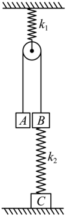

# Physics - 题目 2687

**ID**: af63fa8507a34484bb7432c946ac1d3a
**年级**: Grade 10
**难度**: Medium-Hard
**题型**: Calculation

## 题目
如图所示，A、B、C三个物体的质量是m_{A}=m，m_{B}=m_{C}=2m，A、B两物体通过绳子绕过定滑轮相连，B、C用劲度系数k_{2}的轻弹簧相连，劲度系数为k_{1}的轻弹簧一端固定在天花板上，另一端与滑轮相连。​​​​​​​‌开始时，A、B两物体在同一水平面上，不计滑轮、绳子、弹簧的重力和一切摩擦。现用竖直向下的力缓慢拉动A物体，在拉动过程中，弹簧、与A、B相连的绳子始终竖直，到C物体刚要离开地面（A尚未落地，B没有与滑轮相碰），则：（1）求未拉动A物体前两弹簧的形变量；（2）求C刚要离地时滑轮下降的距离；（3）求C刚要离地时A、B两物体的高度差。

## 解答

1. （1）开始时，由于B的质量大于A的质量，所以，弹簧k_{2}处于压缩状态，设BC间弹簧的压缩量为 $x{{}_{1}}$ ，上面的弹簧伸长量为 $x{{}_{1}^{^{′}}}$ ，绳子的拉力为 $T$ ；
2. 对物体A根据平衡条件可得 $T=mg$
3. 对物体B根据平衡条件可得 $2mg=k{{}_{2}}x{{}_{1}}{{+}}T$
4. 解得  $x{{}_{1}}=\frac {mg}{k{{}_{2}}}$
5. 对滑轮根据平衡条件可得 $2T=k{{}_{1}}x{{}_{1}^{^{′}}}$
6. 解得 $\frac {2mg}{k{{}_{1}}}$
7. （2）设C物体刚要离开地面时，BC间弹簧的伸长量为 $x{{}_{2}}$ ，上面的弹簧伸长量为 $x{{}_{2}^{^{′}}}$ ，绳子的拉力为 $T{^{^{′}}}$ ；
8. 对物体C根据平衡条件可得 $2mg=k{{}_{2}}x{{}_{2}}$
9. 解得 $x{{}_{2}}=\frac {2mg}{k{{}_{2}}}$
10. C物体刚要离地时，绳子拉力为 $T{^{^{′}}}{\rm{=}}8mg$
11. 对滑轮根根平衡条件可得 $8mg=k{{}_{1}}x{{}_{2}^{^{′}}}$
12. 解得 $x{{}_{2}^{^{′}}}=\frac {8mg}{k{{}_{1}}}$
13. C刚要离地时滑轮下降的距离为 $Δx$  $\Delta x=x{{}_{2}^{^{′}}}-x{{}_{2}}=\frac {6mg}{k{{}_{1}}}$
14. （3）A下降的距离： $\Delta h{{}_{{\rm{A}}}}=(\frac {mg}{k{{}_{2}}}+\frac {2mg}{k{{}_{2}}})+2\times (\frac {8mg}{k{{}_{1}}}-\frac {2mg}{k{{}_{1}}})=\frac {3mg}{k{{}_{2}}}+\frac {12mg}{k{{}_{1}}}$
15. B上升的高度 $\Delta h{{}_{{\rm{B}}}}=(\frac {mg}{k{{}_{2}}}+\frac {2mg}{k{{}_{2}}}){\rm{=}}\frac {3mg}{k{{}_{2}}}$
16. 则AB的高度差 $\Delta h{{}_{{\rm{A}}}}+\Delta h{{}_{{\rm{B}}}}=\frac {6mg}{k{{}_{2}}}+\frac {12mg}{k{{}_{1}}}$

## 知识点

**中文**:
  - 弹力的大小与胡克定律

**English**:
  - Magnitude of Elastic Force and Hooke's Law

---
