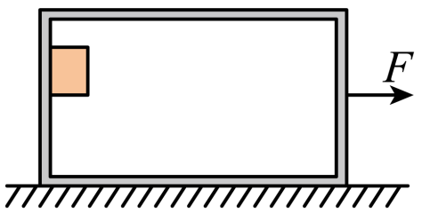

# Physics - 题目 526

**ID**: b4b36a4072474ba9afadc428c3133ab1
**年级**: Grade 10
**难度**: Medium-Hard
**题型**: Calculation

## 题目
质量为M=2.​​​​​​​‌5kg的一只长方体形状的铁箱在水平拉力F作用下沿水平面向右匀加速运动，铁箱与水平面间的动摩擦因数为μ_{1}=0.50．这时铁箱内一个质量为m=0.5kg的木块恰好能静止在后壁上(如图所示)，木块与铁箱内壁间的动摩擦因数为μ_{2}=0.25．设最大静摩擦力等于滑动摩擦力，g取10m/s^{2}．求：(1)木块对铁箱的压力；(2)水平拉力F的大小；(3)使拉力F减小到120N，经过一段时间，木块落至箱底后且不反弹，某时刻当箱的速度为v=6m/s时撤去拉力，经1s时间木块从左侧到达右侧，则铁箱长度是多少？

## 解答

1. （1）木块在竖直方向,由相对静止得mg=F_{f}=μ_{2}F_{N }
2. F_{N}=mg/μ_{2}=5/0.25=20N
3. 由牛顿第三定律得：木块对铁箱的压力
4. F_{N}^{/}=－F_{N}=－20N,方向水平向左
5. 
6. （2）对木块：在水平方向
7. F_{N}=ma∴a=20/0.5=40m/s^{2}
8. 对铁箱和木块整体
9. F－μ_{1}(M+m)g=(M+m)a
10. 故水平拉力
11. F=(M+m)(a+μ_{1}g)=135N
12. （3）当F=120N时，铁箱与木块水平方向仍然一起加速，所以撤去拉力F时，箱和木块的速度均为v=6m/s
13. 因μ_{1}>μ_{2}, 以后木块相对箱滑动，木块加速度
14. a_{2}=μ_{2}g=2.5m/s^{2}
15. 又铁箱加速度
16. $a{{}_{1}}=\frac {μ{{}_{1}}(m+M)g-μ{{}_{2}}mg}{M}=5.5{\rm{m}}/{\rm{s}}{^{2}}$
17. 铁箱减速时间为t_{0}=v/a_{1}=1.1s>1s,故木块到达箱右端时，箱未能停止。
18. 则经t=1s木块比铁箱向右多移动距离L即铁箱长．
19. 即有
20. L=(vt－a_{2}t^{2}/2)－(vt－a_{1}t^{2}/2) =(a_{1}－a-_{2})t^{2}/2 ⑦
21. 解得：L=1.5m

## 知识点

**中文**:
  - 牛顿第二定律的简单计算
  - 连接体问题（整体和隔离法）、临界问题

**English**:
  - Simple Calculations of Newton's 2nd Law
  - Connected Bodies Problems (Whole/Isolation Method), Critical Problems

---
