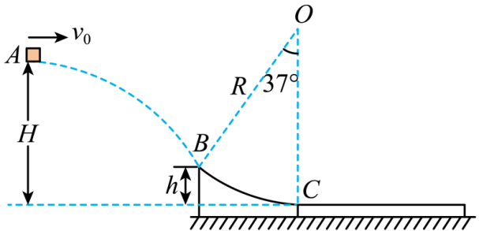

# Physics - 题目 2623

**ID**: b59cfb07d1ed4707ab8a397bce3f41b5
**年级**: Grade 10
**难度**: Medium-Hard
**题型**: Calculation

## 题目
如图所示，从A点以某一水平速度v_{0}抛出一质量m=1 kg的小物块（可视为质点），当物块运动至B点时，恰好沿切线方向进入∠BOC=37°的固定光滑圆弧轨道BC，经圆弧轨道后滑上与C点等高、静止在粗糙水平面上的长木板上，圆弧轨道C端的切线水平。​​​​​​​‌已知长木板的质量M=4 kg，A、B两点距C点的高度分别为H=0.6 m、h=0.15 m，R=0.75 m，物块与长木板之间的动摩擦因数μ_{1}=0.7，长木板与地面间的动摩擦因数μ_{2}=0.2，g=10 m/s^{2}求：（sin 37°=0.6，cos 37°=0.8）（1）小物块的初速度v_{0}及在B点时的速度大小；（2）小物块滑至C点时，对圆弧轨道的压力大小；（3）长木板至少为多长，才能保证小物块不滑出长木板。

## 解答

1. （1）从A点到B点的过程中，小物块做平抛运动，则有 $H-h=\frac {1}{2}gt{^{2}}$ ，设小物块到达B点时竖直分速度为 ${v}_{y}$ ，则有 $v{{}_{y}}=gt$ ，代入数据，联立解得 $v{{}_{y}}=3{\rm{\;}}{\rm{m}}{\rm{/}}{\rm{s}}$ ，又因为此时小物块的速度方向与水平方向的夹角为 ${\rm{θ}}=37{}\degree $ ，则有 ${\rm{t}}{\rm{a}}{\rm{n}}{\rm{θ}}=\frac {v{{}_{y}}}{v{{}_{0}}}=\frac {3}{4}$ ，可得小物块的初速 $v{{}_{0}}=4{\rm{\;}}{\rm{m}}{\rm{/}}{\rm{s}}$ ，
2. 则小物块在B点时的速度大小 $v{{}_{1}}=\sqrt {v{{}_{0}^{2}}+v{{}_{y}^{2}}}=5{\rm{\;}}{\rm{m}}{\rm{/}}{\rm{s}}$ 。
3. （2）小物块从A点至C点的过程中，由动能定理可得 $mgH=\frac {1}{2}mv{{}_{2}^{2}}-\frac {1}{2}mv{{}_{0}^{2}}$ ，设物块在C点受到的支持力为 $F{{}_{{\rm{N}}}}$ ，则有 $F{{}_{{\rm{N}}}}-mg=\frac {mv{{}_{2}^{2}}}{R}$ ，解得 $v{{}_{{{2}}}}=2\sqrt {7}{\rm{\;}}{\rm{m}}{\rm{/}}{\rm{s}}$ ， $F{{}_{{\rm{N}}}}=47.3{\rm{\;}}{\rm{N}}$ 。根据牛顿第三定律得，物块在C点时对圆弧轨道的压力大小为47.3 N
4. （3）小物块与长木板间的滑动摩擦力 $F{{}_{f}}=μ{{}_{1}}mg=7{\rm{\;}}{\rm{N}}$ ，长木板与地面间的最大静摩擦力近似等于滑动摩擦力 $F{{}_{f}}\prime =μ{{}_{2}}(M+m)g=10{\rm{\;}}{\rm{N}}$ ，因为 $F{{}_{f}}<F{{}_{f}}{^{\prime }}$ ，所以小物块在长木板上滑动时，长木板静止不动，小物块在长木板上做匀减速运动，则长木板的长度至少为 $l=\frac {v{{}_{2}^{2}}}{2μ{{}_{1}}g}=2.0{\rm{\;}}{\rm{m}}$ 。

## 知识点

**中文**:
  - 平抛运动与斜面、圆轨道相结合问题
  - 应用动能定理求解多阶段、多过程问题

**English**:
  - Horizontal Projectile on Inclined Planes and Circular Tracks
  - Multi-stage/Multi-process Problems

---
