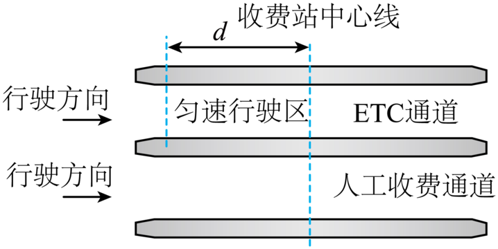

# Physics - 题目 1276

**ID**: b63b5dd242084c21ab86ae3b6bab5bb0
**年级**: Grade 10
**难度**: Medium-Hard
**题型**: Calculation

## 题目
ETC是高速公路不停车电子收费系统的简称，能大幅减少排队缴费时间，提升通行效率。​​​​​​​‌汽车以 $16{\rm{m}}/{\rm{s}}$ 的速度行驶，若过人工收费通道，需在收费站中心线处减速至0，经 $8{\rm{s}}$ 缴费后，再加速至 $16{\rm{m}}/{\rm{s}}$ 继续行驶；若过ETC通道，需在中心线前方 $d=8{\rm{m}}$ 处减速至 $8{\rm{m}}/{\rm{s}}$ ，匀速通过中心线后，再加速至 $16{\rm{m}}/{\rm{s}}$ 行驶。已知汽车加速和减速的加速度大小均为 $2{\rm{m}}/{\rm{s}}{^{2}}$ 。（1）求汽车过人工收费通道，从开始减速到加速结束，总共通过的路程和所需的总时间；（2）求汽车过ETC通道时，通过第（1）问中路程所需的时间，及比人工收费通道节约的时间；（3）汽车过人工收费通道时，按“匀减速 $\to $ 静止缴费 $\to $ 匀加速”的过程运动，若在汽车加速阶段，从某一时刻开始计时，经过3s的位移为21m，求从汽车开始减速到这个计时时刻，总共经历的时间。

## 解答

1. （1）汽车过人工收费通道的路程与时间；
2. 减速阶段：汽车初速度 $v{{}_{0}}=16{\rm{m}}/{\rm{s}}$ ，末速度 $v=0$ ，加速度 $a=-2{\rm{m}}/{\rm{s}}{^{2}}$
3. 由速度公式 $v=v{{}_{0}}+at{{}_{1}}$
4. 得减速时间 $t{{}_{1}}=\frac {v-v{{}_{0}}}{a}=\frac {0-16}{-2}{\rm{s}}=8{\rm{s}}$
5. 由位移公式 $x{{}_{1}}=v{{}_{0}}t{{}_{1}}+\frac {1}{2}at{{}_{1}^{2}}$
6. 得减速位移 $x{{}_{1}}=16\times 8{\rm{m}}+\frac {1}{2}\times \left ({-2}\right )\times 8{^{2}}{\rm{m}}=64{\rm{m}}$
7. 加速阶段：汽车从 $v=0$ 加速到 $v{{}_{0}}=16{\rm{m}}/{\rm{s}}$ ，加速度 $a=2{\rm{m}}/{\rm{s}}{^{2}}$
8. 加速时间与减速时间相等，即 $t{{}_{3}}=8{\rm{s}}$ ；加速位移与减速位移相等，即 $x{{}_{3}}=64{\rm{m}}$
9. 缴费阶段：缴费时间 $t{{}_{2}}=8{\rm{s}}$ ，此阶段汽车静止，位移为0；
10. 总路程： $x{{}_{总}}=x{{}_{1}}+x{{}_{3}}=64{\rm{m}}+64{\rm{m}}=128{\rm{m}}$
11. 总时间： $t{{}_{总}}=t{{}_{1}}+t{{}_{2}}+t{{}_{3}}=8{\rm{s}}+8{\rm{s}}+8{\rm{s}}=24{\rm{s}}$
12. （2）汽车过ETC通道的时间与节约时间
13. 减速阶段（至 $8{\rm{m}}/{\rm{s}})$ ：初速度 $v{{}_{0}}=16{\rm{m}}/{\rm{s}}$ 。末速度 $v{{}_{1}}=8{\rm{m}}/{\rm{s}}$ ，加速度 $a=-2{\rm{m}}/{\rm{s}}{^{2}}$
14. 由 $v{{}_{1}}=v{{}_{0}}+at{{}_{1}^{{\rm{^{′}}}}}$
15. 得减速时间 $t{{}_{1}^{{\rm{^{′}}}}}=\frac {8-16}{-2}{\rm{s}}=4{\rm{s}}$
16. 由 $x{{}_{1}^{{\rm{^{′}}}}}=v{{}_{0}}t{{}_{1}^{{\rm{^{′}}}}}+\frac {1}{2}at{{}_{1}^{{\rm{^{′}}}}}$
17. 得减速位移 $x{{}_{1}^{{\rm{^{′}}}}}=16\times 4{\rm{m}}+\frac {1}{2}\times \left ({-2}\right )\times 4{^{2}}{\rm{m}}=48{\rm{m}}$
18. 匀速阶段：匀速速度 $v{{}_{1}}=8{\rm{m}}/{\rm{s}}$ ，位移 $x{{}_{2}^{{\rm{^{′}}}}}=8{\rm{m}}$
19. 由 $x{{}_{2}^{{\rm{^{′}}}}}=v{{}_{1}}t{{}_{2}^{{\rm{^{′}}}}}$
20. 得匀速时间 $t{{}_{2}^{{\rm{^{′}}}}}=\frac {8}{8}{\rm{s}}=1{\rm{s}}$
21. 加速阶段（至 $16{\rm{m}}/{\rm{s}})$ ：初速度 $v{{}_{1}}=8{\rm{m}}/{\rm{s}}$ ，末速度 $v{{}_{0}}=16{\rm{m}}/{\rm{s}}$ 。加速度 $a=2{\rm{m}}/{\rm{s}}{^{2}}$
22. 加速时间与减速时间相等 $t{{}_{2}^{{\rm{^{′}}}}}=4{\rm{s}}$
23. 加速位移与减速位移相等 $x{{}_{3}^{{\rm{^{′}}}}}=48{\rm{m}}$
24. 额外匀速阶段（补全总路程）：
25. 已行驶位移 $x{{}_{已}}=x{{}_{1}^{{\rm{^{′}}}}}+x{{}_{2}^{{\rm{^{′}}}}}+x{{}_{3}^{{\rm{^{′}}}}}=48{\rm{m}}+8{\rm{m}}+48{\rm{m}}=104{\rm{m}}$
26. 需补全路程 $Δx=128{\rm{m}}-104{\rm{m}}=24{\rm{m}}$
27. 以 $16{\rm{m}}/{\rm{s}}$ 匀速时间 $t{{}_{4}^{{\rm{^{′}}}}}=\frac {Δx}{16}=\frac {24}{16}{\rm{s}}=1.5{\rm{s}}$
28. ETC通道总时间： $t{{}_{{\rm{E}}{\rm{T}}{\rm{C}}}}=t{{}_{1}}+t{{}_{2}}+t{{}_{3}}+t{{}_{4}}=4{\rm{s}}+1{\rm{s}}+4{\rm{s}}+1.5{\rm{s}}=10.5{\rm{s}}$
29. 节约时间： $Δt=t{{}_{总}}-t{{}_{{\rm{E}}{\rm{T}}{\rm{C}}}}=24{\rm{s}}-10.5{\rm{s}}=13.5{\rm{s}}$
30. （3）加速阶段：从静止开始以 $a=2{\rm{m}}/{\rm{s}}{^{2}}$ 加速，速度公式为为加速阶段已运动时间），位移公式为 $x=v{{}_{计}}t+\frac {1}{2}at{^{2}}$
31. （ $v{{}_{计}}$ 为计时时刻的速度 $t=3{\rm{s}}$ 为计时后运动时间）
32. 代入数据得 $21=v{{}_{计}}\times 3+\frac {1}{2}\times 2\times 3{^{2}}.$
33. 解得 $v{{}_{计}}=4{\rm{m}}/{\rm{s}}$
34. 计算加速阶段到计时时刻的时间，加速阶段初速度为0，由速度公式 $v{{}_{计}}=at{{}_{加}}$
35. 得： $t{{}_{加}}=\frac {v{{}_{计}}}{a}=\frac {4}{2}{\rm{s}}=2{\rm{s}}$
36. 计算总时间：总时间为“减速阶段时间十缴费阶段时间十加速阶段到计时时刻的时间”，即 $t{{}_{总}}=t{{}_{1}}+t{{}_{2}}+t{{}_{加}}=8{\rm{s}}+8{\rm{s}}+2{\rm{s}}=18{\rm{s}}$

## 知识点

**中文**:
  - 匀变速直线运动的位移—时间公式及其应用
  - 匀变速直线运动的速度—位移公式及其应用
  - 匀变速直线运动的速度—时间公式及其应用

**English**:
  - Displacement-Time Formula and Applications
  - Velocity-Displacement Formula and Applications
  - Velocity-Time Formula and Applications

---
