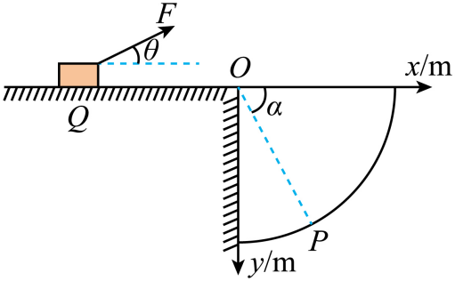

# Physics - 题目 1315

**ID**: b7d05e0111b74eafa7df3507d124a5cc
**年级**: Grade 10
**难度**: Medium-Hard
**题型**: Calculation

## 题目
如图，在粗糙水平台阶上Q点放置一质量 $m=4{\rm{k}}{\rm{g}}$ 可视为质点的小物块，在台阶右侧固定了一个 $\frac {1}{4}$ 圆弧挡板，圆弧半径 $R=1{\rm{m}}$ ，圆弧的圆心在台阶边缘O点。​​​​​​​‌小物块在与水平方向成 $θ=37{}\degree $ 、大小 $F=25{\rm{N}}$ 的拉力作用下，从静止开始沿粗糙水平面做加速度为 $a=2{\rm{m}}{\rm{/}}{\rm{s}}{^{2}}$ 的匀加速直线运动，到O点时撤去拉力，小物块水平抛出并击中挡板。不计空气阻力，重力加速度取 $g=10{\rm{m}}{\rm{/}}{\rm{s}}{^{2}}$ ， $\sin 37\mathrm{°}=0.6$ ， ${\rm{c}}{\rm{o}}{\rm{s}}37{}\degree =0.8$ ，求：（1）小物块与台阶平面间的动摩擦因数 $μ$ ；（2）若小物块击中挡板上的P点，OP与水平方向夹角为 $α=53{}\degree $ ，求小物块由Q运动到O的时间；（3）以O点为原点、水平向右为 $+x$ 、竖直向下为 $+y$ 建立平面直角坐标系。改变小物块出发点的位置，可使其击中挡板上的不同点，欲使其击中挡板时的速度最小，求击中挡板的点的纵坐标（结果可保留根式）。

## 解答

1. （1）分析小物块受力如图所示
2. 
3. 由 $F{\cos}θ-μF{{}_{{\rm{N}}}}=ma$ ， $F{{}_{{\rm{N}}}}+F\sin θ=mg$ ，
4. 解得 $μ=0.48$ 。
5. （2）小物块从O点飞出后做平抛运动，设经过时间t击中P点，
6. 则有 $R{\cos}α=vt$ ， $R\sin α=\frac {1}{2}gt{^{2}}$ ，
7. 解得 $v=1.5{\rm{m}}/{\rm{s}}$ 。
8. 由于小物块从Q到O做匀加速直线运动得 $v=at{{}_{1}}$ ，
9. 可知小物块由Q到O的时间 $t{{}_{1}}=0.75{\rm{s}}$ 。
10. （3）假设从O点飞出时的速度为 $v{{}_{1}}$ 时击中挡板时的速度最小，
11. 此过程中的水平位移 $x=v{{}_{1}}t{{}_{2}}$ ，
12. 竖直位移 $y=\frac {1}{2}gt{{}_{2}^{2}}$ ，
13. 击中时有 $R=\sqrt {x{^{2}}+y{^{2}}}$ ，
14. 联立解得 $\sqrt {{\left({v{{}_{1}}t{{}_{2}}}\right)^{2}}+{\left({\frac {1}{2}gt{{}_{2}^{2}}}\right)^{2}}}=1$ ，
15. 落到P点时的速度 $v{{}_{P}}=\sqrt {{\left({v{{}_{1}}}\right)^{2}}+{\left({gt{{}_{2}}}\right)^{2}}}$ ，
16. 可得 $v{{}_{P}}=\sqrt {\frac {1-\frac {1}{4}g{^{2}}t{{}_{2}^{4}}}{t{{}_{2}^{2}}}+g{^{2}}t{{}_{2}^{2}}}=\sqrt {\frac {1}{t{{}_{2}^{2}}}+\frac {3}{4}g{^{2}}t{{}_{2}^{2}}}$ ，
17. 当 $\frac {1}{t{{}_{2}^{2}}}=\frac {3}{4}g{^{2}}t{{}_{2}^{2}}$ 时 $v{{}_{P}}$ 最小，此时该点的纵坐标为 $y=\frac {1}{2}gt{{}_{2}^{2}}=\frac {\sqrt {3}}{3}{\rm{m}}$ 。

## 知识点

**中文**:
  - 平抛运动中的临界问题

**English**:
  - Critical Problems in Horizontal Projectile Motion

---
