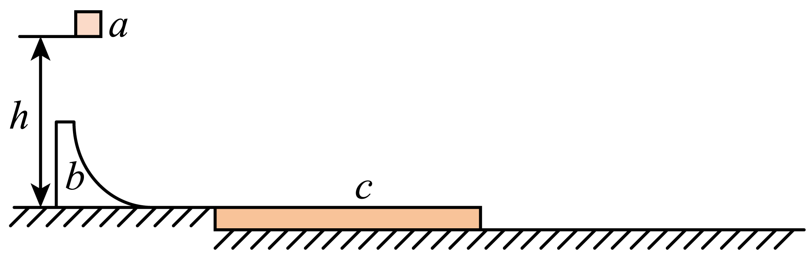

# Physics - 题目 723

**ID**: b9a3e443b58a464192acb939ccb078d6
**年级**: Grade 10
**难度**: Medium-Hard
**题型**: Calculation

## 题目
如图所示，质量为 $m{{}_{1}}=0.5{\rm{k}}{\rm{g}}$ 的足够长木板 ${\rm{c}}$ 放在粗糙水平面上，长木板的左端紧靠一平台且上表面与光滑平台平齐。​​​​​​​‌半径为 $r=1.35{\rm{m}}$ 的 $\frac {1}{4}$ 光滑圆弧形轨道 ${\rm{b}}$ 固定在平台上，且圆弧底端与平台相切。质量为 $m{{}_{2}}$ 、可视为质点的物体 ${\rm{a}}$ 由距离平台 $h=2r$ 高处静止释放，物体 ${\rm{a}}$ 刚好由圆弧轨道的最高点进入圆弧轨道，物体 ${\rm{a}}$ 运动到最低点时对轨道的压力为 $50{\rm{N}}$ 。现将物体 ${\rm{a}}$ 从 $\frac {2}{3}h$ 处静止释放，经过一段时间后从圆弧滑下，经光滑平台滑上长木板 ${\rm{c}}$ ；当物体 ${\rm{a}}$ 在长木板上相对长木板滑动的距离为 $L=6.0{\rm{m}}$ 时，物体 ${\rm{a}}$ 与长木板 ${\rm{c}}$ 达到共同速度 $v{{}_{共}}=2\,{\rm{m}}/{\rm{s}}$ ，且该过程中物体 ${\rm{a}}$ 运动的位移是长木板 ${\rm{c}}$ 运动位移的4倍。重力加速度 $g$ 取 $10{\rm{m}}/{\rm{s}}{^{2}}$ 。求：（1）物体 ${\rm{a}}$ 的质量 $m{{}_{2}}$ ；（2）物体 ${\rm{a}}$ 与长木板 ${\rm{c}}$ 之间的动摩擦因数 $μ{{}_{1}}$ ，长木板 ${\rm{c}}$ 与水平面之间的动摩擦因数 $μ{{}_{2}}$ ；（3）试判断物体 ${\rm{a}}$ 与木板 ${\rm{c}}$ 共速后各自的运动性质，要求写出判断理由；并求出共速后到静止的过程中，木板 ${\rm{c}}$ 损失的机械能。

## 解答

1. （1）根据题意可知，对物体 ${\rm{a}}$ ，从释放到滑动到轨道最低点的过程中，由机械能守恒定律得 $m{{}_{2}}gh=\frac {1}{2}m{{}_{2}}v{{}_{0}^{2}}$ ，在最低点时，由牛顿第二定律得 $F{{}_{{\rm{N}}}}-m{{}_{2}}g=m{{}_{2}}\frac {v{{}_{0}^{2}}}{r}$ ，由牛顿第三定律得 $F{{}_{{\rm{N}}}}^{′}=F{{}_{压}}$ ，解得 $m{{}_{2}}=1\,{\rm{k}}{\rm{g}}$ 。
2. （2）同理，物体 ${\rm{a}}$ 从 $\frac {2}{3}h$ 处静止释放后，设其运动到轨道最低点时的速度为 $v{{}_{1}}$ ，根据机械能守恒定律得 $m{{}_{2}}g\cdot \frac {2}{3}h=\frac {1}{2}m{{}_{2}}v{{}_{1}^{2}}$ ，解得 $v{{}_{1}}=6{\rm{m}}/{\rm{s}}$ ，根据题意可知，物体 ${\rm{a}}$ 在木板 ${\rm{c}}$ 上滑动。当它们达到共速前，设物体 ${\rm{a}}$ 相对地面运动的位移为 $x{{}_{1}}$ ，木板 ${\rm{c}}$ 相对于地面运动的位移 $x{{}_{2}}$ ；该过程中，对物体 ${\rm{a}}$ ，根据动能定理可得 $-μ{{}_{1}}m{{}_{2}}gx{{}_{1}}=\frac {1}{2}m{{}_{2}}v{{}_{{{ }}共{{ }}}^{2}}-\frac {1}{2}m{{}_{2}}v{{}_{1}^{2}}$ ，对木板 ${\rm{c}}$ ，根据动能定理可得 $\left [μ{{}_{1}}m{{}_{2}}g-μ{{}_{2}}\left ({m{{}_{2}}+m{{}_{1}}}\right )g\right ]x{{}_{2}}=\frac {1}{2}m{{}_{1}}v{{}_{{{ }}共{{ }}}^{2}}-0$ ， $x{{}_{1}}-x{{}_{2}}=L$ ，根据题意知 $x{{}_{1}}=4x{{}_{2}}$ ，联立各式解得 $μ{{}_{1}}=0.2$ ， $μ{{}_{2}}=0.1$ 。
3. （3）物体 ${\rm{a}}$ 与木板 ${\rm{c}}$ 共速后，对整体而言，根据牛顿第二定律得 $μ{{}_{2}}\left ({m{{}_{2}}+m{{}_{1}}}\right )g=\left ({m{{}_{2}}+m{{}_{1}}}\right )a{{}_{1}}$
4. 解得 $a{{}_{1}}=1{\rm{m}}/{\rm{s}}{^{2}}$ ，对物体 ${\rm{a}}$ 而言，其相对木板滑动的临界加速度 $a{{}_{0}}=μ{{}_{1}}g=2{\rm{m}}/{\rm{s}}{^{2}}$ ，因为 $a{{}_{1}}<a{{}_{0}}$ ，可判断物体 $a$ 与木板 ${\rm{c}}$ 共速后将一起以加速度 $a{{}_{1}}=1{\rm{m}}/{\rm{s}}{^{2}}$ 向右做匀减速直线运动，直至停下来。则共速后木板 ${\rm{c}}$ 损失的机械能就等于木板 ${\rm{c}}$ 减小的动能，即 ${\rm{Δ}}E{{}_{{{ }}损{{ }}}}=\frac {1}{2}m{{}_{1}}v{{}_{{{ }}共{{ }}}^{2}}-0=1{\rm{J}}$ 。

## 知识点

**中文**:
  - 板块模型中的能量守恒问题

**English**:
  - Energy Conservation in Plate Models

---
