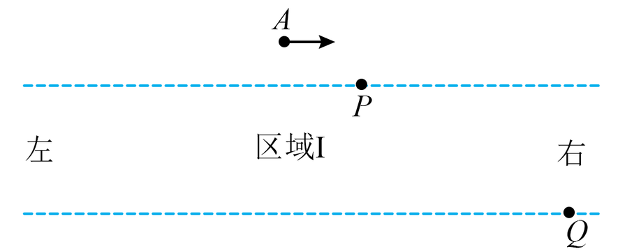

# Physics - 题目 2045

**ID**: bd2519ce5b694dc893c623cb2be397fb
**年级**: Grade 10
**难度**: Medium-Hard
**题型**: Calculation

## 题目
如图，两水平面（虚线）之间为特殊的区域I，当物体经过该区域时会受到水平向右的恒定外力。​​​​​​​‌从区域Ⅰ上方的A点将质量为m的小球以初速率 $v{{}_{0}}$ 向右水平抛出，小球从P点进入区域Ⅰ后恰好做直线运动，并从Q点离开区域I。已知A点到区域Ⅰ上方的距离为h，小球在Q点的速率是在P点速率的2倍，重力加速度为g。不计空气阻力。求：（1）小球在P点的速度与水平方向夹角的正切值及小球在区域Ⅰ中受到水平向右的外力大小；（2）区域Ⅰ上下边界的高度差；（3）若将该小球从A点以初速率 $v{{}_{0}}$ 向左水平抛出，小球从R点（图中未标出）离开区域Ⅰ。试求Q点与R点间的距离。

## 解答

1. （1）由平抛运动，可得竖直方向有 $v{{}_{Py}^{2}}=2gh$ ，解得 $v{{}_{Py}}=\sqrt {2gh}$ ，小球在P点的速度与水平方向夹角的正切值 ${\tan}θ=\frac {v{{}_{Py}}}{v{{}_{0}}}=\frac {\sqrt {2gh}}{v{{}_{0}}}$ ，小球从P点进入区域Ⅰ后，恰好做直线运动，所受合力与速度方向共线 ${\tan}θ=\frac {mg}{F}$ ，解得 $F=mg\frac {v{{}_{0}}}{\sqrt {2gh}}$ 。
2. （2）小球从P点进入区域Ⅰ后，恰好做直线运动，由 $v{{}_{Q}}=2v{{}_{P}}$ ，可得 $v{{}_{Qy}}=2v{{}_{Py}}$ ，又 $v{{}_{Qy}^{2}}=2g\left ({H+h}\right )$ ，解得 $H=3h$ 。
3. （3）将小球向右水平抛出，在区域Ⅰ上方有 $h=\frac {1}{2}gt{{}_{1}^{2}}$ ，由 $v{{}_{Qy}}=2v{{}_{Py}}$ 可得，在区域Ⅰ运动的时间 $t{{}_{2}}=t{{}_{1}}$ ，水平位移 $x{{}_{1}}=v{{}_{0}}t{{}_{1}}+\frac {v{{}_{0}}+2v{{}_{0}}}{2}t{{}_{2}}=\frac {5v{{}_{0}}}{2}\sqrt {\frac {2h}{g}}$ ，将小球向左水平抛出有 $v{{}_{Rx}}=v{{}_{0}}-\frac {F}{m}t{{}_{1}}=0$ ，小球在R点速度方向竖直向下，水平位移 $x{{}_{2}}=v{{}_{0}}t{{}_{1}}+\frac {0+v{{}_{0}}}{2}t{{}_{2}}=\frac {3v{{}_{0}}}{2}\sqrt {\frac {2h}{g}}$ ，故Q点与R点间的水平距离 $x=x{{}_{1}}+x{{}_{2}}=4v{{}_{0}}\sqrt {\frac {2h}{g}}$ 。

## 知识点

**中文**:
  - 平抛运动中的临界问题

**English**:
  - Critical Problems in Horizontal Projectile Motion

---
