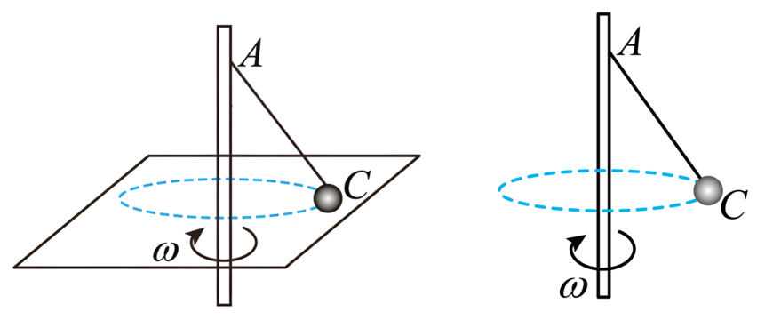

# Physics - 题目 1139

**ID**: c0192f30d8eb4c38a3435e672433d191
**年级**: Grade 10
**难度**: Medium-Hard
**题型**: Calculation

## 题目
小球（可视为质点）质量为m，细线AC长度为L，重力加速度为g。​​​​​​​‌（ $\sin 37{}\degree =0.6$ ， ${\cos}37{}\degree =0.8$ ，计算结果可用根号或分数表示）（1）在紧贴着小球运动的水面上加一光滑平板，使球在板上做匀速圆周运动，此时细线与竖直方向所成夹角为 $θ$ ，如图所示，当小球的角速度 $ω$ 大于某一值 $ω{{}_{1}}$ 时，小球将脱离平板，则 $ω{{}_{1}}$ 为多大？（2）撤去光滑平板，让小球在空中旋转，再用一根细线，同样一端系在该小球上，另一端固定在细杆上的B点，且当两条细线均伸直时，如图所示，各部分长度之比 $\left |{AB}\right |:\left |{AC}\right |:\left |{BC}\right |=5:4:3$ 。则当小球以 $ω{{}_{2}}=\sqrt {\frac {2g}{\sqrt {3}L}}$ 匀速转动时，两细线对小球的拉力大小分别多大？（3）在（2）情境下，当小球以 $ω{{}_{3}}=\sqrt {\frac {5g}{2L}}$ 匀速转动时，两细线对小球的拉力大小分别为多大？

## 解答

1. （1）当平板对小球支持力为零时，小球恰好脱离平板，此时重力和绳子拉力的合力提供向心力，根据牛顿第二定律得 $mg{\tan}θ=mω{{}_{1}^{2}}L\sin θ$ ，解得 $ω{{}_{1}}=\sqrt {\frac {g}{L{\cos}θ}}$ 。
2. （2）当细线恰好伸直时，由几何关系得，AC与竖直方向所成夹角为37°，同理可得，此时小球的角速度为 $ω{{}_{0}}=\sqrt {\frac {g}{L{\cos}37{}\degree }}=\sqrt {\frac {5g}{4L}}>ω{{}_{2}}$ ，则 $ω{{}_{2}}=\sqrt {\frac {2g}{\sqrt {3}L}}$ 时细线末伸直，即 $T{{}_{BC}}=0$ ，设此时细线AC与竖直方向的夹角为 $β$ ，可得 $ω{{}_{2}}=\sqrt {\frac {g}{L{\cos}β}}$ ，解得 ${\cos}β=\frac {g}{Lω{{}_{2}^{2}}}=\frac {\sqrt {3}}{2}$ ，根据平衡条件得 $T{{}_{AC}}=\frac {mg}{{\cos}β}=\frac {2\sqrt {3}}{3}mg$ 。
3. （3）当小球以 $ω{{}_{3}}=\sqrt {\frac {5g}{2L}}$ 匀速转动时，由于 $ω{{}_{3}}=\sqrt {\frac {5g}{2L}}>ω{{}_{0}}=\sqrt {\frac {5g}{4L}}$ ，所以两细线均有拉力，有 $T^{′}{{{}_{AC}}}{\cos}37{}\degree =T^{′}{{{}_{BC}}}{\cos}53{}\degree +mg$ ， $T^{′}{{{}_{AC}}}\sin 37{}\degree +T^{′}{{{}_{BC}}}\sin 53{}\degree =mω{{}_{3}^{2}}L\sin 37{}\degree $ ，联立解得 $T^{′}{{{}_{AC}}}=\frac {17}{10}mg$ ， $T^{′}{{{}_{BC}}}=\frac {3}{5}mg$ 。

## 知识点

**中文**:
  - 绳、杆类圆周运动问题

**English**:
  - String and Rod Circular Motion Problems

---
