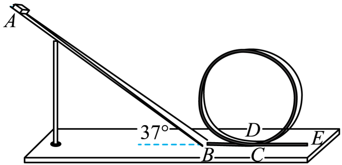

# Physics - 题目 2559

**ID**: c08fdb03d93b400f8596895508de7864
**年级**: Grade 10
**难度**: Medium-Hard
**题型**: Calculation

## 题目
为了研究过山车的原理，物理小组提出了下列设想：取一个与水平方向夹角为37°，长为 $L={{2}}{{.}}0{\rm{\;}}{\rm{m}}$ 的粗糙的倾斜轨道 $AB$ ，通过水平轨道 $BC$ 与竖直圆轨道相连，整个轨道除 $AB$ 段以外都是光滑的，其中 $AB$ 与 $BC$ 轨道以微小圆弧相接，如图所示，一个质量为2 kg的小物块从轨道A点沿倾斜轨道滑下，已知物块与倾斜轨道间的动摩擦因数 $μ=0.{{5}}0$ ， $g$ 取 ${{1}}0{\rm{\;}}{\rm{m}}/{\rm{s}}{^{2}}$ ， $\sin 37{}^\circ =0.6$ ， ${\cos}37{}^\circ =0.8$ 。​​​​​​​‌（1）若竖直圆弧轨道的半径 $R=0{{.}}{{1}}{{8}}{\rm{\;}}{\rm{m}}$ ，小物块不脱离轨道并恰好通过圆周最高点，求小物块在 $C$ 点的速度的大小；（2）若小物块在A点的速度大小 $v{{}_{A}}={{5}}{\rm{\;}}{\rm{m}}/{\rm{s}}$ ，为了让小物块不离开轨道，并且能够滑回倾斜轨道 $AB$ ，则竖直圆轨道的半径R应该满足什么条件？（3）若小物块在A点的速度大小 $v{{}_{A}}={{5}}{\rm{\;}}{\rm{m}}/{\rm{s}}$ 且圆弧轨道的半径R=2 m，那么在小物块的运动过程中，可以有多少次通过圆轨道上距水平轨道高为0.02 m的某一点？（必须有推导过程）

## 解答

1. （1）设小物块恰好进入圆轨道到最高点时速度为v_{1}，此时物块受到的重力恰好提供向心力 $mg=m\frac {v{{}_{1}^{2}}}{R}$ ，物块从C点到最高点过程，根据动能定理有 $-2mgR=\frac {1}{2}mv{{}_{1}^{2}}-\frac {1}{2}mv{{}_{C}^{2}}$ ，联解解得 $v{{}_{C}}=3{\rm{\;}}{\rm{m}}/{\rm{s}}$ 。
2. （2）为了让小物块不离开轨道，并且能够滑回倾斜轨道AB，则物块上升的高度须小于或等于圆轨道的半径，根据动能定理可得 $mg\left ({L\sin θ-R{{}_{1}}}\right )-{\rm μm}gL{\cos}θ=0-\frac {1}{2}mv{{}_{A}^{2}}$ ，解得 $R{{}_{1}}=1.65{\rm{\;}}{\rm{m}}$ ，所以物块能够滑回倾斜轨道AB，则轨道半径大于等于 $1.65{\rm{\;}}{\rm{m}}$ 。
3. （3）小物块冲上圆轨道H_{1}＝1.65 m高度时速度变为0，然后返回倾斜轨道h_{1}高处再滑下，然后再次进入圆轨道达到的高度为H_{2}，根据能量守恒定律有 $mgH{{}_{1}}=mgh{{}_{1}}+{\rm μm}g{\cos}θ\cdot \frac {h{{}_{1}}}{\sin θ}$ ， $mgH{{}_{2}}=mgh{{}_{1}}-{\rm μm}g{\cos}θ\cdot \frac {h{{}_{1}}}{\sin θ}$ ，解得 $H{{}_{2}}=\frac {1}{5}H{{}_{1}}$ ，之后物块在竖直圆轨道和倾斜轨道之间往返运动，同理n次上升的高度 $H{{}_{n}}=(\frac {1}{5}){^{n-1}}H{{}_{1}}(n>0)$ ，为一等比数列，当n＝4时，上升的最大高度小于0.02 m，n＝3即小物块共有6次通过距水平轨道高为0.02 m的某一点。

## 知识点

**中文**:
  - 单一物体机械能守恒定律的应用

**English**:
  - Applications for Single Body

---
