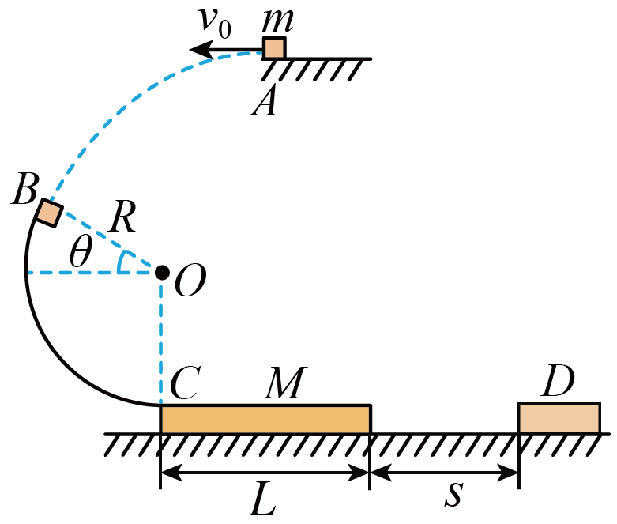

# Physics - 题目 2840

**ID**: c3e3d0c97f20480abbdd33fb8c8d9e1a
**年级**: Grade 10
**难度**: Medium-Hard
**题型**: Calculation

## 题目
如图所示，半径 $R=\frac {1}{4}{\rm{m}}$ 的光滑圆弧轨道固定在竖直平面内，轨道的一个端点B和圆心O的连线与水平方向间的夹角 $θ=37{}\degree $ ，另一端点C为轨道的最低点，其切线水平。​​​​​​​‌一质量 $M=2{\rm{k}}{\rm{g}}$ 、板长 $L=0.65{\rm{m}}$ 的滑板静止在光滑水平地面上，左端紧靠C点，其上表面所在平面与圆弧轨道C点和右侧固定平台D等高。质量为 $m=1{\rm{k}}{\rm{g}}$ 的物块（可视为质点）从空中A点以 $v{{}_{0}}=0.6{\rm{m}}/{\rm{s}}$ 的速度水平抛出，恰好从轨道的B端沿切线方向进入圆弧轨道，然后沿圆弧轨道滑下经C点滑上滑板。滑板运动到平台D时被牢固粘连。已知物块与滑板间的动摩擦因数 $μ=0.5$ ，滑板右端到平台D左侧的距离s在（ $0.1{\rm{m}}<s<0.5{\rm{m}}$ 范围内取值。取 $g=10{\rm{m}}/{\rm{s}}{^{2}}$ ， $\sin 37{}\degree =0.6$ ， ${\cos}37{}\degree =0.8$ 。求：（1）物块到达B点时的速度大小 $v{{}_{B}}$ ；（2）物块经过C点时对圆弧轨道的压力大小；（3）试讨论物块刚滑上平台D时的动能 $E{{}_{{\rm{k}}{\rm{D}}}}$ 与s的大小关系。

## 解答

1. （1）从A到B，物块做平抛运动，物块恰好从轨道的B端沿切线方向进入圆弧轨道，由几何关系得 $\sin 37{}\degree =\frac {v{{}_{0}}}{v{{}_{B}}}$ ，解得 $v{{}_{B}}=1{\rm{m}}{\rm{/}}{\rm{s}}$
2. （2）从B到C，物块机械能守恒 $\frac {1}{2}mv{{}_{C}^{2}}=mg(R+R\sin 37{}\degree )+\frac {1}{2}mv{{}_{B}^{2}}$ ，解得 $v{{}_{C}}=3{\rm{m}}{\rm{/}}{\rm{s}}$ ，在C点有 $F{{}_{{\rm{N}}}}-mg=m\frac {v{{}_{C}^{2}}}{R}$ ，联立解得 $F{{}_{{\rm{N}}}}=46{\rm{N}}$ ，根据牛顿第三定律 $\left |{F{{}_{{\rm{N}}}^{\mathrm{′}}}}\right |=\left |{F{{}_{{\rm{N}}}}}\right |$ ，物块在C点对轨道的压力大小为46N。
3. （3）物块从C点滑上滑板后开始作匀减速运动，此时滑板开始做匀加速直线运动，当物块与滑板达共同速度时，二者开始作匀速直线运动。设它们的共同速度为 $v$ ，物块的加速度 $a{{}_{1}}$ ，有 ${\rm }{\rm μm}g=ma{{}_{1}}{\rm }$ ，滑板的加速度 $a{{}_{2}}$ ，有 ${\rm }{\rm μm}g=Ma{{}_{2}}{\rm }$ ，到共速阶段有 $v=v{{}_{C}}-a{{}_{1}}t=a{{}_{2}}t$ ，解得 $v=1{\rm{m}}{\rm{/}}{\rm{s}}$ ，对物块，用动能定理列方程 $-{\rm μm}gs{{}_{1}}=\frac {1}{2}mv{^{2}}-\frac {1}{2}mv{{}_{C}^{2}}$ ，解得 $s{{}_{1}}=0.8{\rm{m}}$ ，对滑板，用动能定理列方程 ${\rm }{\rm μm}gs{{}_{2}}=\frac {1}{2}Mv{^{2}}{\rm }$ ，解得 $s{{}_{2}}=0.2{\rm{m}}$ ，由此可知物块在滑板上相对滑过 $Δs=s{{}_{1}}-s{{}_{2}}=0.6{\rm{m}}$ 时，小于 $0.65{\rm{m}}$ ，并没有滑下去，二者就具有共同速度了，同速时物块离滑板右侧还有距离为 $L-Δs=0.05{\rm{m}}$ ，①当 $0.2{\rm{m}}⩽s<0.5{\rm{m}}$ 时，物块的运动是匀减速运动 $s{{}_{1}}=0.8{\rm{m}}$ ，匀速运动 $s-s{{}_{2}}$ ，匀减速运动 $L-Δs=0.05{\rm{m}}$ ，滑上平台D，根据动能定理 $-{\rm μm}g\left ({s{{}_{1}}+L-Δs}\right )=E{{}_{{\rm{k}}{\rm{D}}}}-\frac {1}{2}mv{{}_{C}^{2}}$ ，解得 $E{{}_{{\rm{k}}{\rm{D}}}}=0.25{\rm{J}}$ ，②当 $0.1{\rm{m}}<s<0.2{\rm{m}}$ 时，物块的运动是匀减速运动 $L+s$ ，滑上平台D。根据动能定理 $-{\rm μm}g(L+s)=E{{}_{{\rm{k}}{\rm{D}}}}-\frac {1}{2}mv{{}_{C}^{2}}$ ，解得 $E{{}_{{\rm{k}}{\rm{D}}}}=1.25-5s({\rm{J}})$

## 知识点

**中文**:
  - 板块模型中的能量守恒问题

**English**:
  - Energy Conservation in Plate Models

---
