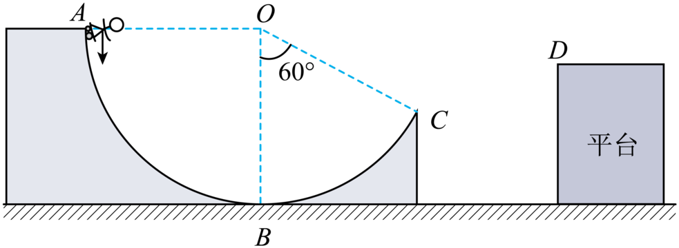

# Physics - 题目 2337

**ID**: c54eba1b8c21476287c34b5fe45a5f2d
**年级**: Grade 10
**难度**: Medium-Hard
**题型**: Calculation

## 题目
如图所示，ABC是半径为R的光滑圆弧形轮滑赛道，A点与圆心O等高，B为最低点（位于水平地面上），圆弧BC所对的圆心角为60°。​​​​​​​‌轮滑运动员从A点以一定的初速度沿圆弧面滑下，从C点滑出后，运动员上升到的最高点与O点在同一水平面上，此后运动员恰好落到平台上的D点，D点距水平地面的高为 $\frac {7}{8}R$ 。已知运动员和轮滑鞋的总质量为m，重力加速度大小为g，运动员和轮滑鞋整体视为质点，不计空气阻力。求：（1）运动员从C点滑出时的速度大小；（2）运动员和轮滑鞋一起在B点对轨道的压力；（3）平台D点离圆弧轨道C点的水平距离。

## 解答

1. （1）设运动员从C点滑出的速度大小为v_{C}，运动员从C点滑出后，竖直上升的高度 $h=R{\cos}60{}\degree $
2. 竖直方向分运动 $(v{{}_{C}}\sin 60{}\degree ){^{2}}=2gh$
3. 解得 $v{{}_{C}}=\frac {2}{3}\sqrt {3gR}$
4. （2）设运动员到B点时速度大小为vB，从B到C，根据机械能守恒 $-mg(R-R{\cos}60{}\degree )=\frac {1}{2}mv{{}_{C}^{2}}-\frac {1}{2}mv{{}_{B}^{2}}$
5. 在B点，根据牛顿第二定律有 $F-mg=m\frac {v{{}_{B}^{2}}}{R}$
6. 解得 $F=\frac {10}{3}mg$
7. 根据牛顿第三定律，运动员和轮滑鞋一起在B点对轨道的压力大小 $F^{′}=F=\frac {10}{3}mg$
8. 方向竖直向下
9. （3）运动员从C点滑出后，上升的过程有 $v{{}_{C}}\sin 60{}\degree =gt{{}_{1}}$
10. 设下降的时间为t_{2}，则 $\frac {1}{8}R=\frac {1}{2}gt{{}_{2}^{2}}$
11. 则D点与C点的水平距离 $s=v{{}_{C}}{\cos}60{}\degree (t{{}_{1}}+t{{}_{2}})=\frac {\sqrt {3}}{2}R$

## 知识点

**中文**:
  - 单一物体机械能守恒定律的应用

**English**:
  - Applications for Single Body

---
