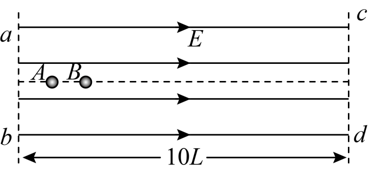

# Physics - 题目 962

**ID**: ca23a1cda4cd4e3f8400eb740a8175cc
**年级**: Grade 10
**难度**: Medium-Hard
**题型**: Calculation

## 题目
如图，光滑绝缘水平桌面位于以ab、cd为边界的匀强电场中，电场方向垂直边界向右。​​​​​​​‌两小球A和B放置在水平桌面上，其位置连线与电场方向平行。两小球质量均为m，A带电荷量为q（q>0），B不带电。初始时小球A距ab边界的距离为L，两小球间的距离也为L。已知电场区域两个边界ab、cd间的距离为10L，电场强度大小为E。现释放小球A，A在电场力作用下沿直线加速运动，与小球B发生弹性碰撞。两小球碰撞时没有电荷转移，碰撞的时间极短。求：（1）两小球发生第一次碰撞后，B获得的动量大小；（2）两小球发生第一次碰撞后至第二次碰撞前，A、B间的最大距离；（3）当小球B离开电场区域时，A在电场中的位置。

## 解答

1. （1）设小球A的加速度为a，与小球B第一次碰前速度为v_{0}，根据牛顿运动定律和运动学公式，有qE=ma①， $v{{}_{0}^{2}}=2aL$   ②，
2. 设碰撞后A、B的速度大小分别为v_{A1}、v_{B1}由量守恒和能量守恒，有 $mv{{}_{0}}=mv{{}_{A1}}+mv{{}_{B1}}$  ③， $\frac {1}{2}mv{{}_{0}^{2}}{\rm{=}}\frac {1}{2}mv{{}_{A1}^{2}}{{+}}\frac {1}{2}mv{{}_{B1}^{2}}$  ④，
3. 联立①②③④式，得 $v{{}_{A1}}=0$ ， $v{{}_{B1}}=v{{}_{0}}=\sqrt {\frac {2qEl}{m}}$  ⑤，
4. 小球B获得的动量大小为 $p{{}_{B1}}=mv{{}_{B1}}=\sqrt {2mqEL}$  ⑥，
5. （2）设A、B两个小球发生第一次碰撞后经时间t′两者速度相同，时两小球相距最大距离为∆s_{m}，根据运动学公式，有 $at{^{\prime }}=v{{}_{B1}}$    ⑦， $Δs{{}_{m}}=v{{}_{B1}}t{^{\prime }}-\frac {1}{2}at{^{\prime }}{^{2}}$  ⑧，
6. 由①⑤⑦⑧式得∆s_{m}=L⑨，
7. （3）设A、B两小球第一次碰撞后，经时间t_{1}发生第二次碰撞，有 $\frac {1}{2}at{{}_{1}^{2}}=v{{}_{B1}}t{{}_{1}}$  ⑩，
8. 由⑤⑩式得 $t{{}_{1}}=\frac {2v{{}_{0}}}{a}$   ⑪，
9. 设A、B两小球第二次碰撞前后的速度分别为v_{A20}，v_{B2}0，v_{A2}，v_{B2}，有 $v{{}_{A20}}=at{{}_{1}}=2v{{}_{0}}$ ， $v{{}_{B20}}=v{{}_{0}}$   ⑫，
10. 由动量守恒和能量守恒，有 $v{{}_{A20}}+v{{}_{B20}}=mv{{}_{A2}}+mv{{}_{B2}}$  ⑬， $\frac {1}{2}mv{{}_{A20}^{2}}+\frac {1}{2}mv{{}_{B20}^{2}}=\frac {1}{2}mv{{}_{A2}^{2}}+\frac {1}{2}mv{{}_{B2}^{2}}$ ⑭，
11. 由⑫⑬⑭式可得 $v{{}_{A2}}=v{{}_{0}}$ ， $v{{}_{B2}}=2v{{}_{0}}$  ⑮，
12. 在t_{1}时间内，A、B小球的位移均为 $s{{}_{1}}=v{{}_{0}}t{{}_{1}}=4L$   ⑯，
13. 可知A与B第二次碰撞位置距电场cd边界的距离为 $s{{}_{2}}=10L-L-L-s{{}_{1}}=4L$  ⑰，
14. 假设经时间t_{2}发生第三次碰撞，由运动学规律，得 $v{{}_{0}}t{{}_{2}}+\frac {1}{2}at{{}_{2}^{2}}=2v{{}_{0}}t{{}_{2}}$  ⑱，
15. 得 $t{{}_{2}}=\frac {2v{{}_{0}}}{a}$ ，
16. 由于 $2v{{}_{0}}t{{}_{2}}=8L>s{{}_{2}}=4L$  ⑲，
17. 故两小球不会发生第三次碰撞。
18. 设两小球第二次碰后B经时间t_{3}离开电场，则 $s{{}_{2}}=v{{}_{B2}}t{{}_{3}}$   ⑳，
19. 在t_{3}时间内，A的位移为 $s{{}_{A2}}=v{{}_{A2}}t{{}_{3}}+\frac {1}{2}at{{}_{3}^{2}}$  （21），
20. 由①②⑮⑰⑳（21）式得 $s{{}_{A2}}=3L$  （22），
21. 即B离开电场时，A距cd边界的距离为 $s{{}_{A}}=s{{}_{2}}-s{{}_{A2}}=L$  （23）。

## 知识点

**中文**:
  - 动量守恒中的多次碰撞问题

**English**:
  - Multiple Collisions in Momentum Conservation

---
