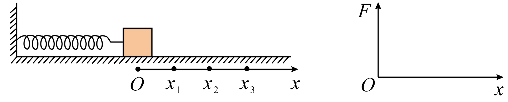

# Physics - 题目 2185

**ID**: ce029c0c946949d0b93b29bb55211c0c
**年级**: Grade 10
**难度**: Medium-Hard
**题型**: Calculation

## 题目
如图所示，弹簧的一端固定，另一端连接一个物块，弹簧质量不计。​​​​​​​‌物块（可视为质点）的质量为m，在水平桌面上沿x轴运动，与桌面间的动摩擦因数为μ。以弹簧原长时物块的位置为坐标原点O，当弹簧的伸长量为x时，物块所受弹簧弹力大小为 $F=kx{\rm ，\mathit{k}}$ 为常量。重力加速度大小为g。（1）请画出F随x变化的示意图；并根据 $F-x$ 图像求物块沿x轴从O点运动到位置x的过程中弹力所做的功W，并据此求弹性势能的变化量 $ΔE{{}_{{\rm{p}}}}$ ；（2）若物块以一定的初速度从 $x{{}_{1}}$ 向右运动，经 $x{{}_{2}}$ 最远到达 $x{{}_{3}}$ ，然后由 $x{{}_{3}}$ 返回到 $x{{}_{2}}$ ，在这个过程中：a.分别求出物块由 $x{{}_{1}}$ 向右第一次到达 $x{{}_{2}}$ 过程及全过程弹力所做的功 $W{{}_{1}}$ 、 $W{{}_{2}}$ ；b.分别求出物块由 $x{{}_{1}}$ 向右第一次到达 $x{{}_{2}}$ 过程及全过程滑动摩擦力所做的功 $W{{}_{3}}$ 、 $W{{}_{4}}$ ，并与弹力做功比较，说明为什么不存在与摩擦力对应的“摩擦力势能”的概念；c.求返回到 $x{{}_{2}}$ 时物块的速度大小v。

## 解答

1. （1）根据，可知图像如图所示
2. 
3. 根据图像与横轴围成的面积表示做功大小，可知物块沿x轴从O点运动到位置x的过程中弹力所做的功为，
4. 弹性势能的变化量为。
5. （2）a.物块由向右第一次到达过程，弹簧弹力所做负功为，
6. 从到达过程，弹簧弹力做负功；再从返回到过程，弹簧弹力做正功；根据对称性可知从到达再从返回到过程，弹簧弹力做功为0，则全过程弹力所做的功为 ，
7. b.物块由向右第一次到达过程，摩擦力所做的功为，
8. 全过程滑动摩擦力所做的功为，
9. 可知，两次沿不同路径从相同出发点运动到同一位置，摩擦力做功不同，说明摩擦力做功与路径有关；而弹簧弹力做功与路径无关，只与初末位置有关，因此存在弹性势能的概念，根据势能的定义可知，不存在摩擦力势能的概念。
10. c.物块从返回到过程，根据动能定理可得，
11. 解得返回到时物块的速度大小为 。

## 知识点

**中文**:
  - 应用动能定理求解与图像相关的动能问题

**English**:
  - Graph-related Kinetic Energy Problems

---
