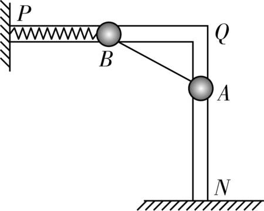

# Physics - 题目 1707

**ID**: ce2c9f7890104ce48b2a6e6f40f623e7
**年级**: Grade 10
**难度**: Medium-Hard
**题型**: Calculation

## 题目
直角光滑固定支架 $PQN$ ， $P$ 点固定于墙面， $N$ 点固定于地面， $PQ$ 水平，长度为 $30\mathrm{ }\mathrm{c}\mathrm{m}$ ， $QN$ 竖直且足够长 ${\rm .​​​​​​​‌}PQ$ 、 $QN$ 分别穿过中间有孔的 $A$ 、 $B$ 小球（两小球均可看作质点），小球质量均为 $m=1\mathrm{ }\mathrm{k}\mathrm{g}$ ， $A$ 、 $B$ 间用铰链与硬质轻杆相连，杆长为 $20\mathrm{ }\mathrm{c}\mathrm{m}$ .原长为 $16\mathrm{ }\mathrm{c}\mathrm{m}$ 的轻质弹簧（始终在弹性限度内）一端固定于 $P$ 点，另一端连接小球 $B$ .初始时，将小球 $A$ 提至 $Q$ 点（ $A$ 、 $B$ 间轻杆水平），由静止释放 $A$ 球，当 $A$ 球下落 $12\mathrm{ }\mathrm{c}\mathrm{m}$ 时， $A$ 的速度大小为 $1.6\mathrm{ }\mathrm{m}/\mathrm{s}$ ， $g$ 取 $10\mathrm{ }\mathrm{m}/{\mathrm{s}}^{2}$ .（1） 求此时小球 $B$ 的速度大小；（2） 求小球 $A$ 从静止释放到下落 $12\mathrm{ }\mathrm{c}\mathrm{m}$ 这一过程中，弹簧弹性势能的减少量 $\mathrm{\Delta }{E}_{\mathrm{p}}$ ；（3） 若将小球 $A$ 的质量换为 $2m$ ，小球 $B$ 的质量换为 $\frac{27}{8}m$ ，仍将小球 $A$ 提至 $Q$ 点，由静止释放，求小球 $A$ 下落 $16\mathrm{ }\mathrm{c}\mathrm{m}$ 时小球 $A$ 的速度大小.

## 解答

1. （1） 如图所示,当 $A$ 球下落 $12\mathrm{ }\mathrm{c}\mathrm{m}$ 时,设 $\mathrm{\angle }ABQ$ 为 $\theta $  ,由几何关系得 $\sin \mathrm{ }\theta =\frac{3}{5}$ ,根据运动的分解可得 ${v}_{B}\cos \mathrm{ }\theta ={v}_{A}\sin \mathrm{ }\theta $  ,解得 ${v}_{B}=1.2\mathrm{ }\mathrm{m}/\mathrm{s}$ .
2. （2） 由机械能守恒定律可得 $\mathrm{\Delta }{E}_{\mathrm{p}}+mgh=\frac{1}{2}m{v}_{A}^{2}+\frac{1}{2}m{v}_{B}^{2}$ ,解得 $\mathrm{\Delta }{E}_{\mathrm{p}}=0.8\mathrm{ }\mathrm{J}$ .
3. （3） 当 $A$ 球下落 $12\mathrm{ }\mathrm{c}\mathrm{m}$ 时, $BQ$ 长度为 $16\mathrm{ }\mathrm{c}\mathrm{m}$ ,此时弹簧的形变量为 $\mathrm{\Delta }{x}_{1}=(16+16-30)\mathrm{ }\mathrm{c}\mathrm{m}=2\mathrm{ }\mathrm{c}\mathrm{m}$ ,弹簧处于压缩状态,此时弹簧弹性势能为 ${E}_{\mathrm{p}}$ , $A$ 下落 $16\mathrm{ }\mathrm{c}\mathrm{m}$ 时,设 $\mathrm{\angle }ABQ$ 为 $\beta $  ,由几何关系得 $\sin \mathrm{ }\beta =\frac{4}{5}$ ,此时 $BQ$ 为 $12\mathrm{ }\mathrm{c}\mathrm{m}$ ,则 $PB$ 长度为 $18\mathrm{ }\mathrm{c}\mathrm{m}$ ,此时弹簧形变量为 $\mathrm{\Delta }{x}_{2}=(18-16)\mathrm{ }\mathrm{c}\mathrm{m}=2\mathrm{ }\mathrm{c}\mathrm{m}$ ,故 $A$ 球从 $Q$ 下落 $12\mathrm{ }\mathrm{c}\mathrm{m}$ 和下落 $16\mathrm{ }\mathrm{c}\mathrm{m}$ 时弹簧弹性势能变化量相同,根据运动的分解可得 $v{\mathrm{\text{'}}}_{B}\cos \mathrm{ }\beta =v{\mathrm{\text{'}}}_{A}\sin \mathrm{ }\beta $  ,由机械能守恒定律得 $\mathrm{\Delta }{E}_{\mathrm{p}}+2mgh\mathrm{\text{'}}=\frac{1}{2}×2mv{\mathrm{\text{'}}}_{A}^{2}+\frac{1}{2}×\frac{27}{8}mv{\mathrm{\text{'}}}_{B}^{2}$ ,解得 $v{\mathrm{\text{'}}}_{A}=1\mathrm{ }\mathrm{m}/\mathrm{s}$ .

## 知识点

**中文**:
  - 其他连接体问题中机械能守恒定律的应用

**English**:
  - Other Connected Body Problems

---
