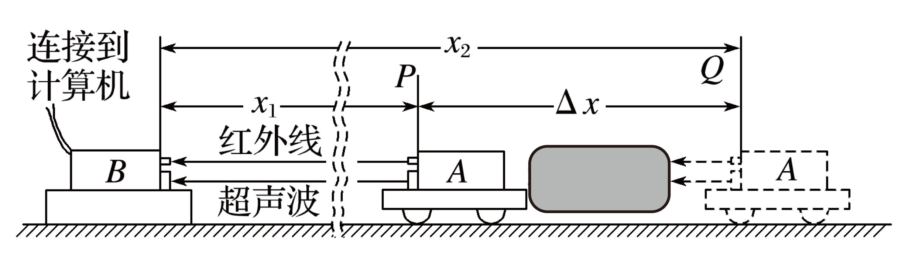
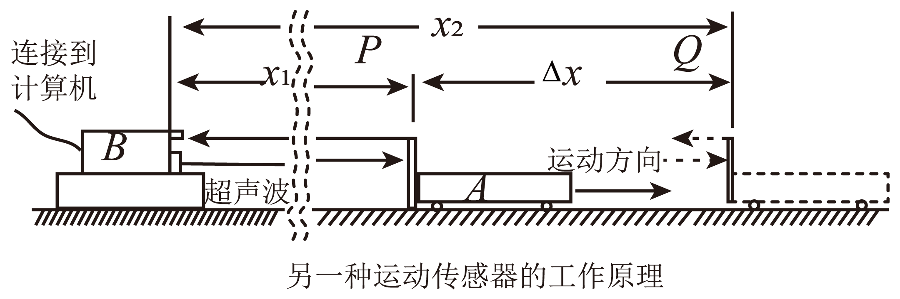

# Physics - 题目 739

**ID**: d05b42df1d494de9b4149f320114a472
**年级**: Grade 10
**难度**: Medium-Hard
**题型**: Calculation

## 题目
图是利用位移传感器测量速度的示意图。​​​​​​​‌这个系统有发射器A与接收器B组成，发射器A能够发射红外线和超声波信号，接收器B可以接受红外线和超声波信号。发射器A固定在被测的运动物体上，接收器B固定在桌面上。测量时A向B同时发射一个红外线脉冲和一个超声波脉冲（即持续时间很短的一束红外线和一束超声波）。已知实验时声波传播速度约为300m/s，红外线的传播速度约为3.0×10^{8}m/s，（由于A、B距离近，红外线传播速度太快，红外线的传播时间可以忽略）请根据以上数据和下面表格数据回答下面的问题：红外线接受时刻0.10.20.30.40.5超声波接受时刻0.1010.2020.3030.4040.505（1）小车是靠近接收装置还是远离接收装置？请说明理由。（2）估算小车在0.4s末的瞬时速度是多少？（3）若发射和接收装置都安装在C上，信号由C发出，经小车D反射后再由C接受，这样只利用超声波信号就可以测量小车速度了。若第一个信号发射时刻为0.3s末，经过0.04s接受到反馈信号；然后在第0.5s发射了第二个信号，再经过0.06s接受到反馈信号，请根据这4个数据计算小车的瞬时速率。

## 解答

1. (1)小车远离接收装置，因为超声波接受的时间变大；
2. (2)0.4s末的速度近似等于0.4s内的平均速度，即为
3. ${\overline{v}}=\frac {0.404-0.4}{0.404}\times 300{\rm{m}}{\rm{/}}{\rm{s}}\approx 3{\rm{m}}{\rm{/}}{\rm{s}}$
4. (3)由题意可知，小车在两次发射信号之间运动的时间为0.2s，运动的距离为
5. $x=(\frac {0.04}{2}-\frac {0.06}{2})\times 300{\rm{m}}=3{\rm{m}}$
6. 所以小车的速度为
7. $v=\frac {x}{t}=\frac {3}{0.2}{\rm{m}}{\rm{/}}{\rm{s}}=15{\rm{m}}{\rm{/}}{\rm{s}}$

## 知识点

**中文**:
  - 平均速度公式的应用

**English**:
  - Applications of Average Velocity Formula

---
