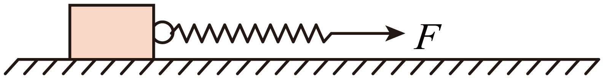

# Physics - 题目 2853

**ID**: d75804dd02584c1098cbf58133912877
**年级**: Grade 10
**难度**: Medium-Hard
**题型**: Calculation

## 题目
如图所示，一质量 $m=12.5{\rm{k}}{\rm{g}}$ 的物体放在水平地板上，用一原长 $l{{}_{0}}=18{\rm{c}}{\rm{m}}$ 的轻质弹簧水平拉该物体。​​​​​​​‌缓慢增大拉力，当物体刚开始运动时，弹簧的长度 $l{{}_{1}}=32{\rm{c}}{\rm{m}}$ ；当弹簧拉着物体匀速前进时，弹簧的长度 $l{{}_{2}}=30.5{\rm{c}}{\rm{m}}$ 。已知弹簧的劲度系数 $k=100{\rm{N}}/{\rm{m}}$ ，重力加速度的大小取 $g=10{\rm{m}}/{\rm{s}}{^{2}}$ ，求：(1)物体所受的最大静摩擦力的大小 $f{{}_{{\rm{m}}}}$ ；(2)物体所受的滑动摩擦力的大小 $f$ ；(3)物体与地板间的动摩擦因数 $μ$ 。

## 解答

1. （1）当物体刚开始被拉动时，弹簧的伸长量为
2. $\Delta x{{}_{1}}=l{{}_{1}}-l{{}_{0}}=14{\rm{c}}{\rm{m}}$
3. 根据胡克定律可得弹簧的弹力
4. $F{{}_{1}}=k\Delta x{{}_{1}}=100{\rm{N}}/{\rm{m}}\times {{0}}{{.}}{{1}}{{4}}{\rm{m}}=14{\rm{N}}$
5. 此时弹簧的弹力大小等于物体所受的最大静摩擦力，即
6. $f{{}_{{\rm{m}}}}=14{\rm{N}}$
7. （2）当物体匀速滑动时，弹簧的伸长量为
8. $\Delta x{{}_{2}}=l{{}_{2}}-l{{}_{0}}=12.5{\rm{c}}{\rm{m}}$
9. 根据胡克定律可得弹簧的弹力
10. $F{{}_{2}}=k\Delta x{{}_{2}}=100{\rm{N}}/{\rm{m}}\times 0.125{\rm{m}}=12.5{\rm{N}}$
11. 此时弹簧的弹力与物体所受的滑动摩擦力平衡，即
12. $f=12.5{\rm{N}}$
13. （3）由滑动摩擦力公式可得
14. $f=μF{{}_{{\rm{N}}}}={\rm μm}g$
15. 解得
16. $μ=0.1$

## 知识点

**中文**:
  - 弹力的大小与胡克定律
  - 滑动摩擦力的判断与计算

**English**:
  - Magnitude of Elastic Force and Hooke's Law
  - Determination and Calculation of Sliding Friction

---
