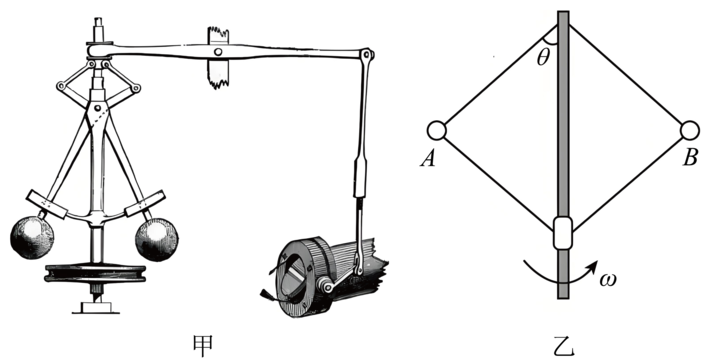

# Physics - 题目 1801

**ID**: dd6200ace3264b5287bfb400492d2ba4
**年级**: Grade 10
**难度**: Medium-Hard
**题型**: Calculation

## 题目
如图甲所示，英国工程师詹姆斯·瓦特于1788年为蒸汽机速度控制而设计的飞球调速器，其简化模型如图乙所示，它由两个质量为m的球A和B通过4根长为l的轻杆与竖直轴的上、下两个套筒用铰链连接。​​​​​​​‌上面套筒固定，下面套筒C可沿轴上下滑动，其质量也为m，整个装置可绕竖直轴转动。不计一切摩擦，重力加速度为g，轻杆与竖直轴之间的夹角记为θ。（1）当θ=60°，整个装置维持静止状态，需要给C多大的竖直向上的托力；（2）当θ=60°，整个装置绕竖直轴匀速转动，则此时ω为多大；（3）当整个装置绕竖直轴匀速转动， $ω=\sqrt {\frac {g}{l}}$ ，则此时θ为多大。

## 解答

1. （1）根据对称性可知，左右对称的轻杆的弹力大小相等，当θ=60°，对A进行分析，令上下轻杆弹力大小分别为 $T{{}_{1}}$ 、 $T{{}_{2}}$ ，根据平衡条件有 $T{{}_{1}}=T{{}_{2}}=mg$
2. 对C进行分析，根据平衡条件有 $F=mg+2T{{}_{2}}{\cos}θ$
3. 解得 $F=2mg$
4. （2）当θ=60°，整个装置绕竖直轴匀速转动，令上下轻杆弹力大小分别为 $T{{}_{3}}$ 、 $T{{}_{4}}$ ，对C进行分析，根据平衡条件有 $mg=2T{{}_{4}}{\cos}θ$
5. 对A进行分析有 $T{{}_{3}}{\cos}θ=mg+T{{}_{4}}{\cos}θ$ ， $T{{}_{3}}\sin θ+T{{}_{4}}\sin θ=mω{^{2}}l\sin θ$
6. 解得 $ω=2\sqrt {\frac {g}{l}}$
7. （3）当整个装置绕竖直轴匀速转动，且有 $ω{{}_{1}}=\sqrt {\frac {g}{l}}$
8. 令上下轻杆弹力大小分别为 $T{{}_{5}}$ 、 $T{{}_{6}}$ ，对C进行分析，根据平衡条件有 $mg=2T{{}_{6}}{\cos}θ{{}_{1}}$
9. 对A进行分析有 $T{{}_{5}}{\cos}θ{{}_{1}}=mg+T{{}_{6}}{\cos}θ{{}_{1}}$ ， $T{{}_{5}}\sin θ{{}_{1}}+T{{}_{6}}\sin θ{{}_{1}}=mω{^{2}}l\sin θ{{}_{1}}$
10. 解得 ${\cos}θ{{}_{1}}=2$
11. 可知，上述情景无解，表明A应靠竖直轴，即有 $θ=0{^{\circ }}$

## 知识点

**中文**:
  - 绳、杆类圆周运动问题

**English**:
  - String and Rod Circular Motion Problems

---
