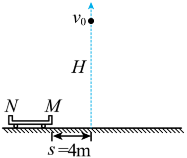

# Physics - 题目 2172

**ID**: e264519dcb1346f081951cf1b15b12b0
**年级**: Grade 10
**难度**: Medium-Hard
**题型**: Calculation

## 题目
如图所示，在离地面高H处以 $v{{}_{0}}=10{\rm{m}}{\rm{/}}{\rm{s}}$ 的速度竖直向上抛出一个可视为质点的小球，距离小球抛出点的正下方 $s=4{\rm{m}}$ 处有一辆长 $L{{}_{1}}=8{\rm{m}}$ 的静止小车，已知小球落地前最后1s内下落的高度为25m，忽略空气阻力及小车的高度，重力加速度g取 $10{\rm{m}}{\rm{/}}{\rm{s}}{^{{{2}}}}$ 。​​​​​​​‌(1)求小球抛出点离地面的高度H；(2)若小车在小球的左侧且M端距离小球抛出点的正下方 $s^{′}=18{\rm{m}}$ ，当小球抛出2s时，小车以 $v{{}_{0}}=10{\rm{m}}{\rm{/}}{\rm{s}}$ 的初速度向小球正下方做匀变速运动，为了避免小球砸到小车，求小车做匀变速运动加速度a的大小取值范围？

## 解答

1. （1）设小球从最高点下落至地面所用的时间为t，最大高度为h，则有 $h=\frac {1}{2}gt{^{2}}$ ， $h-25=\frac {1}{2}g{\left({t-1}\right)^{2}}$ ，解得 $t=3{\rm{s}}$ ， $h=45{\rm{m}}$ ，则小球抛出点离地面的高度为 $H=h-\frac {v{{}_{0}^{2}}}{2g}=\left ({45-\frac {10{^{2}}}{2\times 10}}\right ){\rm{m}}{\rm{=}}{{4}}{{0}}{\rm{m}}$
2. （2）若小车在小球的左侧且M端距离小球抛出点的正下方 $s^{′}=18{\rm{m}}$ ，当小球抛出2s时，小车以 $v{{}_{0}}=10{\rm{m}}{\rm{/}}{\rm{s}}$ 的初速度向小球正下方做匀变速运动，可知小球从抛出2s到下落至地面所用时间为 $t^{′}=\left ({4-2}\right ){\rm{s}}=2{\rm{s}}$ ，若小车做匀加速直线运动，当小球到达地面时，N端刚好到达小球正下方，则有 $L{{}_{1}}+s{^{^{′}}}=v{{}_{0}}t{^{^{′}}}+\frac {1}{2}a{{}_{1}}t{^{^{′}}}{^{2}}$ ，解得 $a{{}_{1}}=3{{\rm{m}}}/{{\rm{s}}}$ ，当小球到达地面时，若M端刚好到达小球正下方，则有 $s{^{^{′}}}=v{{}_{0}}t{^{^{′}}}+\frac {1}{2}a{{}_{2}}t{^{^{′}}}{^{2}}$ ，解得 $a{{}_{2}}=-1{{\rm{m}}}/{{\rm{s}}{^{{{2}}}}}$ ，当车加速时 $a>3{\rm{m}}/{\rm{s}}{^{2}}$ ，可避免小球砸到小车；当车减速时 $a>1{\rm{m}}/{\rm{s}}{^{2}}$ ，可避免小球砸到小车。

## 知识点

**中文**:
  - 自由落体运动和竖直上抛运动的相遇问题

**English**:
  - Encounter Problems: Free Fall and Vertical Throw

---
