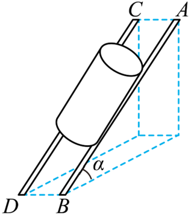

# Physics - 题目 2274

**ID**: e4a243252d9743e8a09317a74e27b459
**年级**: Grade 10
**难度**: Medium-Hard
**题型**: Calculation

## 题目
如图所示，两根直木棍AB和CD相互平行，斜靠在竖直墙壁上固定不动。​​​​​​​‌一个半径R=5cm、质量m=50kg的水泥圆筒从木棍的上部恰好能匀速滑下，已知两木棍间距d=6cm，与水平面的夹角 $α=37{}\degree $ 。（ $\sin 37\mathrm{°}=0.6$ ， ${\cos}37\mathrm{°}=0.8{\rm ，\mathit{g}}$ 取10m/s^{2}）。求：（1）每根直木棍对水泥圆筒的摩擦力；（2）水泥圆筒与直木棍的动摩擦因数；（3）将水泥圆筒沿直木棍匀速向上运动，所需最小拉力。（注： $\sin 2θ=2\sin θ{\cos}θ$ ）

## 解答

1. （1）从右侧视角分析，在沿斜坡方向根据平衡条件 $2f=mg\sin α$
2. 解得 $f=150{\rm{N}}$
3. 方向沿木棍向上
4. （1）由底部沿木棍向上看，受力关系如图所示
5. 
6. 图中θ角满足 $\sin θ=\frac {d}{2R}$
7. 解得 $θ=37{}\degree $
8. 根据平衡条件 $2N{\cos}θ=mg{\cos}α$
9. 解得 $N=250{\rm{N}}$
10. 所以动摩擦因数 $μ=\frac {f}{N}=0.6$
11. （3）从右侧视角受力分析，如图所示
12. 
13. 因木棍提供的支持力合成为 $2N{\cos}θ$ ，摩擦力合成为 $2f=2μN$
14. 这两个力的合力方向固定，图中β角满足 ${\tan}β=\frac {2f}{2N{\cos}θ}=\frac {μ}{{\cos}θ}=\frac {3}{4}$
15. $β=37{}\degree $
16. 现问题变为“物体受重力、木棍提供的力和拉力三力平衡，拉力最小值为多少”，根据力学平衡的矢量三角形得 $F{{}_{{\rm \min }}}=mg\sin 74{^{o}}$
17. 解得 $F{{}_{{\rm \min }}}=480{\rm{N}}$

## 知识点

**中文**:
  - 正交分解法与三角形定则在平衡问题中的应用

**English**:
  - Orthogonal Decomposition and Triangle Rule in Equilibrium

---
