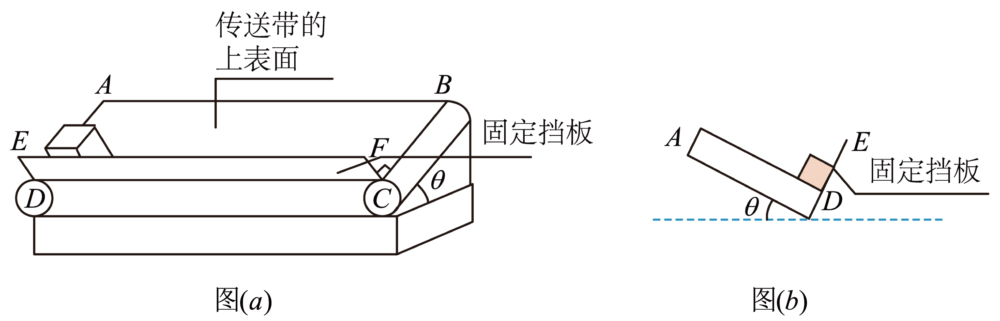

# Physics - 题目 446

**ID**: e6df5f34905241d8bf10cade4fe10e39
**年级**: Grade 10
**难度**: Medium-Hard
**题型**: Calculation

## 题目
图（a）为桃仙国际机场行李传送装置简化图，该装置由传送带 $ABCD$ 及固定挡板 $CDEF$ 组成，固定挡板与传送带上表面垂直，传送带上表面 $ABCD$ 与水平台面的夹角 $θ=37{}\degree $ 。​​​​​​​‌传送带匀速转动时，工作人员将正方体行李箱从 $D$ 点由静止释放，在运动 $L=10{\rm{m}}$ 后取下行李箱，行李箱运动时的剖面图如图（b）所示，已知传送带匀速运行的速度 $v=2{\rm{m}}/{\rm{s}}$ ，行李箱质量 $m=10{\rm{k}}{\rm{g}}$ ，其底部与传送带上表面 $ABCD$ 的动摩擦因数为 $μ{{}_{1}}=0.8125$ ，其侧面与挡板 $CDEF$ 的动摩擦因数为 $μ{{}_{2}}=0.25$ 。（重力加速度 $g=10{\rm{m}}/{\rm{s}}{^{2}},\sin 37{}\degree =0.6,{\cos}37{}\degree =0.8$ ，不计空气阻力）。(1)求加速过程传送带上表面对行李箱的摩擦力大小 $f{{}_{1}}$ 和挡板对行李箱的摩擦力大小 $f{{}_{2}}$ ；(2)行李箱在传送带上运动的时间 $t$ ；(3)若行李箱放到传送带上 $2{\rm{s}}$ 后，传送带由于故障以 $10{\rm{m}}/{\rm{s}}{^{2}}$ 的加速度做匀减速运动，直到行李箱停止后工作人员立即重启系统，然后传送带从静止以 $8{\rm{m}}/{\rm{s}}{^{2}}$ 的加速度加速至恢复正常，若已知行李箱相对传送带累计滑动超过 $55{\rm{c}}{\rm{m}}$ 就会在该表面形成明显破损，请通过计算判断全程行李箱与传送带接触的表面会不会产生明显破损。

## 解答

1. （1）上表面对行李箱的摩擦力
2. $f{{}_{1}}=μ{{}_{1}}mg{\cos}θ=65{\rm{N}}$
3. 挡板对行李箱的摩擦力
4. $f{{}_{2}}=μ{{}_{2}}mg\sin θ=15{\rm{N}}$
5. （2）对行李箱在传送带上由牛顿第二定律有
6. $f{{}_{1}}-f{{}_{2}}=ma{{}_{1}}$
7. 得
8. $a{{}_{1}}=5{\rm{m}}/{\rm{s}}{^{2}}$
9. 加速时间
10. $t{{}_{1}}=\frac {v}{a{{}_{1}}}=0.4{\rm{s}}$
11. 加速位移
12. $x{{}_{1}}=\frac {v}{2}t{{}_{1}}=0.4{\rm{m}}$
13. 余下时间
14. $t{{}_{2}}=\frac {L-x{{}_{1}}}{v}=4.8{\rm{s}}$
15. 总时间
16. $t=t{{}_{1}}+t{{}_{2}}=5.2{\rm{s}}$
17. （3）假设行李箱和传送带相对静止一起匀减速，需要的合外力
18. $F=ma{{}_{2}}=100{\rm{N}}$
19. 由于
20. $f{{}_{1}}+f{{}_{2}}=80{\rm{N}}<F$
21. 可知行李箱和传送带相对滑动。
22. 对行李箱
23. $f{{}_{1}}+f{{}_{2}}=ma{{}_{3}}$
24. 得
25. $a{{}_{3}}=8{\rm{m}}/{\rm{s}}{^{2}}$
26. 行李箱停下运动位移
27. $x{{}_{2}}=\frac {v{^{2}}}{2a{{}_{3}}}=0.25{\rm{m}}$
28. 传送带停下运动位移
29. $x{{}_{3}}=\frac {v{^{2}}}{2a{{}_{4}}}=0.2{\rm{m}}$
30. 行李箱相对于传送带向前滑动的距离
31. $Δx{{}_{1}}=x{{}_{2}}-x{{}_{3}}=0.05{\rm{m}}$
32. 由于再次启动时
33. $a{{}_{带}}>a{{}_{1}}$
34. 故传送带和行李箱发生相对滑动箱加速时间
35. $t{{}_{3}}=t{{}_{1}}=0.4{\rm{s}}$
36. 传送带加速时间
37. $t{{}_{4}}=\frac {v}{a{{}_{带}}}=0.25\,{\rm{s}}$
38. 行李箱运动位移
39. $x{{}_{4}}=x{{}_{1}}=0.4{\rm{m}}$
40. 传送带运动位移
41. $x{{}_{5}}=\frac {v}{2}t{{}_{4}}+v\left ({t{{}_{3}}-t{{}_{4}}}\right )=0.55\,{\rm{m}}$
42. 行李箱相对于传送带向后滑动的距离
43. $Δx{{}_{2}}=x{{}_{5}}-x{{}_{4}}=0.15{\rm{m}}$
44. 在发生故障前行李箱相对于传送带向后滑动的距离
45. $Δx{{}_{3}}=vt{{}_{1}}-x{{}_{1}}=0.4{\rm{m}}$
46. 行李箱相对传送带累计滑动距离
47. $Δx=Δx{{}_{1}}+Δx{{}_{2}}+Δx{{}_{3}}=0.6{\rm{m}}$
48. 由于
49. $Δx>55{\rm{c}}{\rm{m}}$
50. 故表面会产生明显破损

## 知识点

**中文**:
  - 传送带模型

**English**:
  - Conveyor Belt Model

---
