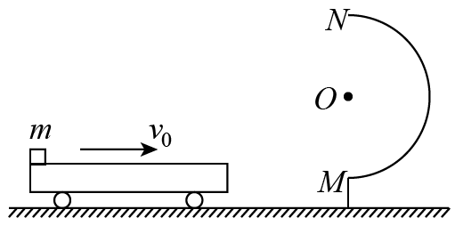

# Physics - 题目 334

**ID**: e7cbb9760e264a019239ca17df142311
**年级**: Grade 10
**难度**: Medium-Hard
**题型**: Calculation

## 题目
如图所示，将质量m=1.0kg的小物块放在长L=3.0m的平板车左端，车的上表面粗糙，物块与车上表面间的动摩擦因数μ=0.6，光滑半圆形固定轨道与光滑水平轨道在同一竖直平面内，直径MON竖直，车的上表面和轨道最低点高度相同，开始时车和物块一起以v_{0}=10m/s的初速度在水平轨道上向右运动，车碰到轨道后立即停止运动，取g=10m/s^{2}，求：（1）若半圆形轨道的直径d_{1}=2.4m，物块刚进入半圆形时对轨道的压力；（2）在（1）的情况下，物块回落至车上时距右端的距离；（3）若半圆形轨道的直径d_{2}=6.5m、平板车的质量M=1.5kg，物块再次回到小车的过程中产生的热量。​​​​​​​‌

## 解答

1. （1）车停止运动后取小物块为研究对象，设其到达车右端时的速度为v_{1}，由动能定理得 $-{\rm μm}gL{\rm{=}}\frac {1}{2}mv{{}_{{{1}}}^{{{2}}}}-\frac {1}{2}mv{{}_{{{0}}}^{{{2}}}}$ ，
2. 解得 $v{{}_{{{1}}}}={{8}}.0{\rm m}/{\rm s}$ ，
3. 刚进入半圆轨道时，设物块受到的支持力为F_{N}，由牛顿第二定律得 $F{{}_{{\rm{N}}}}-mg=\frac {2mv{{}_{1}^{2}}}{d}$ ，
4. 由牛顿第三定律得 $F{{}_{{\rm{N}}}}=-F{{}_{{\rm{N}}}}^{′}$ ，
5. 所以物块刚进入半圆形轨道时对轨道的压力为63.3N，方向竖直向下。
6. （2）若物块能到达半圆形轨道的最高点，则由机械能守恒可得 $\frac {1}{2}mv{{}_{{{1}}}}{^{{{2}}}}=\frac {1}{2}mv{{}_{{{2}}}}{^{{{2}}}}+mgd{{}_{{{1}}}}$ ，
7. 解得 $v{{}_{{{2}}}}={{4}}.0{\rm{m}}{\rm{/}}{\rm{s}}$ ，
8. 设恰能过最高点的速度为v_{3}，则 $mg{\rm{=}}\frac {2mv{{}_{3}^{2}}}{d{{}_{1}}}$ ，
9. 解得 $v{{}_{{{3}}}}=\sqrt {\frac {gd{{}_{1}}}{2}}=2\sqrt {3}{\rm{m}}{\rm{/}}{\rm{s}}$ ，
10. 因 $v{{}_{{{2}}}}>v{{}_{{{3}}}}$ ，故小物块从半圆形轨道最高点做平抛运动，设距车右端的水平距离为x，则 $x=v{{}_{2}}\sqrt {\frac {2d{{}_{1}}}{g}}$ ，
11. 解得 $x=\frac {8\sqrt {3}}{5}{\rm{m}}=2.8{\rm{m}}$ 。
12. （3）若轨道直径足够大，物块上升的最大高度 $H=\frac {v{{}_{2}}{^{2}}}{2g}=3.2{\rm{m}}<\frac {d{{}_{2}}}{2}$ ，
13. 则物块沿圆轨道返回，因固定轨道光滑，再次回到车右端时速度大小 $v{{}_{4}}=v{{}_{1}}=8.0{\rm{m}}{\rm{/}}{\rm{s}}$ ，
14. 在半圆形轨道上运动的初末速度大小相等，由能量守恒定律知，物块再次回到小车的过程中产生的热量等于在小车表面产生的热量  $Q{{}_{{\rm{f}}}}{\rm{=}}{\rm μm}gL{\rm{=}}{{1}}{{8}}{\rm{J}}$ 。

## 知识点

**中文**:
  - 板块模型中的能量守恒问题
  - 竖直面内圆周运动问题

**English**:
  - Energy Conservation in Plate Models
  - Circular Motion in Vertical Plane

---
