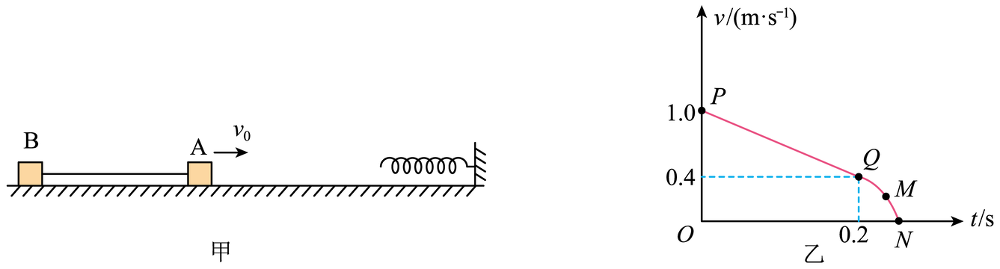

# Physics - 题目 1969

**ID**: ee02d714b93547c8a31fb1dd4bf00c3d
**年级**: Grade 10
**难度**: Medium-Hard
**题型**: Calculation

## 题目
如图甲，粗糙的水平地面右侧竖直墙壁上固定一轻弹簧，两不同材料、质量均为 $m=1.0{\rm{k}}{\rm{g}}$ 的物块 ${\rm{A}}、{\rm{B}}$ 用足够长的轻绳连接。​​​​​​​‌ $t=0$ 时刻开始， ${\rm{A}}、{\rm{B}}$ 一起以共同速度 $v{{}_{0}}=1.0{\rm{m}}/{\rm{s}}$ 向右运动，物块 ${\rm{B}}$ 的 $v-t$ 图线如图乙所示，其中 $PQ、MN$ 为直线， $QM$ 为曲线。已知 ${\rm{B}}$ 与地面的动摩擦因数为 $μ{{}_{2}}=0.4$ ，弹簧劲度系数 $k=200{\rm{N}}/{\rm{m}}$ ，重力加速度 $g=10{\rm{m}}/{\rm{s}}{^{2}}$ ，弹簧始终在弹性限度范围内，不计空气阻力， $\sqrt {34}\approx 5.8$ 。求：（1） ${\rm{B}}$ 在 $0\sim 0.2{\rm{s}}$ 内加速度的大小；（2）A与地面的动摩擦因数 $μ{{}_{1}}$ ；（3）乙图中 $M$ 点速度的大小；（4）弹簧的最大压缩量。

## 解答

1. （1）根据加速度的定义式以及图乙可得 ${\rm{B}}$ 在 $0\sim 0.2{\rm{s}}$ 内的加速度为 $a{{}_{1}}=\frac {Δv}{Δt}=\frac {0.4-1.0}{0.2}{\rm{m}}{\rm{/}}{\rm{s}}{^{2}}=-3{\rm{m}}{\rm{/}}{\rm{s}}{^{2}}$
2. 所以加速度的大小为 $a{{}_{1}}=3{\rm{m}}{\rm{/}}{\rm{s}}{^{{{2}}}}$ ，方向与运动方向相反。
3. （2）假设 ${\rm{A}}$ 、 ${\rm{B}}$ 间轻绳松弛，则对B列牛顿第二定律方程有 $μ{{}_{2}}mg=ma{{}_{2}}$
4. 解得 $a{{}_{2}}=μ{{}_{2}}g=4{\rm{m}}{\rm{/}}{\rm{s}}{^{{{2}}}}>3{\rm{m}}{\rm{/}}{\rm{s}}{^{{{2}}}}$
5. A、B间轻绳应该处于绷紧状态，A接触弹簧前A、B一起向右做匀减速直线运动。所以对A、B整体列牛顿第二定律方程有 $μ{{}_{2}}mg+μ{{}_{1}}mg=2ma{{}_{1}}$
6. 代入数据解得A与地面的动摩擦因数为 $μ{{}_{1}}=0.2$
7. （3）当A与弹簧接触后，若在某个瞬间轻绳松弛，则对B列牛顿第二定律方程有 $μ{{}_{2}}mg=ma$
8. 设此时弹簧的压缩量为 $x$ ，同理对A列牛顿第二定律方程有 $μ{{}_{1}}mg+kx=ma$
9. 联立解得 $x=0.01{\rm{m}}$
10. 即弹簧的压缩量为 $x=0.01{\rm{m}}$ 之前，A、B间的轻绳都处于绷紧状态。从 $Q$ 至 $M$ 的过程，对A、B整体列动能定理方程有 $-\left ({μ{{}_{1}}mg+μ{{}_{2}}mg}\right )x-\frac {0+kx}{2}x=\frac {1}{2}\cdot 2mv{{}_{M}^{2}}-\frac {1}{2}\cdot 2mv{{}_{Q}^{2}}$
11. 代入数据解得 $v{{}_{M}}=0.3{\rm{m}}{\rm{/}}{\rm{s}}$
12. （4）由分析可知弹簧的压缩量为 $x=0.01{\rm{m}}$ 之后，此后A、B向右运动的减速过程有 $a{{}_{{\rm{A}}}}>a{{}_{{\rm{B}}}}$
13. 所以之后A、B间轻绳松弛，A继续压缩弹簧直到A的速度减为0。设弹簧被继续压缩 $x{{}_{1}}$ 后A的速度减为0，则在此过程对A列动能定理方程有 $-μ{{}_{1}}mgx{{}_{1}}-\frac {kx+k\left ({x+x{{}_{1}}}\right )}{2}x{{}_{1}}=0-\frac {1}{2}mv{{}_{M}^{2}}$
14. 解得 $x{{}_{1}}=\left ({\frac {\sqrt {34}-4}{200}}\right ){\rm{m}}\approx 0.009\,{\rm{m}}$
15. 所以弹簧的最大压缩量为 $Δx=x+x{{}_{1}}\approx {{0}}{{.}}{{0}}{{1}}{{9}}{\rm{m}}$ 。

## 知识点

**中文**:
  - 应用动能定理求解与图像相关的动能问题
  - 应用动能定理求解多阶段、多过程问题

**English**:
  - Graph-related Kinetic Energy Problems
  - Multi-stage/Multi-process Problems

---
