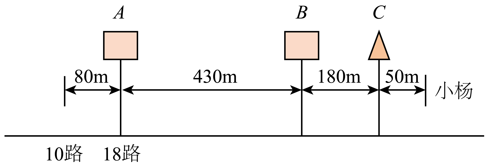

# Physics - 题目 797

**ID**: effce6e892fc4e15847050d9ca412811
**年级**: Grade 10
**难度**: Medium-Hard
**题型**: Calculation

## 题目
小杨同学每天都会乘坐10路公交车到万州二中上学，有一天他对乘车问题做了如下思考：假设在一条平直的道路上有两个红绿灯A、B，其中A、B间距L_{2}=430 m，C为公交车站台，10路车的停靠时间为8 s，18路公交车不停靠，B、C间距L_{3}=180 m。​​​​​​​‌两个灯都是绿灯持续10 s，红灯持续20 s，假设红绿灯切换不需要时间。有可视为质点的10路、18路两辆公交车行驶在路上依次经过A、B、C。两车加速时加速度大小均为a_{1}=2.5 m/s^{2}，减速时加速度大小均为a_{2}=5 m/s^{2}。当18路车以v_{0}=10m/s的速度走到A处时，10路车以同样速度v_{0}走到距离A处L_{1}=80 m的地方，此时A显示绿灯还有4 s，B显示红灯还剩1 s。当两车不能够匀速通过红绿灯时，就会匀减速运动刚好停到红绿灯处；绿灯亮起，公交车马上从静止做匀加速直线运动，加速到v_{0}保持匀速直线行驶。不计站台大小，试求：（1）10路公交车从A前80 m的地方运动到A所需要的时间；（2）10路、18路公交车在A、B之间的最大距离；（3）若小杨同学在距站台右侧50 m处看到18路车刚刚离开站台时，立刻先匀加速直线运动再匀减速直线运动最终到达站台时速度为零，试求小杨要赶上10路公交车，其加速度要满足什么条件？（设人加速和减速时加速度大小相同）

## 解答

1. （1）若10路车从A前50 m以 $v{{}_{0}}$ 匀速运动到A所需时间为 $t{{}_{匀}}=8{\rm{s}}>4{\rm{s}}$ ，所以10路车不能够匀速通过红绿灯，则在到达A之前做匀减速运动；刹车距离为 $x{{}_{1}}=\frac {v{{}_{0}^{2}}}{2a{{}_{2}}}=10{\rm{m}}$ ，刹车时间为 $t{{}_{1}}=\frac {v{{}_{0}}}{a{{}_{2}}}=2{\rm{s}}$ ，匀速时间为 $t^{′}=\frac {L{{}_{1}}-x{{}_{1}}}{v{{}_{0}}}=7{\rm{s}}$ ，解得10路车从A前50m的地方运动到A所需要的时间为 $t=t{{}_{1}}+t^{′}=9{\rm{s}}$ 。
2. （2）A变绿灯时，10路车开始做匀加速运动，此时18路车已到达离A灯的距离为 $x{{}_{0}}=v{{}_{0}}\left ({20+4}\right )=240{\rm{m}}$ ，当两车共速时距离最大，由 $a{{}_{1}}t{{}_{0}}=v{{}_{0}}$ ，解得 $t{{}_{0}}=4{\rm{s}}{\rm ，18}$ 车在4s时间内匀速前进的距离为 $x{{}_{匀}}=v{{}_{0}}t{{}_{0}}=40{\rm{m}}{\rm ，10}$ 车在4s时间内匀加速前进的距离为 $x{{}_{2}}=\frac {1}{2}a{{}_{2}}t{{}_{0}^{2}}=20{\rm{m}}$ ，所以甲、乙两车在A、B之间的最大距离为 $x{{}_{{\rm{m}}}}=x{{}_{0}}+x{{}_{匀}}-x{{}_{2}}=260{\rm{m}}$ 。
3. （3）对18路车，若从A到B为匀速直线运动， $t{{}_{2}}=\frac {L{{}_{2}}}{v{{}_{0}}}=43{\rm{s}}{\rm ，\mathit{B}}$ 灯显示绿灯结束时间 $t^{′}{{{}_{2}}}=1{\rm{s}}+10{\rm{s}}+20{\rm{s}}+10{\rm{s}}{\rm{=}}{{4}}{{1}}{\rm{s}}<43{\rm{s}}$ ，所以18路车不能够匀速通过B灯，则在到达B之前做匀减速运动；刹车距离为 $x{{}_{3}}=\frac {v{{}_{0}^{2}}}{2a{{}_{2}}}=10{\rm{m}}$ ，刹车时间为 $t{{}_{3}}=\frac {v{{}_{0}}}{a{{}_{2}}}=2{\rm{s}}$ ，匀速时间为 $t^{′}{{{}_{3}}}=\frac {L{{}_{2}}-x{{}_{3}}}{v{{}_{0}}}=42{\rm{s}}{\rm ，18}$ 路车从A灯到B灯的总时间为 $t{{}_{总}}=t{{}_{3}}+t^{′}{{{}_{3}}}=44{\rm{s}}$ ，所以18车会在B灯处等17s红灯，对10路车，A灯变绿灯后先匀加速所用时间为 $t{{}_{4}}=\frac {v{{}_{0}}}{a{{}_{1}}}=4{\rm{s}}$ ，加速位移为 $x{{}_{4}}=\frac {v{{}_{0}^{2}}}{2a{{}_{1}}}=20{\rm{m}}$ ，假设之后匀速通过B，则有 $t^{′}{{{}_{4}}}=\frac {L{{}_{2}}-x{{}_{3}}}{v{{}_{0}}}=41{\rm{s}}{\rm ，10}$ 路车从A灯到B灯的总时间为 $t^{′}{{{}_{总}}}=t{{}_{4}}+t^{′}{{{}_{4}}}=45{\rm{s}}$ ，在A灯处10路车比18路车滞后24s，A到B过程10路车比18路车慢1s，在B灯处18路车等17s后显示绿灯，所以10车在18车离开B灯 $T{{}_{1}}=24{\rm{s}}+1{\rm{s}}-17{\rm{s}}=8{\rm{s}}$ ，后到达B灯，此时B灯为绿灯10路车直接通过，所以两辆车通过B灯的时间差为8s，B灯到站台C：18路先加速后匀速，则有 $t{{}_{5}}=\frac {L{{}_{3}}-20}{v{{}_{0}}}+4{\rm{s}}{\rm{=}}{{2}}{{0}}{\rm{s}}{\rm ，\mathit{B}}$ 灯到站台C：10路先匀速后减速，则有 $t^{′}{{{}_{5}}}=\frac {L{{}_{3}}-10}{v{{}_{0}}}+2{\rm{s}}{\rm{=}}{{1}}{{9}}{\rm{s}}$ ，所以两辆车到达站台C的时间差为 $T{{}_{2}}=8{\rm{s}}+19{\rm{s}}-20{\rm{s}}=7{\rm{s}}$ ，根据题意得小杨到达站台时间不超过 $T{{}_{3}}=7{\rm{s}}+8{\rm{s}}=15{\rm{s}}$ ，由图可得 $d=\frac {1}{2}v{{}_{{\rm{m}}}}T{{}_{3}}=50{\rm{m}}$ ，解得 $v{{}_{{\rm{m}}}}=\frac {20}{3}{\rm{m}}/{\rm{s}}$ ，则加速度为 $a=\frac {v{{}_{{\rm{m}}}}}{\frac {T{{}_{3}}}{2}}=\frac {8}{9}{\rm{m}}/{\rm{s}}{^{2}}$ ，则加速度大于等于 $\frac {8}{9}{\rm{m}}/{\rm{s}}{^{2}}$ 。

## 知识点

**中文**:
  - 刹车问题

**English**:
  - Braking Problems

---
