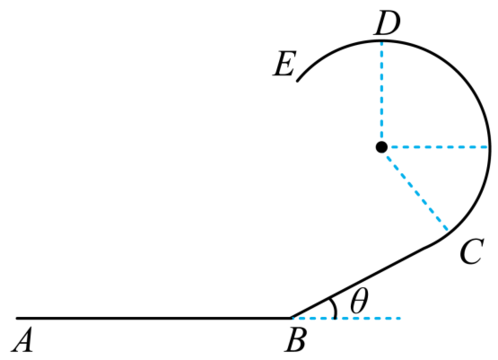

# Physics - 题目 242

**ID**: f12ce11040714eb58f43d3377ca8c2ec
**年级**: Grade 10
**难度**: Medium-Hard
**题型**: Calculation

## 题目
如图所示，某同学搭建的轨道，CDE为半径R=0.3m的光滑圆弧型轨道，C点与斜面BC相切，D点为轨道最高点，斜面倾角θ=30°，与水平轨道AB相交点B点附近用一段小圆弧平滑连接。​​​​​​​‌该同学用一辆质量m=0.2kg的玩具小车从A点由静止开始出发，先做匀加速直线运动到达B点时恰好达到额定功率，匀加速时间t=1s，此后再以恒定功率行驶到C点关闭玩具车电动机。已知玩具车在AB段受到恒定阻力f=0.2N，BC段、CDE段都不受阻力，AB段长为2m，BC段长为1.3m。试求：（1）玩具车在AB段的牵引力及额定功率P；（2）判断玩具车能否运动到D点。若能，则求一下对D点的压力；若不能则说明理由；（3）若小车行驶到B点时，突然出现了障，额定功率降为3W，发现玩具车到达C点前已经匀速，则求玩具车在BC段行驶的时间。

## 解答

1. （1）汽车在AB段做匀加速直线运动，有 $s{{}_{AB}}=\frac {1}{2}at{^{2}}$ ， $F-f=ma$
2. 联立可得 $F=1{\rm{N}}$
3. 玩具车到达B点时恰好达到额定功率，有 $v{{}_{B}}=at=4{\rm{m}}{\rm{/}}{\rm{s}}$ ， $P=Fv{{}_{B}}=4{\rm{W}}$
4. （2）玩具车在BC段保持功率恒定，准备爬坡时牵引力为 $F=1{\rm{N}}$ ，而不受阻力，重力的分力为 $mg\sin θ=F=1{\rm{N}}$
5. 在BC段玩具车做匀速直线运动，C点的速度为4m/s，假设玩具车能经过最高点D点，由动能定理有 $-mg(R+R{\cos}θ)=\frac {1}{2}mv{{}_{D}^{2}}-\frac {1}{2}mv{{}_{C}^{2}}$
6. 解得 $v{{}_{D}}=\sqrt {10-3\sqrt {3}}{\rm{m}}{\rm{/}}{\rm{s}}$
7. 若要安全过D点的最小速度满足只有重力提供向心力，有 $mg=m\frac {v{{}_{{\rm \min }}^{2}}}{R}$
8. 则可得 $v{{}_{{\rm \min }}}=\sqrt {gR}=\sqrt {3}{\rm{m}}{\rm{/}}{\rm{s}}$
9. $v{{}_{D}}>v{{}_{{\rm \min }}}$ ，可知玩具车能安全通过最高点D，由牛顿第二定律有 $mg+N{{}_{{\rm{D}}}}=m\frac {v{{}_{D}^{2}}}{R}$
10. 由牛顿第三定律有 $N{{}_{{\rm{D}}}}=N^{′}{{{}_{{\rm{D}}}}}$
11. 联立可得玩具车对D点的压力为 $N^{′}{{{}_{{\rm{D}}}}}=\frac {14-6\sqrt {3}}{3}{\rm{N}}$ 。
12. （3）玩具车从B点到C点保持功率为 $P{{}_{1}}=3{\rm{W}}$ 不变，设运动时间为 $t{{}_{1}}$ ，匀速的速度为 $v{{}_{1}}$ ，有 $P{{}_{1}}t{{}_{1}}-mg\sin θ\cdot s{{}_{BC}}=\frac {1}{2}mv{{}_{1}^{2}}-\frac {1}{2}mv{{}_{B}^{2}}$ ， $P{{}_{1}}=mg\sin θ\cdot v{{}_{1}}$
13. 联立可得 $t{{}_{1}}=\frac {1}{5}{\rm{s}}$

## 知识点

**中文**:
  - 应用动能定理求解变力做功问题
  - 应用动能定理求解多阶段、多过程问题

**English**:
  - Solving Work Done by Variable Force
  - Multi-stage/Multi-process Problems

---
