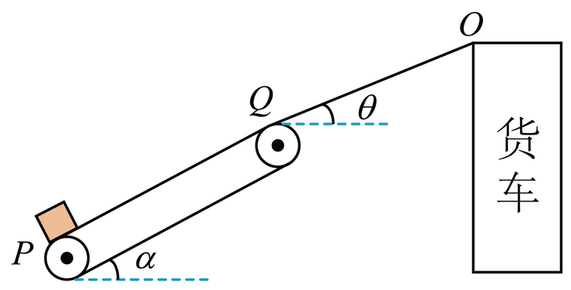

# Physics - 题目 1300

**ID**: f28e4e31381b492aa8ec6be00f9d4a00
**年级**: Grade 10
**难度**: Medium-Hard
**题型**: Calculation

## 题目
某跨境物流公司为提升出口效率，升级了装货装置。​​​​​​​‌如图所示，装货装置由倾角为α=37°的传送带PQ和倾角为 $θ=30\degree $ 的木板平滑地衔接，木板的另一端O点搭在货车上，已知传送带PQ长度 $l{{}_{1}}=20{\rm{m}}$ ，木板OQ长度 $l{{}_{2}}=\frac {16}{15}{\rm{m}}$ ，传送带以 $v{{}_{0}}=5.0{\rm{m}}{\rm{/}}{\rm{s}}$ 的速率顺时针匀速传动，将一个质量为m=5kg的包裹无初速度地放在传送带的底端P，经过一段时间包裹刚好被运送到货车上的O位置，包裹与木板之间的动摩擦因数 $μ=\frac {\sqrt {3}}{6}$ ， $\sin 37\degree =0.6$ ， ${\cos}37\degree =0.8$ 。重力加速度 $g=10{\rm{m}}{\rm{/}}{\rm{s}}{^{{{2}}}}$ ，求：（1）包裹运到传送带顶端Q的速度v_{Q}。（2）包裹与传送带之间的动摩擦因数 $μ^{′}$ 。（3）由于要传送包裹，电动机多消耗的电能。

## 解答

1. （1）包裹在木板上从Q到O过程中，沿木板方向匀减速，根据牛顿第二定律 $mg\sin θ+mg{\cos}θ=ma{{}_{2}}$
2. 由运动学公式 $0-v{{}_{Q}^{2}}=-2a{{}_{2}}l{{}_{2}}$
3. 联立得 $v{{}_{Q}}=4{\rm{m}}{\rm{/}}{\rm{s}}$
4. （2）由于 $v{{}_{Q}}=4{\rm{m}}{\rm{/}}{\rm{s}}<v{{}_{0}}=5{\rm{m}}{\rm{/}}{\rm{s}}$
5. 因此包裹在传送带上一直加速，由动能定理得 $μ^{′}mg{\cos}α\cdot l{{}_{1}}-mgl{{}_{1}}{\cos}\left ({90\degree -α}\right )=\frac {1}{2}mv{{}_{Q}^{2}}-0$
6. 解得 $μ^{′}=0.8$
7. （3）在传送包裹的过程中包裹增加的动能 $\vartriangle E{{}_{{\rm{k}}}}=\frac {1}{2}mv{{}_{Q}^{2}}-0$
8. 包裹增加的重力势能 $\vartriangle E{{}_{{\rm{p}}}}=mgl{{}_{1}}\sin α$
9. 包裹运动的时间为t，有 ${\overline{v}}=\frac {v{{}_{Q}}}{2}，{\overline{v}}t=l{{}_{1}}$
10. 解得t=10s
11. 系统产生的热量 $Q=μ^{′}mg\left ({v{{}_{0}}t-l{{}_{1}}}\right ){\cos}α$
12. 电动机多消耗的电能 ${\rm{Δ}}E={\rm{Δ}}E{{}_{{\rm{k}}}}+{\rm{Δ}}E{{}_{{\rm{p}}}}+Q$
13. 解得 $ΔE=1600{\rm{J}}$

## 知识点

**中文**:
  - 传送带模型中的能量守恒问题

**English**:
  - Energy Conservation in Conveyor Belt Models

---
