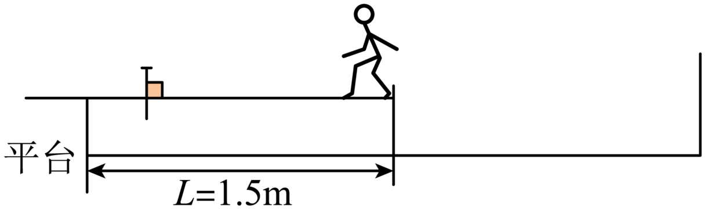

# Physics - 题目 1393

**ID**: f350dfa37c97463a81d17c6191e6a6a7
**年级**: Grade 10
**难度**: Medium-Hard
**题型**: Calculation

## 题目
在一档综艺节目中，有一项娱乐比赛项目，其规则如下：在光滑水平地面上有一个长为L=1.5m、质量为M=40kg的木板。​​​​​​​‌距木板左侧某处固定了一个销钉，紧挨着销钉的右侧放置了一个质量为m=60kg的金属块（金属块和销钉不会干扰参赛者在木板上的运动）。木板紧靠在平台的右侧（木板与平台等高），距离木板右侧较远处有一竖直墙壁。质量为 $m{{}_{0}}=50{\rm kg}$ 的参赛者由木板右端由静止出发，走到木板最左侧处停止，随后与水平面成 $θ$ 角的初速度跳离木板落在平台上，如果金属块最终没有从木板上滑落，即为比赛胜利。已知金属块与木板间的动摩擦因数 $μ=0.1$ ，参赛者、金属块和销钉均可视为质点，木板与墙壁碰撞视为弹性碰撞，重力加速度g取10m/s²。（1）求参赛者在起跳前距离平台的水平距离；（2）求参赛者至少以多大的速度从木板上跳出，才能安全落在平台上，以及 $θ$ 角的大小；（3）在参赛者以做最小功的方式跳出并安全落在平台后，最终金属块未掉落，求金属块与木板间的相对位移。

## 解答

1. （1）参赛者在木板上运动过程动量守恒，有 $m{{}_{0}}v{{}_{0}}=\left ({M+m}\right )v$
2. 将等式两边同时乘以较小的时间间隔 $Δt$ ，设参赛者的位移为 $x{{}_{人}}$ ，板的位移为 $x{{}_{板}}$ ， $m{{}_{0}}x{{}_{人}}=\left ({M+m}\right )x{{}_{板}}$
3. 其中 $x{{}_{人}}+x{{}_{板}}=L$
4. 解得 $x{{}_{板}}=0.5{\rm{m}}$
5. 参赛者起跳前距离平台的距离为 $x=x{{}_{板}}=0.5{\rm{m}}$
6. （2）参赛者起跳的速度为 $v$ ，根据斜抛运动规律可知水平方向有 $v{\rm{c}}{\rm{o}}{\rm{s}}θ\cdot t=x$
7. 竖直方向有 $t=\frac {2v{\rm{s}}{\rm{i}}{\rm{n}}θ}{g}$
8. 解得 $v=\sqrt {\frac {gx}{2{\rm{s}}{\rm{i}}{\rm{n}}θ\cdot {\rm{c}}{\rm{o}}{\rm{s}}θ}}=\sqrt {\frac {gx}{{\rm{s}}{\rm{i}}{\rm{n}}2θ}}$
9. 当 $θ=45{}\degree $ 时， $v$ 最小，解得 $v=\sqrt {5}{\rm{m}}/{\rm{s}}$
10. （3）人跳出时系统水平方向动量守恒有 $m{{}_{0}}v{\rm{c}}{\rm{o}}{\rm{s}}θ=\left ({M+m}\right )v^{′}$
11. 根据能量守恒可得，参赛者做的功为 $W=\frac {1}{2}m{{}_{0}}v{^{2}}+\frac {1}{2}\left ({m+M}\right )v^{′}{^{2}}$
12. 联立解得 $W=\frac {125}{4}·\frac {2+{\rm{c}}{\rm{o}}{\rm{s}}{^{2}}θ}{{\rm{s}}{\rm{i}}{\rm{n}}θ\cdot {\rm{c}}{\rm{o}}{\rm{s}}θ}=\frac {125}{4}\left ({2{\rm{t}}{\rm{a}}{\rm{n}}θ+\frac {3}{{\rm{t}}{\rm{a}}{\rm{n}}θ}}\right )$
13. 当 $2{\rm{t}}{\rm{a}}{\rm{n}}θ=\frac {3}{{\rm{t}}{\rm{a}}{\rm{n}}θ}$ 时， $W$ 有最小值，解得 ${\rm{t}}{\rm{a}}{\rm{n}}θ=\sqrt {\frac {3}{2}}$ , $\left ({{\rm{s}}{\rm{i}}{\rm{n}}θ=\sqrt {\frac {3}{5}},{\rm{c}}{\rm{o}}{\rm{s}}θ=\sqrt {\frac {2}{5}}}\right )$
14. 最终金属块和木板相对静止且停在水平面上，动能转化为热量有 ${\rm μm}g{\rm{Δ}}x=\frac {1}{2}\left ({m+M}\right )v^{′}{^{2}}$
15. 解得 $Δx=\frac {25\sqrt {6}}{144}{\rm{m}}$ ‍。

## 知识点

**中文**:
  - 人船模型
  - 斜抛运动

**English**:
  - Man-Boat Model
  - Oblique Projectile Motion

---
