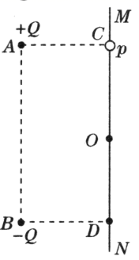

# Physics - 题目 2131

**ID**: f6d3803da49d48c7bcffd80c400d134b
**年级**: Grade 10
**难度**: Medium-Hard
**题型**: Calculation

## 题目
如图所示，固定于同一条竖直线上的 ${\rm{A}}$ 、 ${\rm{B}}$ 是两个带等量异种电荷的点电荷，电荷量分别为 $+Q$ 和 $-Q$ ， $A$ 、 $B$ 相距为 $2d$ 。​​​​​​​‌ $MN$ 是竖直放置的光滑绝缘细杆，另有一个穿过细杆的带电小球 $p$ ，质量为 $m$ 、电荷量为 $+q$ （可视为点电荷，不影响电场的分布），现将小球 $p$ 从与点电荷 $A$ 等高的 $C$ 处由静止开始释放，小球 $p$ 向下运动到与 $C$ 点距离为 $d$ 的 $O$ 点时，速度为 $v$ 。已知 $MN$ 与 $AB$ 之间的距离为 $d$ ，静电力常量为 $k$ ，重力加速度为 $g$ 。（重力不可以忽略）求：(1) $C$ 、 $O$ 间的电势差 $U{{}_{CO}}$ 。(2) $O$ 点处的电场强度 $E$ 的大小。(3)小球 $p$ 经过与点电荷 $B$ 等高的 $D$ 点时的速度。

## 解答

1. (1)小球 $p$ 由 $C$ 点运动到 $O$ 点的过程，由动能定理得
2. $mgd+qU{{}_{CO}}=\frac {1}{2}mv{^{2}}-0$
3. 所以
4. $U{{}_{CO}}=\frac {mv{^{2}}-2mgd}{2q}$
5. (2)小球 $p$ 经过 $O$ 点时受力如图所示
6. 
7. 由库仑定律得
8. $F{{}_{1}}=F{{}_{2}}=k\frac {Qq}{{\left({\sqrt {2}d}\right)^{2}}}$
9. 它们的合力为
10. $F=F{{}_{1}}{\cos}45{}^\circ +F{{}_{2}}{\cos}45{}^\circ =\frac {\sqrt {2}kQq}{2d{^{2}}}$
11. 所以 $O$ 点处的电场强度大小
12. $E=\frac {F}{q}=\frac {\sqrt {2}kQ}{2d{^{2}}}$
13. (3)小球 $p$ 由 $O$ 点运动到 $D$ 点的过程中，由动能定理得
14. $mgd+qU{{}_{OD}}=\frac {1}{2}mv{{}_{D}^{2}}-\frac {1}{2}mv{^{2}}$
15. 由电场特点可知
16. $U{{}_{CO}}=U{{}_{OD}}$
17. 解得 $v{{}_{D}}=\sqrt {2}v$ 。

## 知识点

**中文**:
  - 带电粒子（物体）在重力场和电场组成的复合场中的运动

**English**:
  - Motion in Gravity and Electric Composite Fields

---
