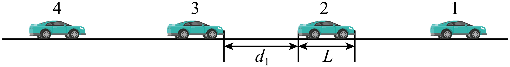

# Physics - 题目 1294

**ID**: f9f40b590a774987ab0261e04b67b66e
**年级**: Grade 10
**难度**: Medium-Hard
**题型**: Calculation

## 题目
如图所示，在一平直的单向单车道上有一车队正在以速度 $v{{}_{0}}=10{\rm{m}}{\rm{/}}{\rm{s}}$ 匀速行驶，从前往后依次编号1、2、3…….​​​​​​​‌每辆车车长均为 $L=5{\rm{m}}$ ，相邻车间距离为 $d{{}_{1}}=10{\rm{m}}$ ， $t=0$ 时刻1号车突发故障，以大小为 $a{{}_{1}}=5{\rm{m}}{\rm{/}}{\rm{s}}{^{2}}$ 的加速度匀减速刹车，后面的车都是在看到前一辆车开始刹车 $Δt{{}_{1}}=0.8{\rm{s}}$ 后也开始匀减速刹车，最后停下时和前车的距离均为 $d{{}_{2}}=1{\rm{m}}$ .（1）求 $t=0.5{\rm{s}}$ 时1号车和2号车之间的距离；（2）求3号车刹车的加速度大小；（3）求 $t=60{\rm{s}}$ 时停止的车队长度（1号车车头和最后一辆车车尾的距离）.

## 解答

1. （1）1号车开始刹车后的 $0.5{\rm{s}}$ 内，1号车和2号车的位移分别为 $x{{}_{1}}=v{{}_{0}}t-\frac {1}{2}a{{}_{1}}t{^{2}}=\left ({10\times 0.5-\frac {1}{2}\times 5\times 0.5{^{2}}}\right ){\rm{m}}=4.375{\rm{m}}$
2. $x{{}_{2}}=v{{}_{0}}t=10\times 0.5{\rm{m}}=5{\rm{m}}$  $t=0.5{\rm{s}}$ 时1号车和2号车之间的距离为 $d=x{{}_{1}}+d{{}_{1}}-x{{}_{2}}=9.375{\rm{m}}$
3. （2）设2号车刹车的加速度大小为 $a{{}_{2}}$ ，有 $d{{}_{2}}=\frac {v{{}_{0}^{2}}}{2a{{}_{1}}}+d{{}_{1}}-\left ({v{{}_{0}}{\rm{Δ}}t{{}_{1}}+\frac {v{{}_{0}^{2}}}{2a{{}_{2}}}}\right )$
4. 求得 $a{{}_{2}}=\frac {50}{11}{{\rm{m}}}/{{\rm{s}}}{^{2}}$
5. 设3号车刹车的加速度大小为 $a{{}_{3}}$ ，有 $d{{}_{2}}=\frac {v{{}_{0}^{2}}}{2a{{}_{2}}}+d{{}_{1}}-\left ({v{{}_{0}}{\rm{Δ}}t{{}_{1}}+\frac {v{{}_{0}^{2}}}{2a{{}_{3}}}}\right )$
6. 求得 $a{{}_{3}}=\frac {25}{6}{{\rm{m}}}/{{\rm{s}}}{^{2}}$
7. （3）设n号车刹车的加速度大小为 $a{{}_{n}}$ ，则 $d{{}_{2}}=\frac {v{{}_{0}^{2}}}{2a{{}_{n-1}}}+d{{}_{1}}-\left ({v{{}_{0}}{\rm{Δ}}t{{}_{1}}+\frac {v{{}_{0}^{2}}}{2a{{}_{n}}}}\right )$
8. 求得 $\frac {1}{a{{}_{n}}}-\frac {1}{a{{}_{n-1}}}=\frac {1}{50}{{\rm{s}}{^{2}}}/{{\rm{m}}}$
9. 即数列 $\left \{\frac {1}{a{{}_{n}}}\right \}$ 是一个首项为 $\frac {1}{a{{}_{1}}}=\frac {1}{5}{{\rm{s}}{^{2}}}/{{\rm{m}}}$ ，公差为 $d{^{^{′}}}=\frac {1}{50}{{\rm{s}}{^{2}}}/{{\rm{m}}}$ 的等差数列，故 $\frac {1}{a{{}_{n}}}=\frac {1}{a{{}_{1}}}+\left ({n-1}\right )d^{′}=\frac {n+9}{50}{\rm{s}}{^{2}}/{\rm{m}}$
10. 故每辆车从开始刹车到停止所需的时间为 $t{{}_{n}}=\frac {v{{}_{0}}}{a{{}_{n}}}=\frac {n+9}{5}{\rm{s}}$
11. 即每辆车从开始刹车到停止所需时间均比前一辆车多 $0.2{\rm{s}}$ ，故从第一辆车开始刹车到第n辆车停止所用的总时间为 $\hspace{-0.5em}\begin{array}{l}t{{}_{总}}=2+\left [\left ({0.8+0.2}\right )\left ({n-1}\right )\right ]{\rm{s}}&\;\end{array}\hspace{-0.5em}$
12. 令 $t{{}_{总}}=60{\rm{s}}$ ，求得 $n=59$
13. 故 $t=60{\rm{s}}$ 时停止的车队长度为 $l=59L+58d{{}_{2}}=\left ({59\times 5+58\times 1}\right ){\rm{m}}=353{\rm{m}}$

## 知识点

**中文**:
  - 刹车问题

**English**:
  - Braking Problems

---
