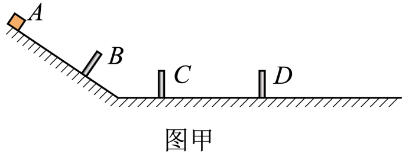

# Physics - 题目 696

**ID**: fccd12e4c23b4aedaa0b24653bb088ac
**年级**: Grade 10
**难度**: Medium-Hard
**题型**: Calculation

## 题目
某研究小组，利用一个斜面和一段水平地面来研究物体做匀变速直线运动的规律，将测量数据记录在表格之中，将小物体从斜面的顶端A点由静止释放，以后小物块每运动 $s=1{\rm{m}}$ 的路程放置一个光电门B、C、D，如图甲所示，已知小物块上装有宽度为 $d=2{\rm{c}}{\rm{m}}$ 的遮光条，小物块通过各光电门的时间如表中所示，小物块通过斜面与水平面连接处时速度大小不变，试回答如下问题：（1）计算小物块通过光电门B、C、D的平均速度大小 $v{{}_{B}}$ 、 $v{{}_{C}}$ 、 $v{{}_{D}}$ ；研究小组将这三个平均速度作为B、C、D三点的瞬时速度，合理吗？（2）求小物块在斜面上加速度 $a{{}_{1}}$ 的大小在水平面上加速度 $a{{}_{2}}$ 的大小；（3）求斜面的长度L（结果保留3位有效数字）。​​​​​​​‌光电门BCD$Δt/{\rm{s}}$$0.01$$0.008$$0.02$

## 解答

1. （1）小物块通过各光电门的平均速度 $v{{}_{B}}=\frac {d}{t{{}_{B}}}=\frac {2\times 10{^{-2}}}{0.01}{\rm{m}}{\rm{/}}{\rm{s}}=2.0{\rm{m}}{\rm{/}}{\rm{s}}$ ， $v{{}_{C}}=\frac {d}{t{{}_{C}}}=\frac {2\times 10{^{-2}}}{0.008}{\rm{m}}{\rm{/}}{\rm{s}}=2.5{\rm{m}}{\rm{/}}{\rm{s}}$ ， $v{{}_{D}}=\frac {d}{t{{}_{D}}}=\frac {2\times 10{^{-2}}}{0.02}{\rm{m}}{\rm{/}}{\rm{s}}=1.0{\rm{m}}{\rm{/}}{\rm{s}}$ ，极短时间内的平均速度等于瞬时速度，将三个平均速度看作过B、C、D三点的瞬时速度是合理的。
2. （2）小物块由A到B做匀加速直线运动，则 $v{{}_{B}^{2}}-v{{}_{A}^{2}}=2a{{}_{1}}s$ ，可得 $a{{}_{1}}=2.0{\rm{m}}{\rm{/}}{\rm{s}}{^{{\rm{2}}}}$ ，小物块由C到D做匀减速直线运动 $v{{}_{D}^{2}}-v{{}_{C}^{2}}=2a{{}_{2}}s$ ，可得 $a{{}_{2}}=-2.625{\rm{m}}{\rm{/}}{\rm{s}}{^{{\rm{2}}}}$ ，故加速度 $a{{}_{2}}$ 的大小为 $2.625{\rm{m}}{\rm{/}}{\rm{s}}{^{{\rm{2}}}}$ 。
3. （3）设斜面底端的速度为v，则有 $\frac {v{^{2}}-v{{}_{B}^{2}}}{2a{{}_{1}}}+\frac {v{{}_{C}^{2}}-v{^{2}}}{2a{{}_{2}}}=1{\rm{m}}$ ，解得 $v=\sqrt {\frac {268}{37}}{\rm{m}}{\rm{/}}{\rm{s}}$ ，斜面长为 $L=s{{}_{AB}}+\frac {v{^{2}}-v{{}_{B}}{^{2}}}{2a{{}_{1}}}=\frac {67}{37}{\rm{m}}{\rm{=}}{\rm{1}}{\rm{.}}{\rm{8}}{\rm{1}}{\rm{m}}$ 。

## 知识点

**中文**:
  - 匀变速直线运动的速度—位移公式及其应用

**English**:
  - Velocity-Displacement Formula and Applications

---
