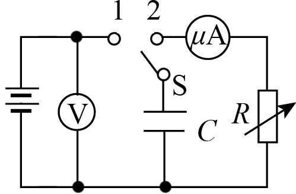

# Physics - 题目 1197

**ID**: 0c0fb5b239a54676b08a8617e3764189
**年级**: Grade 10
**难度**: Medium-Hard
**题型**: Experiment

## 题目
某同学利用图所示的实验电路测量平行板电容器的电容。​​​​​​​‌（1）用欧姆表直接连接待测电容两端，观察到指针的偏转情况是；

## 解答

1. （1）[1]欧姆表测电阻的原理是通过测量流过电阻的电流大小来间接反映其电阻大小，用欧姆表直接连接待测电容两端，表内部电源给电容器充电，在开始时电流较大，所以指针的偏转角度很大，随着电容器所带电荷量不断增大，充电电流逐渐减小，所以指针的偏转角度逐渐减小，综上所述可知D正确。
2. 故选D。
3. （2）[2]对电容器进行充电时，电容器两端应与电源两端相接，所以开关S接通1。
4. （3）[3]如图所示。
5. 
6. （4）[4]I-t图线与t轴所围的面积表示电容器充满电时所带电荷量，即
7. Q≈34×25×10^{-}^{6}×5C=4.25×10^{-}^{3}C
8. 根据电容的定义式可得
9. $C=\frac {Q}{U{{}_{0}}}\approx 1.5\times 10{^{-3}}{\rm{F}}$

## 知识点

**中文**:
  - 电容器的充放电过程及其动态分析

**English**:
  - Capacitor Charge/Discharge and Dynamic Analysis

---
