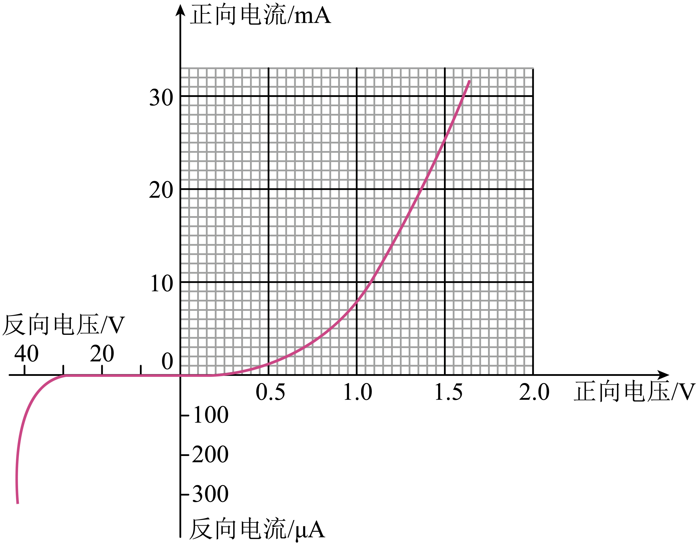

# Physics - 题目 2953

**ID**: 10a223c4b450421f8d4af5c73f57a8f5
**年级**: Grade 10
**难度**: Medium-Hard
**题型**: Experiment

## 题目
二极管具有单向导电性。​​​​​​​‌某同学测绘的某二极管的伏安特性曲线如图所示。实验中可供选择的器材有

## 解答

1. [1][2]二极管具有单向导电性，根据绘制的二极管加正向电压的伏安特性曲线可知，电源应选电源电压为2V的A，电流表应选量程0~30mA的E。
2. [3]因电压表内阻远大于二极管的正向电阻，则采用电流表外接法；滑动变阻器采用分压式接法，则实验时应选择甲电路。

## 知识点

**中文**:
  - 伏安特性曲线

**English**:
  - Volt-Ampere Characteristic Curve

---
