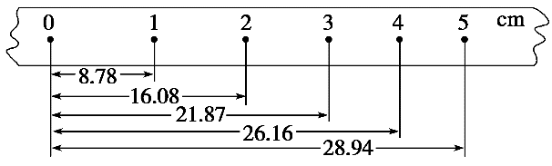

# Physics - 题目 2568

**ID**: 367aaf5d0f9f4056863f1d2702e7e0de
**年级**: Grade 10
**难度**: Medium-Hard
**题型**: Experiment

## 题目
在测定匀变速直线运动的加速度的实验中，用打点计时器记录纸带运动的时间，计时器所用电源的频率为50Hz，如图所示为小车带动的纸带上记录的一些点，在每相邻的两点之间都有四个点未画出．按时间顺序取0、1、2、3、4、5六个点，用米尺量出1、2、3、4、5点到0点的距离如图所示．(1)当打第3个计数点时，小车的速度为(2)若小车做匀变速直线运动，小车的加速度为．​​​​​​​‌

## 解答

1. (1)[1]利用匀变速直线运动的中间时刻的瞬时速度等于这一段时间内的平均速度，则小车在第3个计数点时的速度为：
2. $v{{}_{3}}=\frac {x{{}_{24}}}{t{{}_{24}}}=\frac {0.2616-0.1608}{2\times 0.1}{\rm{m}}{\rm{/}}{\rm{s}}=0.504{\rm{m}}{\rm{/}}{\rm{s}}$
3. (2)[2]根据“逐差法”可以求出加速度的大小，得：
4. $a=\frac {x{{}_{35}}-x{{}_{13}}}{(2T){^{2}}}=\frac {(0.2894-0.2187)-(0.2187-0.0878)}{(2\times 0.1){^{2}}}{\rm{m}}{\rm{/}}{\rm{s}}{^{{\rm{2}}}}=-1.5{\rm{m}}{\rm{/}}{\rm{s}}{^{{\rm{2}}}}$
5. 负号表示加速度方向与初速度方向相反，加速度为： $-1.5{\rm{m}}{\rm{/}}{\rm{s}}{^{{\rm{2}}}}$ ．

## 知识点

**中文**:
  - 匀变速直线运动

**English**:
  - Uniformly Variable Rectilinear Motion

---
