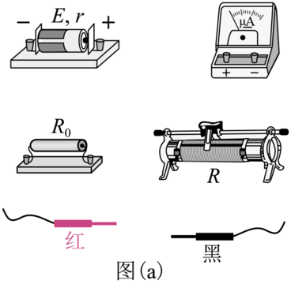
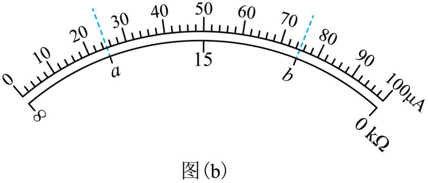
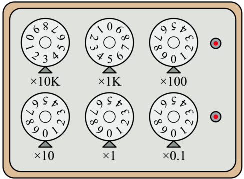

# Physics - 题目 2468

**ID**: 46c4f92dca9e490cbcd25b81ec049d44
**年级**: Grade 10
**难度**: Medium-Hard
**题型**: Experiment

## 题目
某同学欲将内阻为98.​​​​​​​‌5Ω、量程为100uA的电流表改装成欧姆表并进行刻度和校准，要求改装后欧姆表的15kΩ刻度正好对应电流表表盘的50uA刻度．可选用的器材还有：定值电阻R_{0}（阻值14kΩ），滑动变阻器R_{1}（最大阻值1500Ω），滑动变阻器R_{2}（最大阻值500Ω），电阻箱（0~99999.9Ω），干电池（E=1.5V，r=1.5Ω），红、黑表笔和导线若干．（1）欧姆表设计将图（a）中的实物连线组成欧姆表．(            )欧姆表改装好后，滑动变阻器R接入电路的电阻应为Ω：滑动变阻器选（填“R_{1}”或“R_{2}”）．（2）刻度欧姆表表盘通过计算，对整个表盘进行电阻刻度，如图（b）所示．表盘上a、b处的电流刻度分别为25和75，则a、b处的电阻刻度分别为、．（3）校准红、黑表笔短接，调节滑动变阻器，使欧姆表指针指向kΩ处；将红、黑表笔与电阻箱连接，记录多组电阻箱接入电路的电阻值及欧姆表上对应的测量值，完成校准数据测量．若校准某刻度时，电阻箱旋钮位置如图（c）所示，则电阻箱接入的阻值为Ω．

## 解答

1. （1）连线如图：
2. 
3. 根据欧姆表的改装原理，当电流计满偏时，则 $I{{}_{g}}=\frac {E}{r+R{{}_{0}}+R+R{{}_{g}}}$ ，解得R=900Ω；为了滑动变阻器的安全，则滑动变阻器选择R_{1}；
4. （2）在a处，  $\frac {1}{4}I{{}_{g}}=\frac {E}{r+R{{}_{0}}+R{{}_{g}}+R{{}_{xa}}}$ ，解得R_{xa}=45kΩ；
5. 在b处，则 $\frac {3}{4}I{{}_{g}}=\frac {E}{r+R{{}_{0}}+R{{}_{g}}+R{{}_{xb}}}$ ，解得R_{xb}=5kΩ；
6. （3）校准：红黑表笔短接，调节滑动变阻器，使欧姆表指针指到0 kΩ处；由图可知，电阻箱接入的电阻为：R=35000.0Ω．

## 知识点

**中文**:
  - 多用电表的使用

**English**:
  - Use of Multimeter

---
