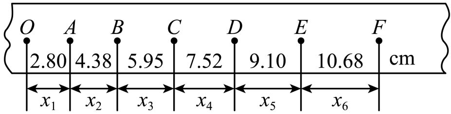

# Physics - 题目 2647

**ID**: 519663b4acb34b43bbb7e2d09f90bf05
**年级**: Grade 10
**难度**: Medium-Hard
**题型**: Experiment

## 题目
如图所示是某同学测量匀变速直线运动的加速度时，从若干纸带中选中的一条纸带的一部分，他每隔4个点取一个计数点，图中注明了他对各计数点间距离的测量结果。​​​​​​​‌所接电源是频率为50 Hz的交变电源。(1)为了验证小车的运动是匀变速运动，请进行下列计算，并填入下表内。（单位：cm）x_{2}－x_{1}x_{3}－x_{2}x_{4}－x_{3}x_{5}－x_{4}x_{6}－x_{5}1.581.57由此可以得出结论：小车的运动是。(2)两个相邻计数点间的时间间隔Δt＝s。(3)小车的加速度的计算式a＝，加速度a＝m/s^{2}（结果保留三位有效数字）。(4)计算打计数点B时小车的速度v_{B}＝m/s（结果保留三位有效数字）。

## 解答

1. （1）[1]第四段 $x{{}_{4}}$ 和第三段 $x{{}_{3}}$ 之差
2. $x{{}_{4}}-x{{}_{3}}=1.57{\rm{c}}{\rm{m}}$ 。
3. [2] 第五段段 $x{{}_{5}}$ 和第四段 $x{{}_{4}}$ 之差
4. $x{{}_{5}}-x{{}_{4}}=1.58{\rm{c}}{\rm{m}}$ 。
5. [3] 第六段 $x{{}_{6}}$ 和第五段 $x{{}_{5}}$ 之差
6. $x{{}_{6}}-x{{}_{5}}=1.58{\rm{c}}{\rm{m}}$ 。
7. [4]第二段 $x{{}_{2}}$ 和第一段 $x{{}_{1}}$ 之差
8. $x{{}_{2}}-x{{}_{1}}=1.58{\rm{c}}{\rm{m}}$
9. 第三段 $x{{}_{3}}$ 和第二段 $x{{}_{2}}$ 之差
10. $x{{}_{3}}-x{{}_{2}}=1.57{\rm{c}}{\rm{m}}$
11. 数据分析可知，在误差允许范围内相邻相等时间内的位移差相等，因此可以得出结论：小车的运动是匀变速直线运动。
12. （2）[5]该打点计时器所接的电源是频率为50 Hz的交变电源，相邻两个点之间的时间间隔为0.02s，纸带上每隔4个点取一个计数点，即两个相邻计数点间的时间间隔
13. $Δt=5\times 0.02{\rm{s}}=0.1{\rm{s}}$ 。
14. (3)[6] 根据
15. $Δx=aT{^{2}}$
16. 运用逐差法得
17. $a=\frac {\hspace{-0.5em}\begin{array}{l}\left ({x{{}_{4}}+x{{}_{5}}+x{{}_{6}}}\right )-\left ({x{{}_{1}}+x{{}_{2}}+x{{}_{3}}}\right )\end{array}\hspace{-0.5em}}{9\Delta t{^{2}}}$ 。
18. [7] 带入数据
19. $a=\frac {\hspace{-0.5em}\begin{array}{l}\hspace{-0.5em}\begin{array}{l}\left ({7.57+9.10+10.71-2.80-4.40-5.95}\right )\times 10{^{-2}}\end{array}\hspace{-0.5em}\end{array}\hspace{-0.5em}}{9\times 0.01}{\rm{m}}{\rm{/}}{\rm{s}}{^{{\rm{2}}}}\approx 1.57{\rm{m}}{\rm{/}}{\rm{s}}{^{{\rm{2}}}}$
20. （4）[8]由于小车做匀变速直线运动，因此，打计数点B时小车的速度等于AC段的平均速
21. 度
22. $v{{}_{B}}=\frac {x{{}_{2}}+x{{}_{3}}}{2\Delta t}\approx 0.517{\rm{m}}{\rm{/}}{\rm{s}}$  。

## 知识点

**中文**:
  - 实验：用打点计时器测量物体的速度

**English**:
  - Experiment: Measuring Velocity with Ticker Timer

---
