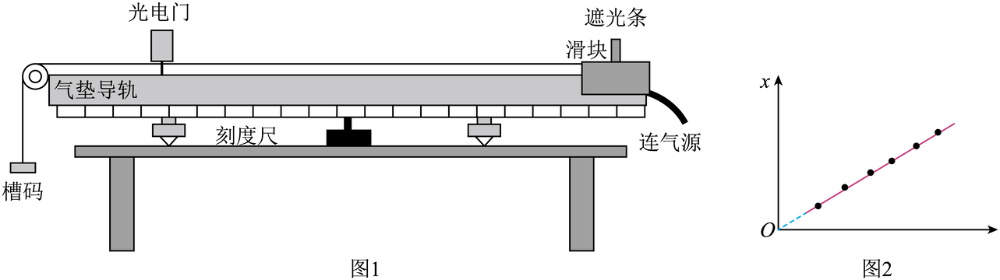

# Physics - 题目 1888

**ID**: 853b1c6918984357967299a85280c102
**年级**: Grade 10
**难度**: Medium-Hard
**题型**: Experiment

## 题目
一物理兴趣小组的同学们，利用如图1所示的实验装置来验证机械能守恒定律，实验时调整气垫导轨处于水平状态，重力加速度g取 $9.8{\rm{m}}/{\rm{s}}{^{2}}$ 。​​​​​​​‌请回答下列问题：（1）关于本实验，下列说法中正确的是。

## 解答

1. （1）为了保证物块平稳运动，需要保证“细线与导轨平行”，A正确；为了便于测量速度、动能，槽码的质量应适当大些，不应该要求“槽码质量远小于滑块质量”，B错误；测量遮光片到达光电门的速度为“瞬时速度”，遮光片的宽度应选小的，C错误。
2. （2）根据题意，系统减小的重力势能即槽码减小的重力势能，取两位有效数字为 ${\rm{Δ}}E{{}_{{\rm{p}}}}=mgx\approx 0.67{\rm{J}}$ ，槽码与滑块速度相同，系统增加的动能为 ${\rm{Δ}}E{{}_{{\rm{k}}}}=\frac {1}{2}\left ({m+M}\right )\cdot {\left({\frac {d}{t}}\right)^{2}}=0.72{\rm{J}}$ 。
3. （3）由 $mgx=\frac {1}{2}(m+M)\cdot (\frac {d}{t}){^{2}}$ ，可得 $x=\frac {m+M}{2mg}\cdot \frac {d{^{2}}}{t{^{2}}}$ ，欲得到如图2所示的“线性图线”，横坐标轴表示的物理量应为“ $\frac {1}{t{^{2}}}$ ”，代入数据可知图中图线的斜率为 $k=\frac {(m+M)d{^{2}}}{2mg}\approx 4.6\times 10{^{-6}}{\rm{m}}\cdot {\rm{s}}{^{2}}$ ，相对误差 $η=\frac {4.6-4.5}{4.6}\times 100{\rm{\%}}\approx 2.2{\rm{\%}}$ ，本次实验可以验证机械能守恒定律。

## 知识点

**中文**:
  - 实验：验证机械能守恒定律

**English**:
  - Experiment: Verifying Conservation of Mechanical Energy

---
