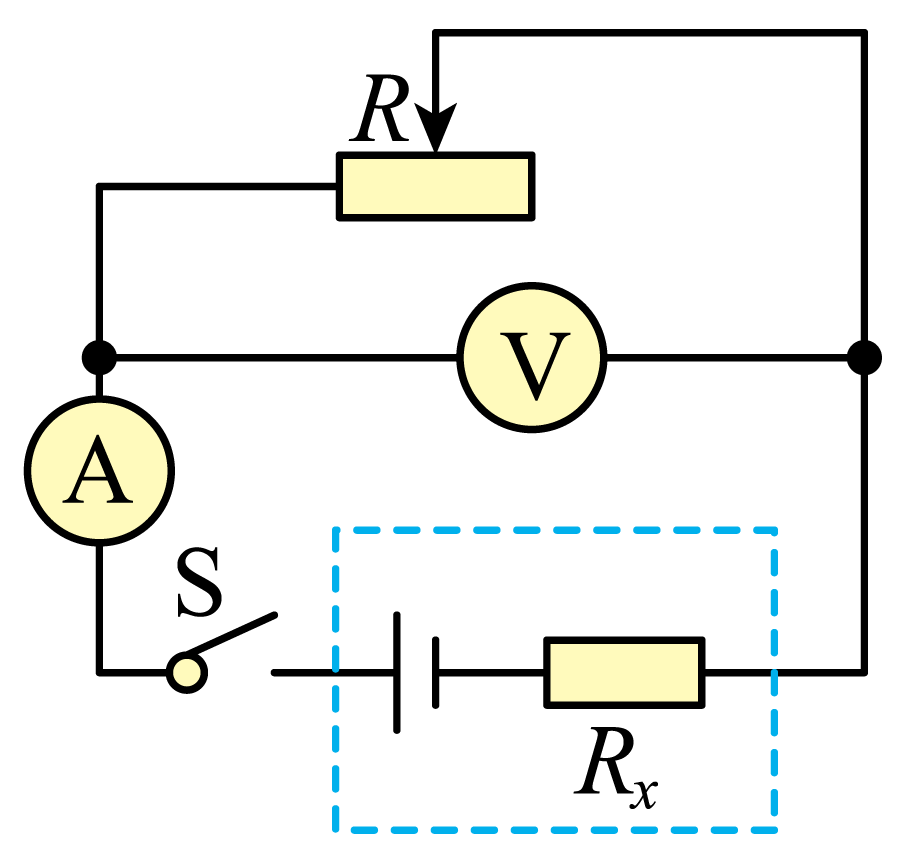

# Physics - 题目 2755

**ID**: db9f45c368154ba993e9c249a692cc01
**年级**: Grade 10
**难度**: Medium-Hard
**题型**: Experiment

## 题目
小明用如图所示电路测量某电路元件盒中未知电阻 $R{{}_{x}}$ 的阻值。​​​​​​​‌已知未知电阻 $R{{}_{x}}$ 的阻值不小于 $5Ω$ ，电源由两节干电池组成。除了开关、导线外，可供使用的实验器材有：电压表（量程 $0\sim 15{\rm{V}}$ 、 $0\sim 3{\rm{V}}$ ）；电流表（量程 $0\sim 3{\rm{A}}$ 、 $0\sim 0.6{\rm{A}}$ ）；滑动变阻器R（ $20Ω,1{\rm{A}}$ ）阻值已知且大小不等的定值电阻 $R{{}_{1}}$ 和 $R{{}_{2}}$ 。（1）实验中移动滑动变阻器的滑片，当电流表的示数是 ${{0}}{\rm{．}}{{1}}{{4}}{\rm{A}}$ 时，电压表的示数是 ${{2}}{{.}}{{1}}{\rm{V}}$ ；当电流表的示数是 ${{0}}{{.}}{{2}}{\rm{A}}$ 时，电压表的示数是 ${{1}}{{.}}{{8}}{\rm{V}}$ ，电路元件盒中的电源电压是V，未知电阻 $R{{}_{x}}$ 的阻值是 $Ω$ 。（2）利用该实验电路，调节滑动变阻器的滑片，可得到滑动变阻器的最大电功率为W。（3）小明同学利用上述器材，还设计了如图所示的测量未知电阻 $R{{}_{x}}$ 的四种实验电路（电源电压未知）；其中无法测出未知电阻 $R{{}_{x}}$ 的选项是。

## 解答

1. （1）电路是由 $R{{}_{x}}$ 与滑动变阻器组成的串联电路，当电流表的示数为0.14A，电压表的示数为2.1V时，由欧姆定律有 $U=I{{}_{1}}R{{}_{x}}+U{{}_{1}}$ ，当电流表的示数为0.2A，电压表的示数为1.8V时，由欧姆定律有 $U=I{{}_{2}}R{{}_{x}}+U{{}_{2}}$ ，联立可得 $U=2.8{\rm{V}}$ ， $R{{}_{x}}=5Ω$ 。
2. （2）经过分析，当滑动变阻器 $R=5Ω$ 时，可得到滑动变阻器的最大电功率为 $P=(\frac {U}{R+R{{}_{x}}}){^{2}}R=0.392{\rm{W}}$ 。
3. （3）将滑动变阻器接入电路中的阻值最大，读数电压表的示数为 $U{{}_{1}}$ ，根据欧姆定律求出电流 $I$ ，由于电源电压未知，无法测出未知电阻 $R{{}_{x}}$ 的电压，所以不能求出 $R{{}_{x}}$ 的阻值，A符合题意；使滑动变阻器接入电路中的电阻为零，读出此时电流表示数 $I{{}_{1}}$ ，由欧姆定律可知，电源电压为 $U=I{{}_{1}}R{{}_{x}}$ ，使滑动变阻器接入电路中的电阻最大，读出此时电流表示数 $I{{}_{2}}$ ，由欧姆定律可知，电源电压为 $U=I{{}_{2}}(R{{}_{x}}+R)$ ，则未知电阻的阻值为 $R{{}_{x}}=\frac {I{{}_{2}}R}{I{{}_{1}}-I{{}_{2}}}{\rm ，B}$ 不符合题意；当开关S拨到1时，电流表示数为I_{1}，根据欧姆定律 $U{{}_{源}}=I{{}_{1}}(R{{}_{1}}+R{{}_{x}})$ ，当开关S拨到2时，电流表示数为I_{2}，根据欧姆定律 $U{{}_{源}}=I{{}_{2}}(R{{}_{2}}+R{{}_{x}})$ ，则 $R{{}_{x}}=\frac {I{{}_{2}}R{{}_{2}}-I{{}_{1}}R{{}_{1}}}{I{{}_{1}}-I{{}_{2}}}{\rm ，C}$ 不符合题意；断开开关，电压表测电源电压U。当闭合开关时，读出电压表的示数为 $U{{}_{1}}$ ，然后根据欧姆定律求出电流，再利用串联电路中电压的规律和欧姆定律得变形公式即可求出 $R{{}_{x}}$ 的阻值，即 $R{{}_{x}}=\frac {U-U{{}_{1}}}{\frac {U{{}_{1}}}{R{{}_{1}}}}=\frac {U-U{{}_{1}}}{U{{}_{1}}}R{{}_{1}}{\rm ，D}$ 不符合题意。

## 知识点

**中文**:
  - 实验：电阻的测量

**English**:
  - Experiment: Measuring Resistance

---
