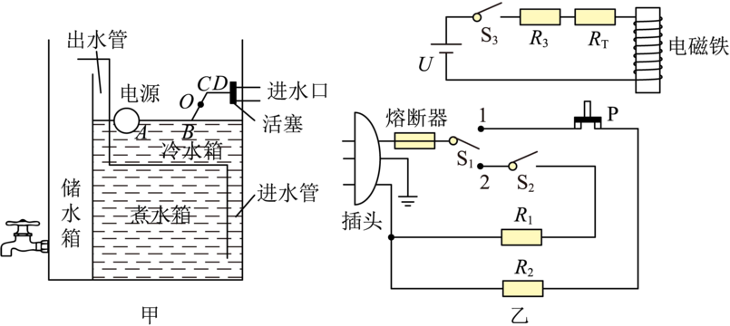

# Physics - 题目 8

**ID**: e87e71a148cf42049319978bec862287
**年级**: Grade 10
**难度**: Medium-Hard
**题型**: Experiment

## 题目
图甲是某型号电开水器结构简图，图乙是它的电路原理图。​​​​​​​‌控制进水口的浮球阀由不锈钢浮球、绕O点转动的金属杆 $ABC$ 、连杆 $CD$ 、活塞组成。使用时，将插头插入家庭电路的插座中，电压为 $220{\rm{V}}$ 。冷水自进水口进入冷水箱，再经连通管进入煮水箱，当冷水箱水位达到设定高度，浮球浮起， $AB$ 水平，连杆 $CD$ 水平向右推动活塞堵住进水口，停止进水，同时开关S_{2}闭合，开关S_{1}与触点2接通，煮水箱中的电热管 $R{{}_{1}}$ 工作，额定煮水功率为 ${{3}}{{3}}{{0}}{{0}}{\rm{W}}$ ，水沸腾后经出水管溢入贮水箱，冷水再补充入煮水箱，冷水箱中水位下降，进水口打开进水，同时S_{2}断开，重复上述过程，至贮水箱中注满水后，开关S_{1}与触点1接通，贮水箱中的电热管 $R{{}_{2}}$ 工作，进行保温，额定保温功率为 $660{\rm{W}}$ 。保温时，S_{3}同时接通，当电磁铁线圈中的电流达到 $0.02{\rm{A}}$ ，衔铁P被吸起（开关断开）；当电磁铁线圈中电流减小到 $0.01{\rm{A}}$ ，衔铁P被释放（开关重新接通），使贮水箱内热水温度维持在 $90℃\sim 95℃$ 。 $R{{}_{3}}$ 是定值电阻。 $R{{}_{{\rm{T}}}}$ 是热敏电阻，其温度与贮水箱内水温相同，温度每升高 $1℃$ ，电阻减小 $100Ω$ ，电磁铁线圈的电阻忽略不计。（ $c{{}_{水}}=4.2\times 10{^{3}}{\rm{J}}/\left ({{\rm{k}}{\rm{g}}\cdot ℃}\right )$ ， $ρ{{}_{水}}=1.0\times 10{^{3}}{\rm{k}}{\rm{g}}/{\rm{m}}{^{3}}{\rm ，\mathit{g}}$ 取 $10{\rm{N}}{\rm{/}}{\rm{k}}{\rm{g}}$ ）（1）该电开水器正常工作时，熔断器上通过的最大电流为；

## 解答

1. （1）[1]由题意可知，开关S_{2}闭合，开关S_{1}与触点2接通，煮水箱中的电热管 $R{{}_{1}}$ 工作，额定煮水功率为 ${{3}}{{3}}{{0}}{{0}}{\rm{W}}$ ，工作电路中功率最大，所以熔断器上通过的最大电流
2. $I{{}_{最大}}=\frac {P{{}_{最大}}}{U}=\frac {{{3}}{{3}}{{0}}{{0}}{\rm{W}}}{{{2}}{{2}}{{0}}{\rm{V}}}=15{\rm{A}}$
3. 故C符合题意，ABD不符合题意。
4. 故选C。
5. ${\rm （2）[2]}33{\rm{L}}$ 的开水的质量
6. $m=ρV=1\times 10{^{3}}{\rm{k}}{\rm{g}}{\rm{/}}{\rm{m}}{^{3}}\times 33\times 10{^{-3}}{\rm{m}}{^{{{3}}}}=33{\rm{k}}{\rm{g}}$
7. 冷水温度为 $22℃$ ，开水温度为 $100℃$ ，则水吸收热量
8. $Q{{}_{吸}}=cm{\rm{Δ}}t=4.2\times 10{^{3}}{\rm{J}}{\rm{/}}\left ({{\rm{k}}{\rm{g}}\cdot ℃}\right )\times 33{\rm{k}}{\rm{g}}\times \left ({100℃{{-}}22℃}\right )=10810800{\rm{J}}$
9. 电热管 $R{{}_{1}}$ 连续正常工作1小时，产生热量
10. $Q{{}_{放}}=Pt=3300{\rm{W}}\times 3600{\rm{s}}=11880000{\rm{J}}$
11. 则煮水箱的加热效率
12. $η=\frac {Q{{}_{吸}}}{Q{{}_{放}}}\times 100{\rm{\%}}=\frac {10810800{\rm{J}}}{11880000{\rm{J}}}\times 100{\rm{\%}}=91{\rm{\%}}$
13. （3）[3]浮球质量为0.55kg，则浮球的重力
14. G_{球}=m_{球}g=0.55kg×10N/kg=5.5N
15. 若浮球恰好一半体积浸在水中，连杆CD受到活塞对它水平向左的推力为30N，根据杠杆平衡原理可得
16. (F_{浮}_{1}-G)×l_{1}=F_{推}_{1}×l_{2}
17. 浮球全部浸没于水中，此时连杆能够承受活塞的水平推力为90N，根据杠杆平衡原理可得
18. (F_{浮}_{2}-G)×l_{1}=F_{推}_{2}×l_{2}
19. 根据阿基米德原理可得
20. F_{浮}_{2}=2F_{浮}_{1}
21. 解得一半浮球受到的浮力
22. F_{浮}_{1}=2G=2×5.5N=11N
23. 由阿基米德原理可得，浮球的体积
24. $V{{}_{球}}=2V{{}_{排}}=2\times \frac {F{{}_{浮1}}}{ρ{{}_{水}}g}=2\times \frac {11{\rm{N}}}{1\times 10{^{3}}kg/{\rm{m}}{^{3}}\times 10{\rm{N}}/kg}=2.2\times 10{^{-3}}{\rm{m}}{^{3}}$
25. [4]贮水箱内热水温度维持在 $90℃\sim 95℃$ ，则温度在95℃时，电磁铁线圈中的电流达到 $0.02{\rm{A}}$ ，衔铁P被吸起， $R{{}_{{\rm{T}}}}$ 是热敏电阻，其温度与贮水箱内水温相同，温度每升高 $1℃$ ，电阻减小 $100Ω$ ，设此时电阻为 $R{{}_{{\rm{T}}}}$ ，则贮水箱中保温控制电路的电压
26. $U{{}_{1}}=0.02{\rm{A}}\times \left ({R{{}_{3}}+R{{}_{{\rm{T}}}}}\right )$ ①
27. 温度在90℃时，电磁铁线圈中电流减小到 $0.01{\rm{A}}$ ，衔铁P被释放，此时 $R{{}_{{\rm{T}}}}$ 电阻为 $R{{}_{{\rm{T}}}}+500{\rm{Ω}}$ ，则贮水箱中保温控制电路的电压
28. $U{{}_{1}}=0.01{\rm{A}}\times \left ({R{{}_{3}}+R{{}_{{\rm{T}}}}+500{\rm{Ω}}}\right )$ ②
29. 联立①②解得
30. U_{1}=10V

## 知识点

**中文**:
  - 力学
  - 电磁学

**English**:
  - Mechanics
  - Electromagnetism

---
