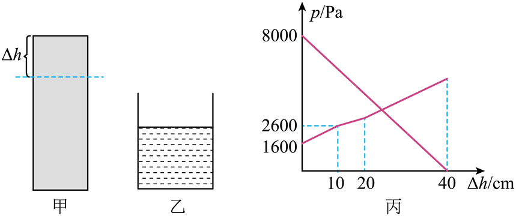

# Physics - 题目 1088

**ID**: 487b993c1ceb4186a05f4cf394a37a30
**年级**: Grade 10
**难度**: Medium-Hard
**题型**: Fill-in-the-blank

## 题目
如图所示，水平地面上放置一个质量分布均匀、底面积为200cm^{2}的长方体甲和一个质量未知的薄壁柱形容器乙，已知容器乙的高度为h，其内装有一定量的水。​​​​​​​‌现将甲沿水平方向切去一定的厚度Δh，并将甲切下的部分保持竖直，轻放入乙容器的水中沉底，甲物体和乙容器对地面的压强随切去厚度Δh的变化情况如图丙所示，长方体甲的密度是kg/m^{3}，当甲物体和乙容器对地面的压强相等时，乙中甲和水的总质量为kg。

## 解答

1. 从丙可知，当Δh=40cm时，对应的甲剩余部分的压强为零，可知甲的高度为40cm,所以物体甲的体积V_{甲}=S_{甲}h_{甲}=200cm^{2}×40cm=8000cm^{3}=8×10^{-3}m^{3}，当Δh=0cm时，甲对应的压强为8000Pa，G_{甲}=F_{甲}=pS_{甲}=8000Pa×200×10^{-4}m^{2}=160N，甲的密度 $ρ{{}_{甲}}=\frac {m{{}_{甲}}}{V{{}_{甲}}}=\frac {G{{}_{甲}}}{gV{{}_{甲}}}=\frac {160{\rm{N}}}{10{\rm{N}}{\rm{/}}{\rm{k}}{\rm{g}}\times 8\times 10{^{-3}}{\rm{m}}{^{{{3}}}}}=2\times 10{^{3}}{\rm{k}}{\rm{g}}{\rm{/}}{\rm{m}}{^{{{3}}}}$ ，当Δh=0cm时，乙对应的压强为1600Pa，当Δh=10cm时压强为2600Pa，所以Δp=p_{2}-p_{1}=2600Pa-1600Pa=1000Pa，压力的变化量ΔF=ΔG=S_{甲}Δh_{1}ρ_{甲}g=200×10×10^{-6}m^{3}×2×10^{3}kg/m^{3}×10N/kg=40N，容器乙的底面积 $S{{}_{乙}}=\frac {ΔF}{Δp}=\frac {40{\rm{N}}}{1000{\rm{P}}{\rm{a}}}=4\times 10{^{-2}}{\rm{m}}{^{{{2}}}}{\rm{=}}{{4}}{{0}}{{0}}{\rm{c}}{\rm{m}}{^{{{2}}}}$ ，从图丙可知当Δh=20cm时，从图像直线斜度变化可知，乙的高度为20cm，所以容器中原有水的质量为m_{水}=（h_{2}S_{乙}-h_{1}S_{甲}）ρ_{水}=（20×400cm^{3}-10×200cm^{3}）×1.0g/cm^{3}=6000g=6kg，当Δh=0时，容器乙对面的压力F_{0}=p_{0}S_{乙}=1600Pa×4×10^{-2}m^{2}=64N，即水和容器的重力G_{0}=64N，所以容器的质量 $m{{}_{乙}}=m{{}_{0}}-m{{}_{水}}=\frac {G{{}_{0}}}{g}-m{{}_{水}}=\frac {{{6}}{{4}}{\rm{N}}}{{{1}}{{0}}{\rm{N}}{\rm{/}}{\rm{k}}{\rm{g}}}{{-}}{{6}}{\rm{k}}{\rm{g}}{\rm{=}}{{0}}{{.}}{{4}}{\rm{k}}{\rm{g}}$ ，当Δh=20cm时，容器中水的重力G_{剩水}=（S_{乙}-S_{甲}）h_{2}ρ_{水}g=（4×10^{-2}m^{2}-200×10^{-4}m^{2}）×20×10^{-2}m×1.0×10^{3}kg/m^{3}×10N/kg=40N，甲物体和乙容器对地面的压强相等时， $(h-Δh)ρ{{}_{甲}}g=\frac {G{{}_{乙}}+G{{}_{剩水}}+ΔhS{{}_{甲}}ρ{{}_{甲}}g}{S{{}_{乙}}}{\rm ，（0.4m-Δ\mathit{h}）×2×10^{3}kg}$ /m^{3}×10N/ ${\rm kg=}\frac {0.4{\rm{k}}{\rm{g}}\times 10{\rm{N}}{\rm{/}}{\rm{k}}{\rm{g}}+40{\rm{N}}+\vartriangle h\times 200\times 10{^{-4}}{\rm{m}}{^{{{2}}}}\times 2\times 10{^{3}}{\rm{k}}{\rm{g}}{\rm{/}}{\rm{m}}{^{{{3}}}}\times 10{\rm{N}}{\rm{/}}{\rm{k}}{\rm{g}}}{4\times 10{^{-2}}{\rm{m}}{^{{{2}}}}}$ ，解得Δh=0.23m=23cm，此时乙中水和甲的总质量 $m{{}_{总}}=\frac {G{{}_{剩水}}}{g}+m{{}_{甲}^{^{′}}}{\rm =}$  $\frac {40{\rm{N}}}{10{\rm{N}}{\rm{/}}{\rm{k}}{\rm{g}}}{\rm ，0.23m×200×10^{-4}m^{2}×2×10^{3}kg}$ /m^{3}=4kg+9.2kg=13.2kg。

## 知识点

**中文**:
  - 力学

**English**:
  - Mechanics

---
